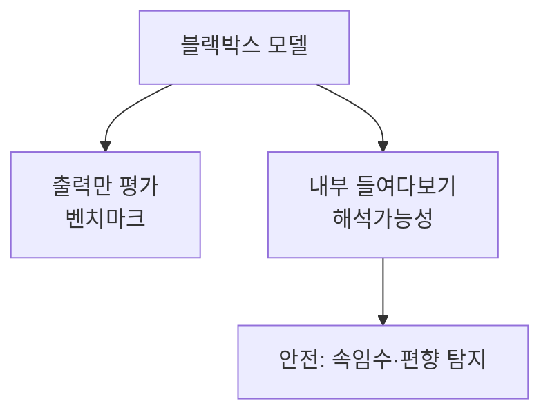

# 해석가능성 (Interpretability)

> 해석가능성은 신경망 **내부에서 무슨 일이 일어나는지**(어떤 개념을 어떻게 표현하고 계산하는지)를 사람이 이해하려는 연구 분야다. 모델을 블랙박스로 두지 않고 열어 보려는 시도다.

## 쉽게 말하면
자동차를 시험 주행 결과로만 평가하지 않고 엔진 뚜껑을 열어 어떤 부품이 무슨 일을 하는지 보는 것이다. 다만 LLM의 엔진은 수십억 개의 숫자라서, "이 숫자 묶음이 금문교 개념이다" 같은 번역표를 만드는 일부터 해야 한다.

## 자세히
- Anthropic은 2024-05-21 "Mapping the Mind of a Large Language Model"에서 Claude 3 Sonnet 중간 층에서 **희소 오토인코더 같은 사전학습(dictionary learning)** 으로 수백만 개의 해석 가능한 **특징(feature)** 을 추출했다고 밝혔다(열어서 확인).
- 특징은 도시·인물·원소·코드 문법·추상 개념(코드 버그, 비밀 유지)에 반응하고, 여러 언어와 이미지에도 반응한다. 개념적으로 가까운 특징은 서로 가깝게 모인다.
- **조향(steering)**: 특징을 인위적으로 키우면 행동이 바뀐다. "금문교" 특징을 키우자 Claude가 무관한 질문에도 다리를 언급하고 스스로를 다리라고 답했다(Golden Gate Claude, 2024-05-23). 이는 특징이 행동에 인과적으로 영향을 준다는 증거로 제시됐다.
- 안전 관련 특징(코드 백도어, 편향, 사기 이메일, 아첨)도 발견했다. 단, 특징이 있다는 것이 그렇게 행동한다는 뜻은 아니다.
- **한계**(저자들이 명시): 찾은 특징은 전체의 일부이고 전부를 찾는 비용이 모델 훈련보다 클 수 있으며, 특징이 어떤 **회로**로 쓰이는지는 아직 별도 과제다. 안전 개선 효과도 입증이 더 필요하다.
- 구분: 설명가능성([explainability](#explainability))은 결과를 사용자에게 설명하는 넓은 개념이고, 해석가능성은 내부 메커니즘 이해에 초점이 있다.

## 그림으로 보기

## 예시
- 연구자는 "사기 이메일 작성" 특징이 켜질 때 모델이 어떻게 달라지는지 보고, 위험 특징을 탐지하는 감시 장치로 쓸 수 있는지 연구한다.
- 실무자의 관점: 내 서비스 모델의 내부를 직접 열 일은 드물지만, "모델이 왜 그랬나"를 로그·평가·프롬프트 실험으로 추적하는 습관이 필요하다.

## 헷갈리는 것과 비교
| 개념 | 차이 |
|---|---|
| 해석가능성 | 내부 표현·회로를 이해 |
| [설명가능성](#explainability) | 결과 이유를 사용자에게 설명 |
| [정렬](#ai-alignment) | 목표·가치가 맞는가, 해석가능성은 점검 도구 중 하나 |
| 생각 로그(CoT) | 모델이 쓴 설명일 뿐, 내부 계산과 일치 보장 없음 |

## 더 읽을거리
- [Mapping the Mind of a Large Language Model (Anthropic, 2024-05-21)](https://www.anthropic.com/research/mapping-mind-language-model) — 특징 추출, Golden Gate Claude, 한계(열어서 확인).
