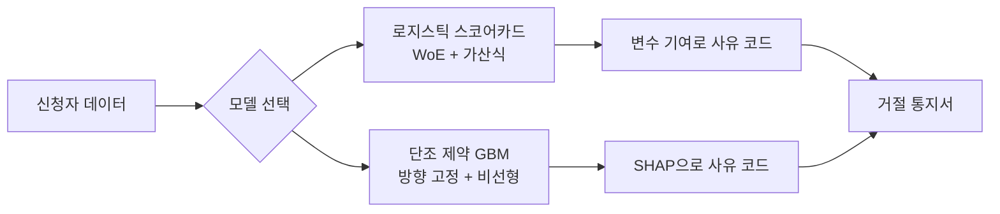

# 해석 가능한 신용 모델

> 대출 심사 모델을 "왜 이 점수가 나왔는지" 설명할 수 있게 만드는 선택지. 로지스틱 회귀 스코어카드와, 단조 제약(monotonic constraint)을 건 GBM이 대표적이다.

## 쉽게 말하면
심사역이 "소득이 높을수록 점수가 올라간다"는 상식을 어기는 모델은 못 믿는다. 해석 가능한 모델은 이런 상식(방향)을 규칙으로 못 박아 두고, 그 안에서만 똑똑해지게 한 모델이다.

## 자세히
- **로지스틱 회귀 스코어카드**: 변수를 구간으로 나눠 WoE(weight of evidence) 값으로 바꾼 뒤 가산식으로 점수를 낸다. 변수별 기여가 더해지는 구조라 거절 사유 코드를 뽑기 쉽다. 오래된 업계 표준.
- **단조 제약 GBM**: XGBoost·LightGBM 등에서 "이 변수가 오르면 위험은 오르기만 한다"를 제약으로 건다. 비선형 모양은 허용하되 방향은 고정한다.
- **정확도 비용**: 2025년 arXiv 벤치마크(Koklev, 공개 신용 데이터 5종·부스팅 라이브러리 3종)는 제약을 제대로 정하면 정확도 손실이 작은 편이라고 보고한다. 제약을 잘못 정하면 손해가 커서 "wrong-sign 진단"을 함께 권한다.
- **한계**: 제약만으로 거절 사유가 나오지는 않는다. 업계 문서는 제약 + SHAP 값으로 [거절 사유 코드](#adverse-action-explainability)를 만드는 방식을 소개한다(벤더 자료이므로 표준은 아님).

## 그림으로 보기

## 예시
- 연체 횟수는 늘수록 위험이 줄 수 없다 → 연체 변수에 `monotone_constraints=1`을 건다.
- 규제 대응이 급한 은행은 스코어카드로 시작하고, 성능 격차가 크면 제약 GBM을 병행 검증한다.

## 헷갈리는 것과 비교
| 개념 | 차이 |
|---|---|
| 스코어카드 | 구조 자체가 설명 가능, 표현력 낮음 |
| 단조 제약 GBM | 표현력 높음, 설명은 별도 도구(SHAP) 필요 |
| 일반 GBM | 방향 보장 없음, 상식과 충돌 가능 |
| [공정 대출 점검](#fair-lending-disparate-impact) | 설명 가능성과 별개로 집단 간 격차를 본다 |

## 더 읽을거리
- [Koklev, 단조 제약 벤치마크 (arXiv 2512.17945)](https://arxiv.org/abs/2512.17945v2) — 신용 데이터 5종 실험
- [H2O: From GLM to GBM Part 2](https://www.h2o.ai/blog/from-glm-to-gbm-part-2/) — GLM과 제약 GBM 비교
- [Provenir: Constraining ML credit decision models](https://provenir.com/blog-constraining-machine-learning-credit-decision-models) — 제약 + SHAP 사유 코드(벤더)
