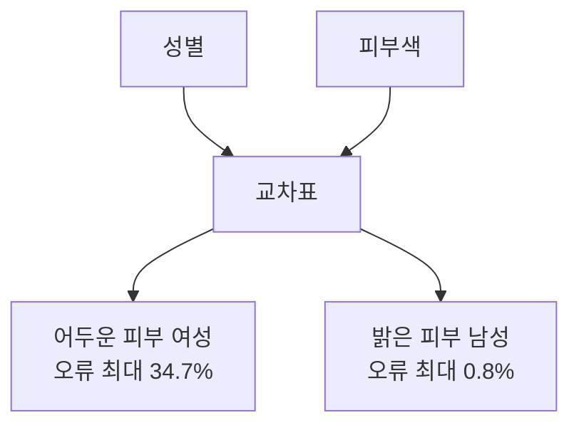
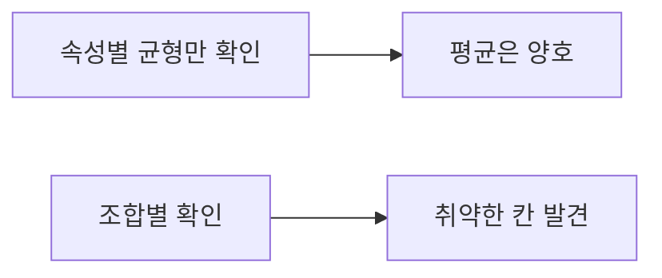

# 교차 조합 커버리지

> 성별 따로, 피부색 따로가 아니라 **속성의 조합(예: 어두운 피부색 여성)** 별로 데이터가 충분히 있는지, 그리고 그 조합에서 성능이 괜찮은지 점검하는 일이다. 각 속성의 평균이 괜찮아도 조합에서 크게 무너질 수 있다.

## 쉽게 말하면
학교의 남녀 비율도 맞고 학년 비율도 맞는데, "3학년 여학생"만 한 명뿐이라면? 속성별 합계는 균형 잡혀 보여도 칸(조합)별로 보면 텅 빈 곳이 있다. 교차 커버리지는 표의 가로 합계·세로 합계가 아니라 **칸 하나하나**를 보는 것이다.

## 자세히
(PMLR에 실린 Gender Shades 논문(Buolamwini·Gebru, FAT* 2018)의 초록 페이지를 직접 읽었다. 이 글은 논문 전체가 아니라 초록에서 확인된 범위만 쓴다.)
- **핵심 사례(Gender Shades)**: 연구진은 Fitzpatrick 피부 유형으로 대상을 **피부색(어두움/밝음) × 성별** 네 집단(어두운 피부 여성, 밝은 피부 여성, 어두운 피부 남성, 밝은 피부 남성)으로 나눠 상용 성별 분류 시스템 **세 개**를 평가했다. 오류율은 **어두운 피부 여성이 최대 34.7%**로 가장 높았고 **밝은 피부 남성은 최대 0.8%**였다.
- **벤치마크의 쏠림(초록)**: 기존 벤치마크 IJB-A와 Adience는 밝은 피부가 각각 **79.6%, 86.2%**로 편중돼 편향을 드러내는 능력이 제한된다. 연구진은 성별·피부색으로 균형을 맞춘 새 얼굴 분석 데이터셋을 만들었다. 초록에는 데이터셋 이름과 시스템 이름이 나오지 않아 여기서 쓰지 않는다.
- **교차 분석이 필요한 이유(해석)**: 성별만의 오류율이나 피부색만의 오류율로는 가장 취약한 조합의 문제가 평균에 묻힌다. 논문은 이런 정확도 격차가 공정하고 투명하며 책임 있는 안면 분석 시스템을 만들려면 시급히 다뤄져야 한다고 주장한다.
- **커버리지 점검 방법(일반 원칙, 위 논문의 방법을 그대로 가리키지 않음)**: ① 속성 쌍·삼중 조합의 교차표를 만들어 칸별 표본 수를 센다 ② 칸별 하한(예: 각 칸 최소 N개)을 정한다 ③ 칸별 성능(오류율, 재현율)을 따로 보고한다 ④ 칸이 너무 많아지면(조합 폭발) 위험이 큰 속성부터 고른다.
- **한계**: 조합 수는 속성 수에 지수적으로 늘어 모든 칸을 채울 수 없다. 표본이 작은 칸의 성능 추정은 불확실해 신뢰구간을 함께 본다(일반 원칙).

## 그림으로 보기

## 예시
- 채용 추천 모델: 성별×연령대×직무 조합별 표본 수와 추천 정확도를 표로 만들어 비어 있거나 성능이 낮은 칸을 찾는다.
- 교육 소재: 교차표 한 장으로 "평균의 함정" 체험.

## 헷갈리는 것과 비교
| 개념 | 차이 |
|---|---|
| 교차 조합 커버리지 | 속성 조합 칸별 데이터·성능 점검 |
| [데이터 균형 특성](#data-balance-characteristic) | 클래스·집단 비율의 쏠림(보통 속성별) |
| [데이터 다양성 특성](#data-diversity-characteristic) | 다양한 상황·집단 포함 정도 |
| [사후 층화 가중](#post-stratification-weights) | 칸별 비율을 맞추는 보정(결합 분포 필요) |

## 더 읽을거리
- [Gender Shades (PMLR v81, FAT* 2018)](https://proceedings.mlr.press/v81/buolamwini18a.html) — 교차 집단별 오류율과 벤치마크 쏠림(초록 직접 읽음).
