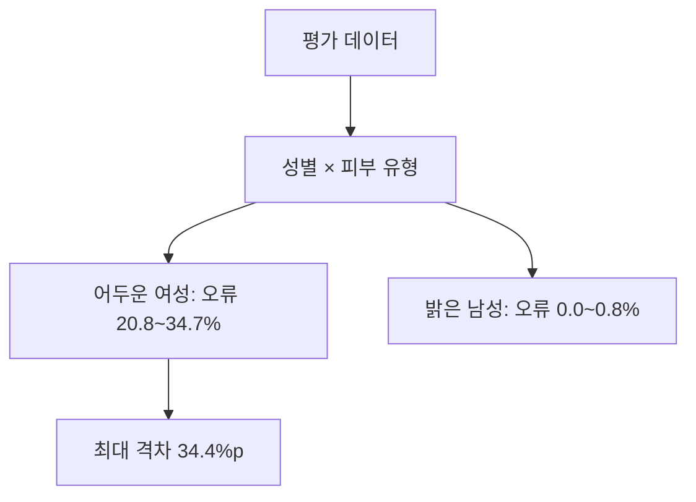
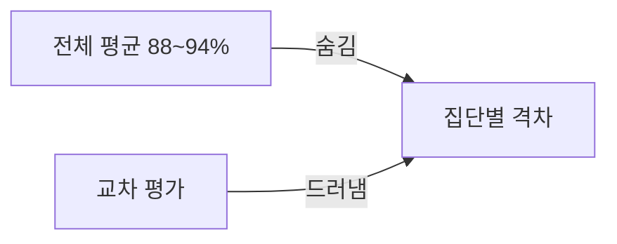

# 교차(intersectional) 평가

> 성별, 피부색처럼 여러 속성을 따로따로가 아니라 겹쳐서(예: 어두운 피부 여성) 성능을 비교하는 평가 방식이다. 단일 속성 평균에서는 가려진 격차가 드러난다.

## 쉽게 말하면
전교 평균 점수가 높아도 "특정 학년의 특정 반"만 크게 뒤처져 있을 수 있다. 학년별·반별로 따로 보면 안 보이고 교차해서 봐야 보인다.

## 자세히
(Buolamwini & Gebru, "Gender Shades", PMLR 81, 2018을 하위 에이전트가 PDF로 읽은 노트 기준. 아래 수치는 논문 보고값이며 이번 세션에서 에이전트의 추출 결과를 사용했다.)
- **설계**: 성별(여/남) × 피부 유형(밝음 = Fitzpatrick I–III, 어두움 = IV–VI) 4개 집단으로 상업 얼굴 성별 분류 API(Microsoft, Face++, IBM)를 Pilot Parliaments Benchmark(PPB)에서 평가.
- **전체 정확도**: 87.9–93.7%로 좋아 보인다.
- **교차 결과(오류율)**: 어두운 피부 여성 — MSFT 20.8%, Face++ 34.5%, IBM 34.7%. 밝은 피부 남성 — 각각 0.0%, 0.8%, 0.3%. 최대 격차 **34.4%p**.
- **오류 기여**: 어두운 피부 여성은 PPB의 21.3%인데 오류의 61.0–72.4%를 차지. 밝은 피부 남성은 30.3%인데 오류의 0.0–2.4%.
- **의미**: 평균 정확도, 성별 평균, 피부색 평균만 보면 이 격차가 묻힌다. 평가 데이터가 집단별로 충분히 균형 잡혀야 신뢰할 수 있다([Pilot Parliaments Benchmark](#pilot-parliaments-benchmark)).
- 한계(제안): 교차 집단이 늘면 표본이 작아져 신뢰구간이 넓어지므로 칸별 표본 수를 함께 표시한다.

## 그림으로 보기

## 예시
- 채용 추천 모델을 성별×연령대로 교차해 정확도·거절률 비교.
- 교육 활용: 평균 하나로 모델을 평가하면 안 되는 이유를 사례로 설명.

## 헷갈리는 것과 비교
| 개념 | 차이 |
|---|---|
| 교차 평가 | 속성 조합별 성능 |
| 단일 속성 평가 | 성별만·피부색만 따로 |
| [알고리즘 감사](#algorithmic-audit) | 외부에서 교차 평가 등으로 제품을 검증 |

## 더 읽을거리
- [Gender Shades (PMLR 81)](http://proceedings.mlr.press/v81/buolamwini18a/buolamwini18a.pdf) — 원 논문.
