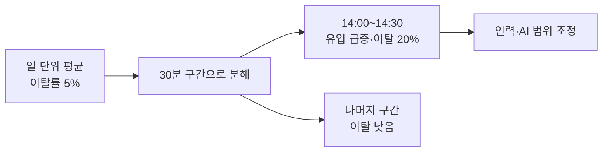
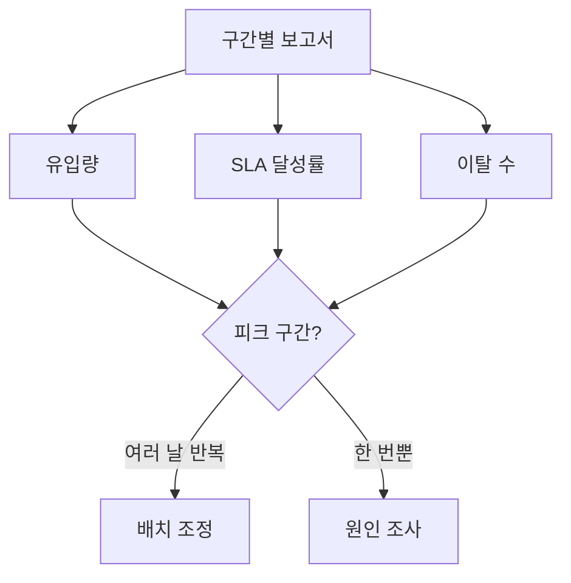

# 구간별 보고

> 구간별 보고(interval reporting)는 하루 통계를 30분 같은 짧은 구간으로 쪼개 구간마다 유입·이탈·응대 지표를 따로 보는 방식이다. 하루 평균에 묻힌 피크 시간대의 손실을 드러낸다.

## 쉽게 말하면
식당의 하루 매출 평균만 보면 점심 12시~1시에 줄이 길어 손님이 돌아간 사실이 안 보인다. 시간대별로 "들어온 손님 수와 그냥 간 손님 수"를 적어 두면 어느 시간에 일손이 모자랐는지 바로 보인다. AI 상담에서도 하루 이탈률이 5%여도 오후 2시대만 20%일 수 있다.

## 자세히
- **구간 크기**: Google CCAI Platform의 Queue Interval 대시보드는 하루를 보면 막대 하나가 30분이고, 여러 날을 보면 막대 하나가 하루다(2026-11 확인). Exotel의 ACD 구간 요약 보고서는 구간을 사용자가 정하며 예시는 1시간 단위다. 도구마다 기본값이 다르므로 비교 전에 확인한다.
- **구간마다 보는 지표**: SLA 달성률, 대기열 유입 대비 이탈 수, 응대 건수, 평균 처리 시간. Exotel 보고서는 구간별로 수신·연결·이탈 호와 목표 시간 안/뒤 구분까지 37개 열을 낸다.
- **읽는 순서(Google 문서에서 추론한 절차)**: ① 유입이 몰린 구간 찾기 → ② 같은 구간의 SLA가 떨어지는지 → ③ 이탈이 튀는지 → ④ 여러 날 내보내 같은 시간대에 반복되는지 확인.
- **예**: Exotel 문서의 LoanDesk 큐는 09~10시 SLA 75%·이탈 21%로, 혼잡 또는 인력 부족 신호로 해석한다.
- **AI 도입과의 연결**: AI가 1차 응대하고 사람에게 이관하는 구조에서는 이관이 몰리는 구간에서 [대기열 이탈률](#queue-abandonment)이 급증한다. 구간별로 봐야 AI 범위·상담원 배치를 조정할 근거가 생긴다.
- **주의**: 구간이 짧을수록 건수가 적어 비율이 출렁인다. 건수와 비율을 함께 본다. 이탈 정의(짧은 이탈 제외 여부 등)도 도구마다 다르다.

## 그림으로 보기

## 예시
- 은행 AI 챗봇 + 상담원 이관: 30분 구간표를 2주치 내보내 점심 직후 이관 이탈이 반복됨을 확인하고 그 시간대 상담원을 늘린다.
- 프롬프트 예: "이 구간별 CSV에서 이탈률이 일평균의 2배 넘는 구간을 찾고, 건수 30건 미만 구간은 따로 표시해 줘."

## 헷갈리는 것과 비교
| 개념 | 차이 |
| --- | --- |
| [대기열 이탈률](#queue-abandonment) | 지표 자체. 구간별 보고는 이를 시간대로 쪼개 보는 방법 |
| [이관 호 이탈](#transferred-call-abandonment) | AI를 거쳐 온 고객만 따로 본 이탈 |
| 일별·주별 보고 | 추세용. 피크 손실은 가려진다 |

## 더 읽을거리
- [Google CCAI Platform: Queue Interval dashboards](https://docs.cloud.google.com/contact-center/ccai-platform/docs/dashboards-queue-interval) — 30분 구간 위젯 구성
- [Exotel: ACD Call Interval Summary Report](https://docs.exotel.com/contact-center/acd-call-interval-summary-report) — 구간별 열과 해석 예
