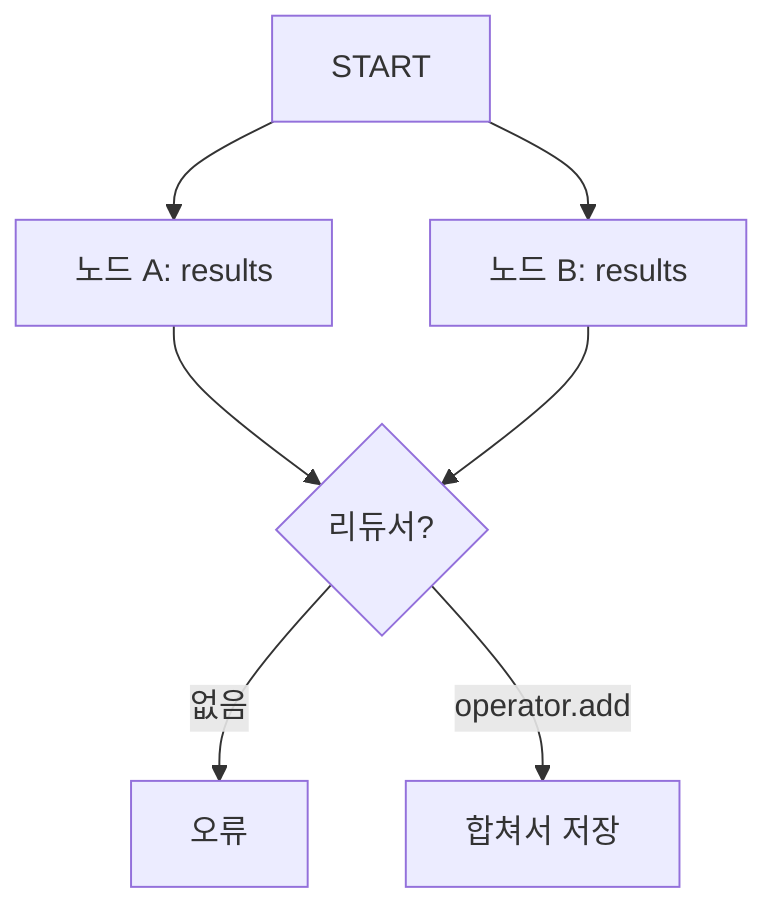

# InvalidUpdateError

> LangGraph에서 병렬로 도는 노드 여러 개가 같은 단계에 리듀서 없는 같은 상태 키를 갱신하려 할 때 나는 오류다.

## 쉽게 말하면
공용 화이트보드의 한 칸에 두 사람이 동시에 다른 글씨를 쓰면 어느 것이 맞는지 알 수 없다. "두 사람 글을 모두 이어 적는다"는 규칙을 미리 정해 두면(리듀서) 문제가 사라진다.

## 자세히
공식 문서(INVALID_CONCURRENT_GRAPH_UPDATE) 기준:
- 원인: 한 단계(superstep) 안에서 병렬 노드(팬아웃)가 같은 키를 반환하는데, 그 키에 **리듀서가 없으면** 기본은 "덮어쓰기"라 어느 값이 이길지 정할 수 없다. 그래서 오류.
- 해결 1: 키에 리듀서를 붙인다. `Annotated[list[str], operator.add]`처럼 하면 값이 합쳐진다. 반환도 리스트(`["from A"]`)로 맞춘다.
- 해결 2: 병렬이 꼭 필요하지 않으면 노드를 직렬로 잇는다.
- [update_state](#langgraph-update-state)에서 병렬 가지 뒤에 갱신할 때는 `as_node`를 명시하라고 타임 트래블 문서가 안내한다.
- 관련 오류 이름은 버전에 따라 다를 수 있다. 메시지를 읽어 해당 키를 찾는 것이 빠르다.

## 그림으로 보기


## 예시
```python
class State(TypedDict):
    results: Annotated[list[str], operator.add]
```
업무 장면: 문서 3개를 병렬로 요약하는 그래프에서 각 노드가 `summaries`에 쓰는 경우, 리듀서가 있어야 3개가 모두 남는다. 참고: [병렬화 패턴](#parallelization-pattern).

## 헷갈리는 것과 비교
| 개념 | 차이 |
|---|---|
| 리듀서 없는 키 | 마지막 값으로 덮어씀(병렬이면 충돌) |
| `operator.add` 리듀서 | 리스트를 이어 붙임 |
| `as_node` | 갱신을 어느 노드 결과로 볼지 지정 |

## 더 읽을거리
- [INVALID_CONCURRENT_GRAPH_UPDATE](https://docs.langchain.com/oss/python/langgraph/errors/INVALID_CONCURRENT_GRAPH_UPDATE) — 원인과 코드 수정 예
- [LangGraph Time travel](https://docs.langchain.com/oss/python/langgraph/use-time-travel) — as_node와 포크
