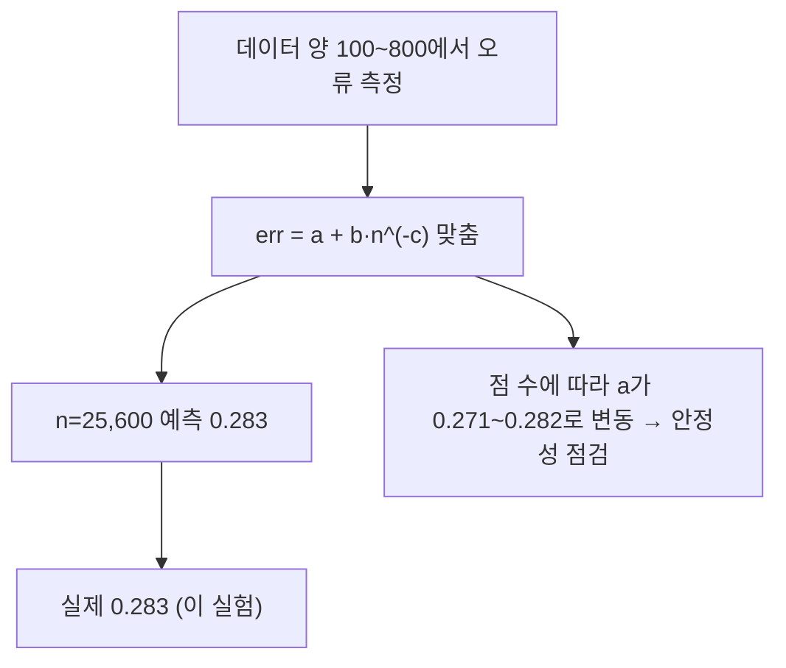
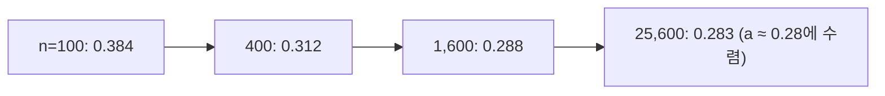

# 역멱법칙 맞춤

> 학습 데이터 양 n에 따른 오류 곡선을 **오류 ≈ a + b·n^(−c)** 형태로 맞춰, 데이터를 더 모았을 때의 오류를 미리 예상하는 방법이다. a는 데이터를 무한히 늘려도 남는 오류(점근값), c는 줄어드는 속도다.

## 쉽게 말하면
처음엔 공부 시간을 늘릴수록 점수가 빨리 오르다가 점점 천천히 오르고 결국 평평해진다. 이 곡선의 모양을 수식으로 잡아 두면 "시간을 10배 더 쓰면 점수가 얼마나 오를까"를 대략 짐작할 수 있다.

## 자세히
- **근거**: Kaplan 등(arXiv 2001.08361 초록 확인)은 언어 모델의 손실이 모델 크기·데이터 크기·학습 계산량에 대해 **멱법칙**으로 줄어들며 그 경향이 7자릿수 이상에 걸쳐 유지된다고 보고한다. 학습 곡선 외삽 방법과 같은 계열의 도구이며 이 글의 실험은 로지스틱 회귀의 오류 곡선이다.
- **수식**: `err(n) = a + b·n^(−c)`. n이 커지면 항 `b·n^(−c)`가 0에 가까워져 a에 수렴한다. `scipy.optimize.curve_fit`으로 맞춘다(a≥0, b>0, c>0으로 제약해 안정화).
- **직접 실험(scikit-learn, 합성 이진 분류, 학습 n=100~25,600에서 로지스틱 회귀를 n마다 6번 반복해 평균 오류, 같은 2만 개 시험 세트)**
  - 측정 오류: n=100 0.384, 200 0.346, 400 0.312, 800 0.305, 1,600 0.288, 3,200 0.287, 6,400 0.282, 12,800 0.283, 25,600 0.283.
  - **앞의 4점(n≤800)만 맞춘 곡선**: a=0.282, b=3.64, c=0.77 → n=25,600에서 예측 0.283, 실제 0.283. **앞의 5점(n≤1,600)**은 a=0.271, c=0.65, 예측 0.274(실제 0.283, 0.009 낙관). **6점(n≤3,200)**은 a=0.277, 예측 0.279.
  - n≤800 맞춤으로 더 큰 n을 예측한 오차: n=1,600 예측 0.294(실제 0.288), 3,200 0.289(0.287), 6,400 0.286(0.282), 12,800 0.284(0.283), 25,600 0.283(0.283). 이 설정에서는 외삽이 상당히 잘 맞았다.
  - 하지만 **맞춤에 쓴 점 수에 따라 점근값 a가 0.271~0.282로 흔들렸다.** 외삽에 쓴 범위나 점 선택에 따라 결론(남은 개선 여지)이 달라질 수 있다.
- **사용 순서(제안)**: ① 데이터 양을 로그 간격(1×, 2×, 4×…)으로 늘리며 같은 시험 세트에서 오류 측정 ② 각 n마다 여러 번 반복해 평균(곡선이 매끄러워짐) ③ 멱법칙 맞춤 ④ 맞춤 범위를 바꿔 a·c의 안정성을 점검 ⑤ 목표 오류에 필요한 n 추정.
- **판단 지침**: 점근값 a가 목표보다 높다면 데이터를 더 모아도 소용없고 모델·특징을 바꿔야 한다. a가 목표 이하이고 남은 구간이 크면 수집이 의미 있다([학습 곡선](#learning-curve)).
- **한계**: 이 형태는 가정이다. 데이터 품질 문제, 분포 변화, 큰 모델의 이중 하강 등에서는 맞지 않을 수 있고, 측정 잡음에 민감하다. 먼 구간으로의 외삽은 [낙관 편향](#extrapolation-optimism) 위험이 있다.

## 그림으로 보기



## 예시
```python
import numpy as np
from scipy.optimize import curve_fit
f = lambda n, a, b, c: a + b * n ** (-c)
p, _ = curve_fit(f, sizes[:4], errs[:4], p0=[0.1, 1, 0.5], bounds=([0, 0, 0.01], [0.6, 50, 2]))
print("점근 오류", p[0], "n=10만 예측", f(1e5, *p))
```
- 라벨링 예산 결정: 오류 0.30에서 0.28로 가려면 데이터가 얼마나 필요한지 추정.
- 교육: "수확 체감"을 수식으로 설명하는 사례.

## 헷갈리는 것과 비교
| 개념 | 차이 |
|---|---|
| 역멱법칙 맞춤 | 오류 곡선을 a+b·n^(-c)로 외삽 |
| [학습 곡선](#learning-curve) | 측정 곡선 자체의 진단 |
| 스케일링 법칙 | 대규모 모델의 멱법칙 경험칙 |
| [외삽 낙관 편향](#extrapolation-optimism) | 먼 구간 예측이 낙관적인 위험 |

## 더 읽을거리
- [Scaling Laws for Neural Language Models (arXiv 2001.08361)](https://arxiv.org/abs/2001.08361) — 손실의 멱법칙 경향(초록 확인).
- [scipy.optimize.curve_fit](https://docs.scipy.org/doc/scipy/reference/generated/scipy.optimize.curve_fit.html) — 곡선 맞춤 함수(직접 사용 확인).
