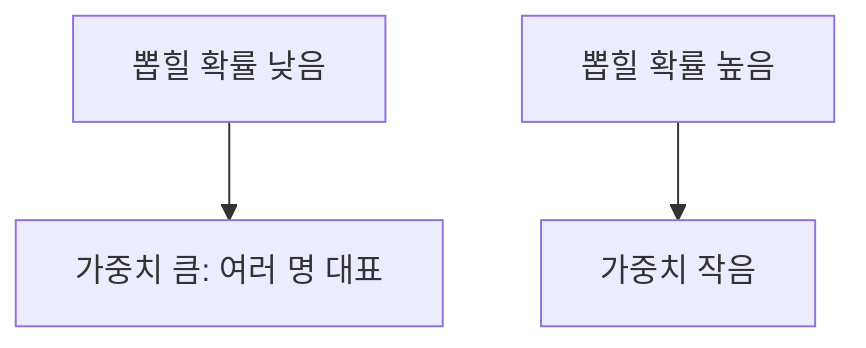

# 역확률 가중

> 표본이 뽑힐 확률이 사람마다 다를 때, **각 표본에 "뽑힐 확률의 역수"를 가중치로 곱해** 모집단 전체의 통계(평균·합계)를 되살리는 방법이다. 잘 안 뽑히는 사람의 표본은 더 크게 쳐 주고, 잘 뽑히는 사람은 작게 쳐 준다.

## 쉽게 말하면
온라인 설문에 고소득자가 훨씬 많이 응답했다면 그대로 평균을 내면 "다들 부자"라는 결론이 나온다. 응답할 확률이 낮은 저소득 응답자 한 명이 사실은 여러 명을 대표하므로, 그 한 명의 답을 여러 번 센다(가중치를 크게). 이것이 역확률 가중이다.

## 자세히
(이 세션에서 numpy로 **직접 시뮬레이션**한 결과. 정규 분포가 아니라 로그정규 소득 모집단 N=1,000,000명(진짜 평균 43,488)에서, 소득이 높을수록 표본에 뽑힐 확률이 커지는 편향 표집(평균 포함 확률 2.81%, 기대 표본 크기 약 28,000)을 300번 반복했다. 포함 확률 π는 **알고 있다고 가정**했다. 알려지지 않은 경우는 시험하지 않았다.)
- **방법**: 표본 i의 가중치 w_i = 1/π_i. 두 가지 추정:
  - **Horvitz–Thompson(HT)**: Σ(x_i/π_i)/N (모집단 크기 N을 알아야 함)
  - **Hájek(정규화)**: Σ(x_i/π_i)/Σ(1/π_i) (N을 몰라도 됨)
- **결과(실행, 300회 평균)**
  | 추정 | 평균 | 편향 | 표준편차 |
  |---|---|---|---|
  | 그냥 평균(naive) | 75,486 | **+31,998 (+73.6%)** | 270 |
  | HT | 43,498 | +10 (+0.02%) | 250 |
  | Hájek | 43,499 | +11 (+0.02%) | 227 |
  → 가중하지 않은 평균은 진짜 평균을 **약 74% 과대추정**했고, 역확률 가중은 **편향이 사실상 0**이었다. 표준편차가 오히려 줄지는 않았으므로 **편향을 없애는 도구이지 분산을 줄이는 도구는 아니다**(이 실험 한정).
- **조건(Wikipedia, 직접 확인)**: 문서는 일관성·교란변수 없음·**양의 확률(positivity)** 가정을 든다. 즉 모든 모집단 단위의 포함 확률이 **0보다 커야** 하고, 포함 확률을 **정확히 알아야** 한다. 모르면 모델로 추정하는 별도 문제가 생긴다.
- **함정**: 확률이 매우 작은 표본은 가중치가 엄청 커져 추정이 불안정해진다. 이 실험에서 평균 최대 가중치는 약 1,254, **유효 표본 크기는 약 11,035**로 실제 28,109개의 약 39%로 줄었다. → [극단 가중치 불안정](#extreme-weight-instability)
- **AI 데이터에서의 쓰임(해석)**: 설문·로그·라벨 수집이 특정 집단에 쏠렸을 때 평가 지표나 학습 손실에 가중을 줘서 모집단 성능을 추정할 때 쓴다.

## 그림으로 보기

## 예시
- 온라인 패널 설문에서 연령대별 응답 확률을 알면 1/확률로 가중해 전국 평균을 추정.
- 교육 활동: 표본 5개에 임의의 확률을 주고 가중 평균과 그냥 평균을 손으로 계산해 비교.

## 헷갈리는 것과 비교
| 개념 | 차이 |
|---|---|
| 역확률 가중 | 확률의 역수로 편향 보정 |
| 단순 평균 | 편향 표집에서는 모집단과 어긋남 |
| [Horvitz–Thompson 추정량](#horvitz-thompson-estimator) | 이 가중을 쓴 합계 추정량 |
| [극단 가중치 불안정](#extreme-weight-instability) | 가중치가 클 때 생기는 분산 문제 |

## 더 읽을거리
- [Inverse probability weighting (Wikipedia)](https://en.wikipedia.org/wiki/Inverse_probability_weighting) — 정의, 가정(일관성·교란 없음·양의 확률), 극단 가중치 불안정(직접 확인). Hájek 정규화 추정은 이 페이지에 없어 위 표의 수치와 함께 이 노드의 직접 시뮬레이션이다.
