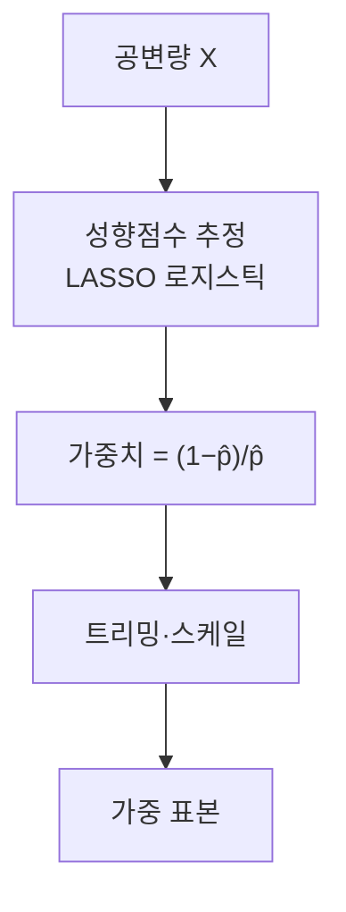
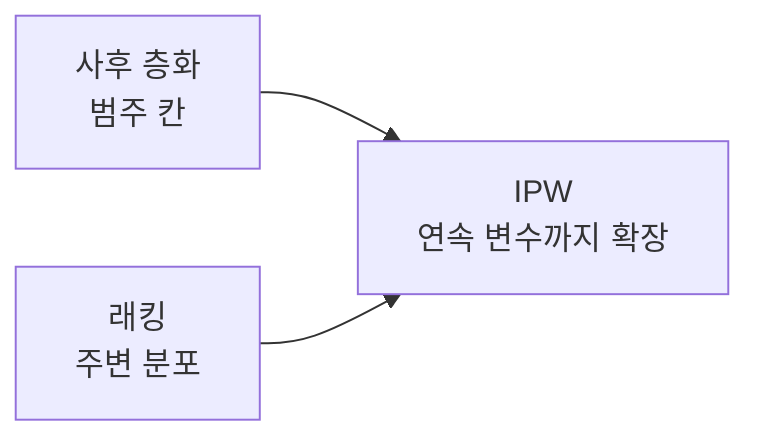

# 역성향점수 가중(IPW)

> 각 사례가 표본에 **들어올 확률(성향점수)** 을 모델로 추정하고, 그 확률의 역수 같은 값을 가중치로 줘서 표본의 쏠림을 보정하는 방법이다. 사후 층화·래킹을 연속 변수로 일반화한 것으로 볼 수 있다.

## 쉽게 말하면
설문에 답할 가능성이 낮은 유형(예: 바쁜 직장인)은 표본에 드물게 들어온다. 그런 사람이 한 명 들어오면 "이 사람은 비슷한 사람 여럿을 대표한다"고 보고 더 크게 세어 주는 방식이다. 얼마나 크게 셀지는 "이런 사람이 응답할 확률"을 예측해 정한다.

## 자세히
(Meta의 `balance` 논문 arXiv 2307.06024 3.3.3절과 후처리 부분을 PDF에서 직접 읽었다. 아래는 그 논문의 설계이며 모든 IPW 구현의 표준이 아니다.)
- **성향점수의 정의(논문 식 3)**: 공변량 X가 주어졌을 때 표본에 포함될 조건부 확률 p(X) = Pr(R=1 | X). Rosenbaum과 Rubin이 관찰 연구에서 인과효과 추정을 위한 매칭 방법으로 제안했고 이후 서베이 가중에 쓰였다. **강한 무시 가능성**(결과와 응답이 X를 주면 독립, 그리고 0 < P(R=1|X) < 1)이 성립하면 p(X)가 가장 거친 균형 점수가 되어 차원이 낮은 선택 확률 추정 수단이 된다. 이 역수를 가중치로 쓰는 것은 Horvitz–Thompson 추정량의 정신이라고 논문이 설명한다.
- **추정 모델**: 로지스틱 회귀, 의사결정나무, 랜덤 포레스트 등 분류 도구면 된다. `balance`는 **정규화된(LASSO) 로지스틱 회귀**를 구현했다(식 4: log(p/(1−p)) = βᵀX).
- **가중치 공식**: 이 논문은 목표 모집단을 기준 집단으로 보고 표본이 목표에 속할 수 있다고 가정하므로 **wᵢ = (1 − p̂ᵢ) / p̂ᵢ** 를 쓴다(인과추론의 "통제군에 대한 평균 처치효과" 추정 개념을 빌림). 단순한 1/p̂가 아님에 주의.
- **분산 문제와 완화**: 공변량이 많으면 성향점수·가중치의 분산이 커져 추정이 부풀 수 있다. LASSO로 응답과 무관한 공변량의 계수를 줄이거나 제외하고(응답과 무관한 공변량은 연구자가 직접 빼야 한다), 극단 가중치는 **트리밍**으로 억제한다. 공변량별 벌점 계수로 어떤 항을 얼마나 조정할지도 정할 수 있다. 가중치를 고정으로 보는 분산 공식은 가중치 추정의 변동을 반영하지 못하며 부트스트랩이 더 정확하지만 비싸다고 각주에 적는다.
- **약점(논문)**: 성향점수 모델 지정에 크게 의존할 수 있다(시뮬레이션 연구 인용). 대안으로 Covariate Balancing Propensity Score(CBPS)나 트리 기반 방법이 제시된다.
- **후처리(논문)**: 추정된 가중치는 모집단 크기로 스케일되어 "그 표본 단위가 대표하는 목표 모집단 사람 수"로 해석되고, 이후 위에서부터 [트리밍](#weight-trimming)해 평균·합을 유지한다.

## 그림으로 보기



## 예시
```python
# 개념 예시: 표본(R=1)과 목표 모집단(R=0)을 합쳐 로지스틱 회귀로 p̂를 구하고
w = (1 - p_hat) / p_hat      # 표본 사례의 가중치
```
- 교육 소재: "응답 확률이 낮은 사람의 한 표를 더 크게 세는 이유와 위험"을 토론.

## 헷갈리는 것과 비교
| 개념 | 차이 |
|---|---|
| IPW | 응답 확률 모델로 가중 |
| [사후 층화 가중](#post-stratification-weights) | 범주 칸의 비율로 가중 |
| [래킹](#raking-iterative-proportional-fitting) | 주변 분포만으로 반복 보정 |
| [역확률 가중 보정](#inverse-probability-weighting-logs) | 로그 샘플링 확률을 보정하는 관련 아이디어 |

## 더 읽을거리
- [balance (arXiv 2307.06024)](https://arxiv.org/pdf/2307.06024) — 성향점수 정의, 가중치 공식, LASSO·트리밍(PDF 직접 읽음).
