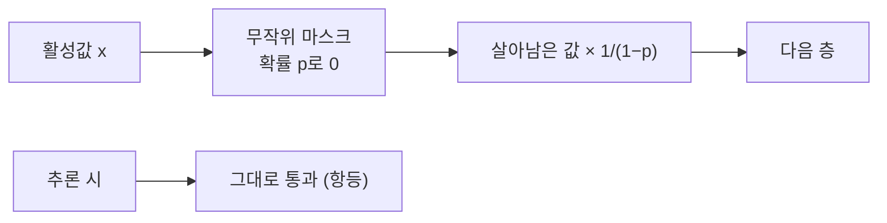

# Inverted Dropout

> 학습 때 살아남은 뉴런의 값을 1/(1−p)배 키워 두어, 추론 때는 아무 보정 없이 그대로 쓸 수 있게 한 드롭아웃 구현 방식이다.

## 쉽게 말하면
회의에서 참석자 일부(비율 p)만 발언한다면, 발언자의 점수를 1/(1−p)배 쳐주면 전체 합이 평소와 비슷해진다. 이렇게 학습 단계에서 미리 맞춰 두면 실전(추론)에서는 전원 참석에 계산을 바꿀 필요가 없다.

## 자세히
- 원 논문 방식: 학습 시에는 유닛을 끄고, **테스트 시 가중치를 줄여**(보존 확률 곱) 평균을 근사한다(JMLR 2014, 2026-11 확인).
- inverted 방식(일반적 현대 구현): 학습 시 남은 값을 `1/(1−p)`로 **미리 스케일**하고 추론은 항등 함수. PyTorch `nn.Dropout` 문서도 학습 중 출력이 1/(1−p)로 스케일되어 평가 때는 항등 함수가 된다고 설명한다(문서 내용을 이번 세션에서 직접 열람하지 못해 기억에 기반 — confidence: medium).
- 장점: 추론 코드가 단순하고 빠르다. 모델을 배포할 때 드롭아웃 층이 사실상 사라진다.
- 기댓값 관점: 켜진 확률이 (1−p)이므로 `E[x·mask/(1−p)] = x`로 기댓값이 유지된다.

## 그림으로 보기

## 예시
p=0.5이면 학습 중 살아남은 값은 2배가 된다. 추론 때는 모델이 `model.eval()` 상태여야 이 스케일이 사라지고 항등으로 동작한다 → [train·eval 모드](#train-vs-eval-mode).

## 헷갈리는 것과 비교
| 개념 | 차이 |
|---|---|
| 원 논문 방식 | 테스트 때 가중치 축소 |
| inverted dropout | 학습 때 스케일 업, 테스트는 그대로 |
| [드롭아웃](#dropout) | 상위 개념 |

## 더 읽을거리
- [Dropout 논문 (JMLR)](https://jmlr.org/papers/v15/srivastava14a.html) — 테스트 시 가중치 축소 근사.
