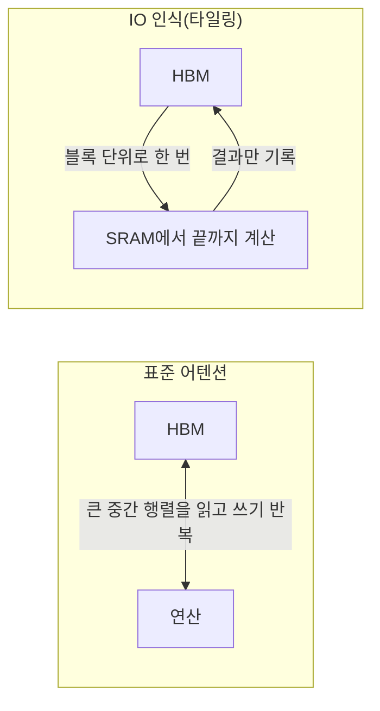

# IO 인식 알고리즘 (IO-aware Algorithms)

> 계산 횟수가 아니라 메모리 사이를 오가는 데이터 읽기·쓰기량을 기준으로 설계한 알고리즘으로, FlashAttention이 대표 사례다.

## 쉽게 말하면
요리사가 칼질 속도보다 냉장고를 왔다 갔다 하는 시간이 더 오래 걸린다면, 재료를 한 번에 도마 위로 옮겨 놓고 거기서 끝까지 처리하는 순서로 바꿔야 빨라진다. 계산은 같아도 이동을 줄이면 전체 시간이 줄어든다.

## 자세히
FlashAttention 논문(arXiv 2205.14135, Dao 외, 2026-11 확인):
- 어텐션 비용은 시퀀스 길이에 **제곱**으로 늘어난다. 저자들은 GPU 메모리 계층 사이의 **읽기·쓰기를 계산에 넣어** 알고리즘을 설계해야 한다고 주장한다.
- 방법: **타일링**으로 GPU의 HBM(고대역폭 메모리)과 칩 내 SRAM 사이 왕복을 줄인다. 근사가 아닌 **정확한(exact) 어텐션**이다.
- 보고된 효과: BERT-large(길이 512) 학습 약 15% 단축(MLPerf 1.1 기록 대비), GPT-2(길이 1K) 약 3배, Long-Range Arena(1K–4K) 약 2.4배. 더 긴 문맥을 가능하게 해 Path-X(16K)·Path-256(64K)에서 우연 이상 성능을 낸 첫 트랜스포머라고 보고.
- 일반 원리: 현대 GPU 추론은 연산보다 **메모리 이동이 병목**인 경우가 많다([추측 디코딩](#speculative-decoding)도 같은 사실에 기대는 기법).

## 그림으로 보기

## 예시
Hugging Face에서 `attn_implementation="flash_attention_2"`로 로드하면 메모리 트래픽이 줄어든 어텐션 백엔드를 쓴다(HF 문서). 긴 문서 요약 시 OOM이 줄어드는 효과를 기대.

## 헷갈리는 것과 비교
| 개념 | 차이 |
|---|---|
| IO 인식 | 데이터 이동량 최소화 설계 철학 |
| 근사 어텐션(희소 등) | 계산 자체를 줄이되 결과가 근사 |
| [FlashAttention](#flash-attention) | IO 인식의 구체 구현 |
| [GPU 메모리 계층](#gpu-memory-hierarchy) | 이동 비용의 배경 |

## 더 읽을거리
- [FlashAttention 논문](https://arxiv.org/abs/2205.14135) — IO 복잡도와 속도 결과.
