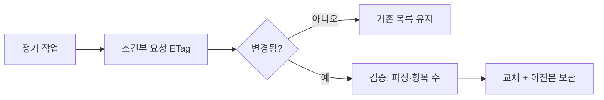
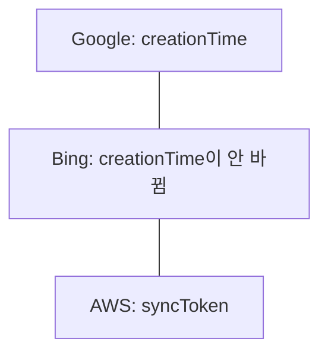

# IP 대역 목록 갱신

> 크롤러 운영자가 공개하는 **IP 대역 JSON 목록은 시간이 지나면 바뀐다.** 검증용 목록을 한 번 받아 두고 방치하면 새 대역을 사칭으로 오판하거나 폐기된 대역을 계속 신뢰하게 되므로, 정기적으로 다시 받고 변경을 추적한다.

## 쉽게 말하면
회사 직원 명부가 갱신되지 않으면 새 직원은 출입을 거부당하고 퇴사자는 계속 들어온다. 명부의 "개정 번호"를 보고 바뀌었을 때만 새로 받으면 효율적이다.

## 자세히
- 직접 확인(2026-11-27, 공개 목록 4곳 수집):
  | 목록 | 상단 키 | 항목 수 | 변경 추적 단서 |
  |---|---|---|---|
  | Google `googlebot.json` | `creationTime`, `prefixes` | 317(IPv4 170 + IPv6 147) | `creationTime` 2026-11-26T15:45:48, HTTP `Last-Modified` 2026-11-26 15:46:26 GMT |
  | OpenAI `gptbot.json` | `creationTime`, `prefixes` | 18(IPv4만) | `creationTime` 2026-09-22T02:00:07, `ETag` |
  | Bing `bingbot.json` | `creationTime`, `prefixes` | 29(IPv4만) | `creationTime` 2024-01-03인데 `Last-Modified` 2026-11-09, `ETag` |
  | AWS `ip-ranges.json`(참고: 크롤러 아님) | `syncToken`, `createDate`, `prefixes`, `ipv6_prefixes` | 10,775 | **`syncToken` "1795740425"**, `createDate` 2026-11-27-00-47-05, `ETag` |
- 읽는 법:
  - 형식이 제각각이다. 앞의 세 곳은 항목이 `{"ipv4Prefix"|"ipv6Prefix": "CIDR"}` 모양이고, AWS는 `ip_prefix`·`region`·`service` 필드와 별도 IPv6 배열을 쓴다. 파서를 운영자별로 분기해야 한다.
  - **`creationTime`만 믿으면 안 된다**: Bing 파일은 `creationTime`이 2024-01-03에 머물러 있는데 서버의 `Last-Modified`는 2026-11-09였다. 내용이 갱신돼도 내부 시각 필드가 안 바뀔 수 있으므로 **`ETag`/`Last-Modified`** 또는 내용 해시(예: SHA-256)로 변경을 감지한다(제안).
  - **`syncToken`**은 AWS가 제공하는 개정 번호다. 값이 바뀌면 목록이 바뀐 것이므로 이전 토큰과 비교해 갱신 여부를 판정한다.
- 갱신 절차(제안): ① 조건부 요청(`If-None-Match: <ETag>`)으로 하루 1회 이상 확인 ② 바뀌면 새 목록을 임시 검증(파싱 오류·대역 수가 급감하지 않는지) 후 교체 ③ 이전 버전도 며칠 보관해 전환기 오판을 줄임 ④ 다운로드 실패 시 마지막 정상본을 유지하고 알림 ⑤ 갱신 일시·항목 수를 로그에 남김.
- 항목 수 급감(예: 317→0)은 파일 이상일 가능성이 크므로 자동 교체를 멈추고 사람이 확인한다(제안).
- 한계: 운영자가 목록의 갱신 주기를 공지하지 않을 수 있다. 4곳의 조사 결과는 시점 스냅샷이다.

## 그림으로 보기



## 예시
```bash
curl -sI https://developers.google.com/static/search/apis/ipranges/googlebot.json | grep -i -E "etag|last-modified"
curl -s -H 'If-None-Match: "4c4f5439a5de299b831d64fbdae91310"' -o /dev/null -w "%{http_code}\n" https://openai.com/gptbot.json
```
- 교육: 보안 설정이 "한 번 하고 끝"이 아님을 보여 주는 운영 사례.

## 헷갈리는 것과 비교
| 개념 | 차이 |
|---|---|
| `syncToken` | 운영자가 제공하는 개정 번호 |
| `ETag`/`Last-Modified` | HTTP가 제공하는 변경 감지 |
| 내용 해시 | 직접 계산하는 가장 확실한 변경 감지 |
| [FCrDNS](#fcrdns) | DNS 기반 검증(대역 목록과 보완 관계) |

## 더 읽을거리
- [Google: Verifying Googlebot](https://developers.google.com/search/docs/crawling-indexing/verifying-googlebot) — IP 대역 JSON 파일 안내(읽음).
- 직접 실행: Google·OpenAI·Bing·AWS 목록 4개 수집·비교.
