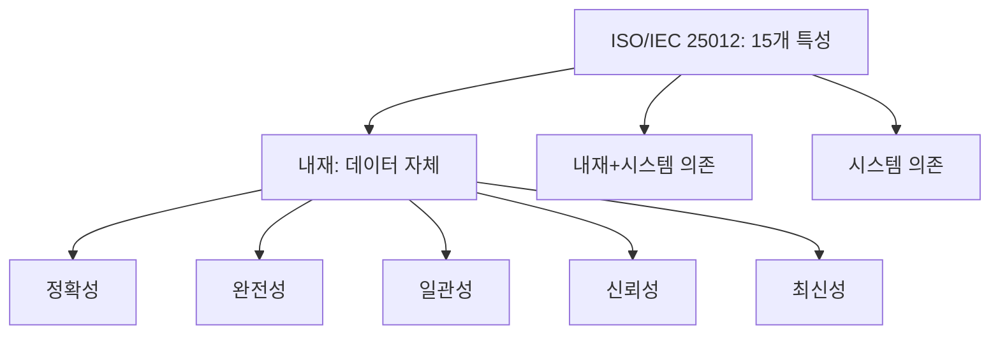

# 내재 데이터 품질 특성

> ISO/IEC 25012의 15개 데이터 품질 특성 중 **데이터 자체만 보고 평가할 수 있는** 다섯 가지(정확성·완전성·일관성·신뢰성·최신성)다. 시스템·저장 환경과 무관하게 데이터 값의 상태를 따진다.

## 쉽게 말하면
도서 목록 파일이 있다. 책 제목이 실제와 맞는지(정확성), 빈 칸이 없는지(완전성), 같은 책이 서로 다른 저자로 적혀 있지 않은지(일관성), 믿을 만한 출처인지(신뢰성), 최신 개정판을 반영했는지(최신성)를 파일만 열어 보고 점검한다. 파일이 어느 서버에 있는지는 상관없다.

## 자세히
(공식 표준 본문은 유료이며 ISO 페이지 접근이 403으로 막혀 **표준 원문은 직접 읽지 못했다**. 아래는 ISO 25000 시리즈 해설 사이트 iso25000.com과 arc42 품질 사이트를 열어 확인한 내용이다.)
- **표준의 구조(iso25000.com, 직접 확인)**: ISO/IEC 25012는 15개 특성을 세 묶음으로 나눈다. **내재**: 정확성·완전성·일관성·신뢰성(credibility)·최신성(currentness). **내재+시스템 의존**: 접근성·준수·기밀성·효율성·정밀성·추적성·이해 용이성. **시스템 의존**: 가용성·이식성·복구성. 표준은 2008년판이며 ISO 카탈로그는 2025년에 재검토되었다고 검색 요약이 알려 준다(검색 결과 요약, 원문 확인 못 함).
- **세 가지 정의(iso25000.com, 직접 확인)**
  - **정확성(Accuracy)**: 데이터 값이 사용 맥락에서 의도한 속성의 참값에 얼마나 가까운가. **구문적**·**의미적** 측면이 있다.
  - **완전성(Completeness)**: 한 개체에 대한 데이터가 기대되는 모든 속성과 관련 개체 인스턴스의 값을 얼마나 포함하는가.
  - **일관성(Consistency)**: 한 개체 내부 또는 비교 가능한 개체 간에 모순이 없고 다른 데이터와 얼마나 부합하는가.
- **나머지 두 가지(arc42 품질 사이트의 짧은 설명, 2차 해설)**: 최신성은 목적에 비해 충분히 최신인 정도, 신뢰성은 이해관계자가 사용 목적에 맞게 데이터를 믿을 수 있는 정도. 이 두 정의는 표준 문구가 아니라 해설 사이트의 표현이다.
- **실무 연결(제안)**: 특성별로 측정 가능한 규칙을 붙인다. 완전성은 필수 컬럼의 비어 있지 않은 비율([결측과 범위 검사의 차이](#gx-null-vs-range)), 일관성은 중복·모순 검사, 최신성은 마지막 갱신 시각 기준([신선도 사전 필터 vs 감쇠](#freshness-prefilter-vs-decay)), 정확성은 참조 데이터와 대조. 합격선은 사용 목적에 따라 정한다.
- **한계**: 정확성의 "참값"을 알기 어려운 경우가 많고, 신뢰성은 정량화가 어렵다.

## 그림으로 보기

## 예시
- 고객 테이블: 완전성(전화번호 기재율 98% 이상), 일관성(같은 고객 ID의 이름 불일치 0건), 최신성(주소 갱신 12개월 이내 90%).
- 교육 소재: 같은 표를 보고 다섯 특성별로 문제를 하나씩 찾아 분류하는 실습.

## 헷갈리는 것과 비교
| 개념 | 차이 |
|---|---|
| 내재 특성 | 데이터 자체로 평가 |
| [시스템 의존 특성](#iso-25012-system-dependent-characteristics) | 저장·운영 환경에 좌우 |
| 정확성 vs 정밀성 | 참값과의 근접 vs 표현의 세밀함 |
| [데이터 품질 점검표 만들기](#data-quality-checklist-template) | 특성을 점검 항목으로 변환 |

## 더 읽을거리
- [ISO 25012 (iso25000.com)](https://iso25000.com/index.php/en/iso-25000-standards/iso-25012) — 15개 특성 구조와 세 정의(직접 확인).
- [ISO/IEC 25012 (arc42 Quality)](https://quality.arc42.org/standards/iso-iec-25012) — 특성 요약(직접 확인, 해설).
