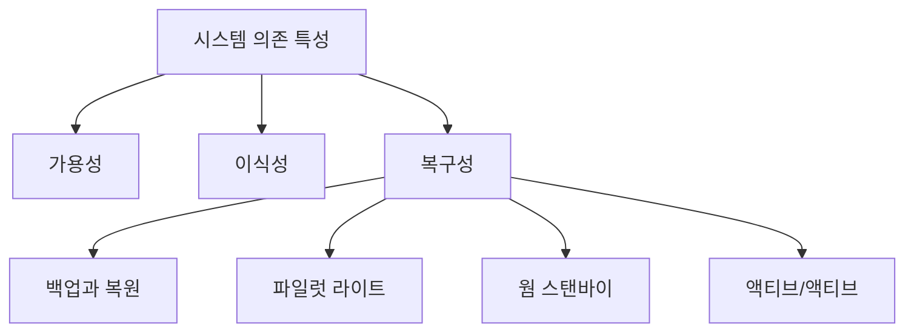
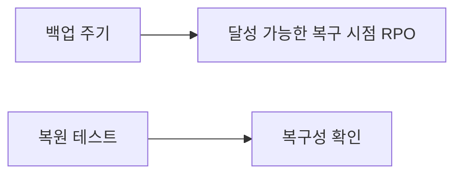

# 시스템 의존 데이터 품질 특성

> ISO/IEC 25012의 15개 데이터 품질 특성 중 데이터가 **저장·처리되는 시스템 환경(하드웨어·소프트웨어·인프라)에 좌우되는** 특성이다. 가용성·이식성·복구성이 대표적이며, 데이터 값이 맞아도 시스템이 못 받쳐 주면 품질이 떨어진다.

## 쉽게 말하면
도서관 책 내용은 정확해도 서고 문이 잠겨 있으면(가용성), 다른 도서관으로 옮길 수 없으면(이식성), 화재 후 복원할 수 없으면(복구성) 쓸모가 줄어든다. 데이터 값이 아니라 보관 시스템이 만드는 품질이다.

## 자세히
(표준 원문은 유료·접근 제한으로 **직접 읽지 못했다**. 아래는 해설 사이트와 AWS 공식 백서를 열어 확인한 내용이다.)
- **분류(iso25000.com, 직접 확인)**: 시스템 의존 묶음은 **가용성·이식성·복구성**. 내재와 시스템 의존 양쪽에 걸친 특성(접근성·준수·기밀성·효율성·정밀성·추적성·이해 용이성)도 있다. 다른 해설 페이지(Nemko)는 이 묶음 설명에 "Security"를 넣어 목록이 서로 다르다. 어느 쪽이 표준 문구와 맞는지는 원문을 보지 못해 확인하지 못했다.
- **해설 사이트의 정의(Nemko, 2차 해설)**: 가용성은 분산 시스템이 필요할 때 데이터에 접근할 수 있는 정도, 이식성은 다른 데이터 모델·플랫폼으로 옮길 수 있는 정도, 복구성은 시스템 장애에도 데이터 무결성을 유지하는 능력. 표준 문구가 아닌 요약이다.
- **복구성을 구현하는 예(AWS 재해 복구 백서, 직접 확인)**: 재해 복구 전략을 네 가지로 구분한다. **백업과 복원**(비용·복잡도 최저, 데이터 손실·손상 대비. 백업 주기가 달성 가능한 복구 시점을 정하며 RPO와 맞춰야 한다), **파일럿 라이트**(데이터 복제와 핵심 인프라 사본 유지, 앱 서버는 꺼 둠), **웜 스탠바이**(축소된 완전 가동 사본, 즉시 일부 트래픽 처리), **멀티 사이트 액티브/액티브**(가장 복잡·비용 높음, 복구 시간을 거의 0으로 줄일 수 있으나 데이터 손상은 백업에 의존해 복구 시점은 0이 아님). 백서는 연속 복제가 손상·악의적 삭제를 막지 못할 수 있어 **버전 관리나 시점 복구가 함께 필요**하고, 백업은 **복원 테스트**를 포함해야 한다고 강조한다.
- **연결(해석)**: 데이터 품질 점검표에서 시스템 의존 특성은 RPO·RTO 목표, 복원 테스트 주기, 이전(포맷·스키마 변환) 절차 같은 **운영 항목**으로 쓴다([데이터 품질 점검표 만들기](#data-quality-checklist-template)). RAG 인덱스의 재구축 능력([RAG 인덱스 버전](#rag-index-versioning))도 이 관점이다.
- **한계**: 이 글은 표준 정의를 확인하지 못했고 AWS 사례는 한 벤더의 구현 예다.

## 그림으로 보기

## 예시
- 사내 학습 데이터 저장소: 일 1회 백업(복구 시점 최대 24시간), 분기마다 복원 훈련, 다른 클라우드로의 이전 절차를 문서화.
- 교육 소재: "데이터는 맞는데 서비스가 멈췄다"는 사례를 시스템 의존 특성으로 분류.

## 헷갈리는 것과 비교
| 개념 | 차이 |
|---|---|
| [내재 특성](#iso-25012-inherent-characteristics) | 데이터 값 자체의 상태 |
| 시스템 의존 특성 | 환경이 결정하는 품질 |
| 백업 | 복구의 재료 |
| 복원 테스트 | 복구성의 증거 |

## 더 읽을거리
- [ISO 25012 (iso25000.com)](https://iso25000.com/index.php/en/iso-25000-standards/iso-25012) — 특성 분류(직접 확인).
- [AWS: Disaster recovery options in the cloud](https://docs.aws.amazon.com/whitepapers/latest/disaster-recovery-workloads-on-aws/disaster-recovery-options-in-the-cloud.html) — 네 가지 전략(직접 확인).
