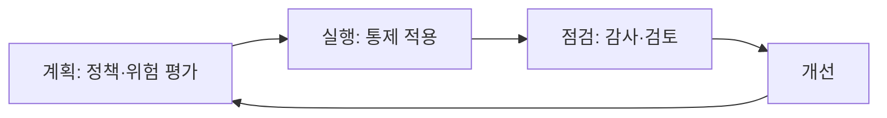
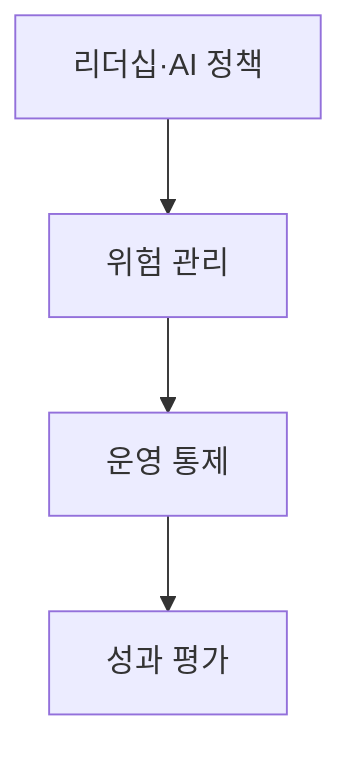

# ISO/IEC 42001

> **ISO/IEC 42001:2023**은 조직이 AI 경영시스템(AIMS)을 수립·운영·유지·개선하기 위한 요구사항을 정한 최초의 국제 표준이며 인증을 받을 수 있다.

## 쉽게 말하면
품질경영 ISO 9001이 "품질을 관리하는 체계"를 인증하듯, 42001은 "AI를 책임 있게 다루는 조직 체계"를 인증한다. 특정 모델의 성능이 아니라 조직의 관리 방식을 본다.

## 자세히
(ISO 설명·검색 요약 확인, 표준 전문은 유료라 열지 않음)
- **적용 대상**: AI 제품·서비스를 제공하거나 사용하는 모든 조직(규모·유형 무관).
- **방법**: PDCA(계획-실행-점검-개선) 순환.
- **요구 영역**: 리더십·조직 맥락, AI 정책·목표, AI 시스템 위험 관리, 데이터 거버넌스·수명주기 통제, 투명성, 성과 평가·모니터링, 지속적 개선. 요구사항은 4~10절이며 8절(운영)이 AI 고유 부분이라는 설명이 있다.
- ISO 9001, ISO/IEC 27001과 통합 운영 가이드가 부속서에 있다.
- **판 현황**: 검색 결과에 따르면 BS EN ISO/IEC 42001:2026이 2023판을 대체하되 기술적 차이는 없다고 한다. 계약·인증 전 최신 판을 확인할 것.
- 유료: 약 CHF 225.

## 그림으로 보기

## 예시
- AI 서비스를 파는 기업이 고객 신뢰 확보를 위해 외부 인증기관 심사로 42001 인증을 받는다.

## 헷갈리는 것과 비교
| 개념 | 차이 |
|---|---|
| ISO/IEC 42001 | AI 경영시스템 인증 표준 |
| NIST AI RMF | 미국 자발적 위험관리 프레임워크, 인증 없음 |
| [범용 AI 모델 의무](#gpai-obligations) | EU 법적 의무 |
| ISO 27001 | 정보보안 경영시스템 |

## 더 읽을거리
- [ISO: ISO/IEC 42001 설명](https://www.iso.org/home/insights-news/resources/iso-42001-explained-what-it-is.html)
- [ISO 표준 페이지](https://www.iso.org/standard/42001)
