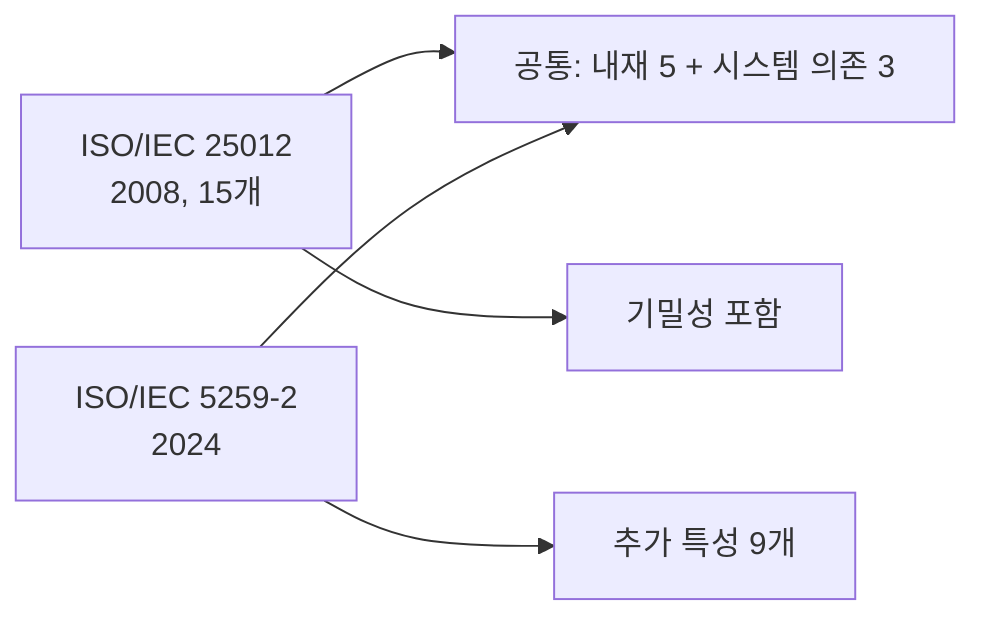
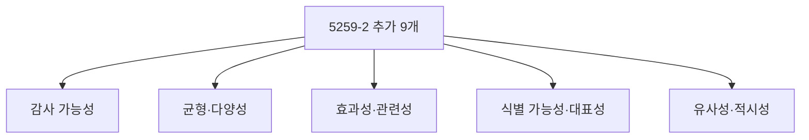

# 25012와 5259-2 특성 비교

> ISO/IEC 25012(2008)의 15개 데이터 품질 특성과 ISO/IEC 5259-2(2024)의 특성 목록을 나란히 놓고 **무엇이 같고 무엇이 빠지거나 더해졌는지** 보는 비교다. 5259-2는 부속서 E에서 두 표준의 특성을 직접 비교한다.

## 쉽게 말하면
같은 건강검진이라도 2008년 판은 일반 성인용, 2024년 판은 "AI 모델에게 먹일 데이터"용으로 항목을 고친 것과 같다. 기본 항목은 그대로 두고 AI에 필요한 검사 항목을 더 붙였다.

## 자세히
(5259-2의 **목차**는 DIN 사본과 VDE 미리보기 PDF로 직접 확인했고, 25012의 목록은 이 지도의 기존 글이 iso25000.com에서 확인한 것을 따랐다. **부속서 E의 본문 비교표는 읽지 못했다.** 아래 대조는 두 목록을 사람이 맞춰 본 결과이며 표준이 말한 결론이 아니다.)
- **5259-2의 특성 구성(목차)**: 6.2 **내재** 5개 — 정확성·완전성·일관성·신뢰성·최신성 / 6.3 **내재+시스템 의존** 6개 — 접근성·준수·효율성·정밀성·추적성·이해 용이성 / 6.4 **시스템 의존** 3개 — 가용성·이식성·복구성 / 6.5 **추가** 9개 — 감사 가능성·균형·다양성·효과성·식별 가능성·관련성·대표성·유사성·적시성.
- **25012의 구성(기존 글)**: 내재 5개(위와 동일) / 내재+시스템 의존 7개 — 접근성·준수·**기밀성**·효율성·정밀성·추적성·이해 용이성 / 시스템 의존 3개(위와 동일). 총 15개.
- **대조 결과(해석)**:
  1. 내재 5개와 시스템 의존 3개는 두 표준이 같다.
  2. 6.3 묶음에서 **기밀성(Confidentiality)** 이 5259-2 목차에는 보이지 않는다(25012에는 있음). 빠진 이유와 다른 곳에서 다루는지는 본문을 못 읽어 확인하지 못했다.
  3. 5259-2는 **추가 특성 9개**를 6.5에 둔다. 균형·다양성·대표성·유사성·관련성·식별 가능성 같은 항목은 ML 데이터 문제와 직접 연결된다. 감사 가능성·효과성·적시성은 25012의 추적성·최신성 등과 어떤 관계인지 본문 없이는 단정할 수 없다.
- **같은 뿌리**: 5259-2 서문은 이 표준이 ISO 8000 시리즈, 25012, 25024에 기반한다고 밝힌다. 부속서 C는 특성 개요, D는 "대체 가능한 특성 묶음", E는 25012와의 비교다(목차).
- **실무에서의 선택(일반 원칙)**: 일반 업무 데이터는 25012의 15개로 충분할 수 있고, 학습·평가 데이터에는 5259-2의 추가 특성을 고려한다. 어느 목록을 쓰든 조직의 점검표에는 쓰는 특성의 정의를 명시한다.
- **면책**: 표준 간 대응 관계의 공식 설명은 부속서 E에 있으므로 확정이 필요하면 원문을 구입해 확인한다.

## 그림으로 보기

## 예시
- 사내 점검표를 만들 때: 기본 6~8개 특성은 25012에서, 학습 데이터용 항목으로 균형·대표성·식별 가능성을 5259-2에서 가져와 합친다.
- 교육 소재: "새 표준은 옛 표준에 무엇을 더했나?" 비교표 만들기 실습.

## 헷갈리는 것과 비교
| 개념 | 차이 |
|---|---|
| ISO/IEC 25012 | 범용 데이터 품질 모델(15특성, 2008) |
| ISO/IEC 5259-2 | 분석·ML용 품질 모델·측정·보고(2024) |
| [데이터 균형 특성](#data-balance-characteristic) | 5259-2 추가 특성의 예 |
| [데이터 식별 가능성](#data-identifiability) | 5259-2 추가 특성의 예 |

## 더 읽을거리
- [ISO/IEC 5259-2 미리보기 PDF (VDE)](https://vde-verlag.de/iec-normen/preview-pdf/info_isoiec5259-2%7Bed1.0%7Den.pdf) — 서문·범위·목차(직접 읽음).
- [ISO/IEC 5259-2:2024](https://www.iso.org/standard/81860.html) — 표준 페이지, 본문 유료.
