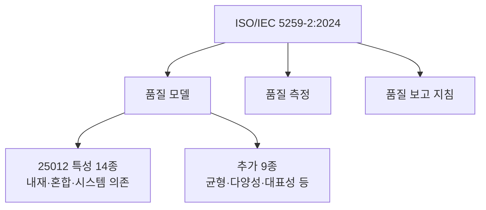

# 5259-2 데이터 품질 측정

> ISO/IEC 5259-2:2024는 **분석·머신러닝(ML)용 데이터의 품질 모델, 품질 측정 지표, 품질 보고 지침**을 정한 국제 표준이다(2024-11 제1판). ISO/IEC 25012의 특성에 ML에 특화된 특성(균형·다양성·대표성 등)을 더해 확장했다.

## 쉽게 말하면
기존 데이터 품질 체크리스트(25012)가 "자료가 깨끗한가"를 본다면, 5259-2는 거기에 "학습용으로 쓸 만한가"를 더한다. 예컨대 데이터가 한쪽 집단으로 쏠려 있지 않은지(균형), 대상 현실을 대표하는지(대표성) 같은 ML 특유의 질문이다.

## 자세히
(표준 본문은 유료지만, VDE 출판사가 공개한 **미리보기 PDF(표지·목차·서문·1~3절 일부)를 직접 열어 확인**했다. 각 특성의 정의와 측정식은 미리보기에 없어 읽지 못했다.)
- **서지 정보(미리보기·EVS 페이지)**: *Artificial intelligence — Data quality for analytics and machine learning (ML) — Part 2: Data quality measures*, ISO/IEC 5259-2:2024(en), 제1판 2024-11. JTC 1/SC 42(인공지능) 작성. EVS 페이지는 5 November 2024부터 유효하다고 표기.
- **범위(1절)**: 분석과 ML 맥락의 **데이터 품질 모델, 품질 측정, 품질 보고 지침**을 규정. 모든 유형의 조직에 적용 가능. 서문은 불완전·거짓·오래된 데이터가 분석·ML 결과에 악영향을 줄 수 있고, 안전·신뢰·상호운용성을 위한 표준화된 접근이 필요하다고 쓴다. ISO 8000 시리즈, ISO/IEC 25012, ISO/IEC 25024 위에 세웠고 품질 모델은 확장·수정할 수 있다고 한다.
- **목차로 본 구조**: 5절 데이터 품질 구성요소와 모델(생명주기 속 구성요소), 6절 특성과 측정, 7절 ML 과제에 모델·측정 적용, 8절 품질 보고(보고 틀·측정 정보·조직 지침). 부속서 A는 측정 함수 설계, B는 UML 모델, C는 특성 개요, D는 대체 그룹, **E는 25012와 5259-2 특성 비교**.
- **6절의 특성 목록(목차에서 직접 확인)**
  - 내재: 정확성, 완전성, 일관성, 신뢰성(credibility), 최신성(currentness)
  - 내재+시스템 의존: 접근성, 준수, 효율성, 정밀성, 추적성, 이해 용이성
  - 시스템 의존: 가용성, 이식성, 복구성
  - **추가 특성(6.5)**: 감사 가능성(auditability), **균형(balance), 다양성(diversity)**, 효과성(effectiveness), 식별 가능성(identifiability), 관련성(relevance), **대표성(representativeness)**, 유사성(similarity), 적시성(timeliness)
  - 목차의 6.3에는 25012 해설에서 본 "기밀성"이 보이지 않는다. 25012와 어떻게 다른지는 부속서 E에 있으나 본문을 보지 못했다.
- **미확인**: 특성별 정의·측정식, 합격선 권고 여부. 대표성·균형의 측정 방법은 이 글에서 설명하지 않는다([데이터 대표성](#data-representativeness)은 별도 노드).
- **활용(제안)**: 25012 기반 점검표([데이터 품질 점검표 만들기](#data-quality-checklist-template))에 ML용 항목(균형·대표성·관련성)을 추가하는 확장 틀로 쓴다.

## 그림으로 보기

## 예시
- 채용 AI 학습 데이터 점검표에 "성별·연령대 균형", "지원자 집단 대표성" 행을 추가하고 측정 방법을 5259-2 해당 절에서 확인.
- 교육 소재: 25012의 15개 특성과 5259-2의 추가 9개를 비교한 표를 보며 "ML이라 더 필요한 질문"을 찾는 활동.

## 헷갈리는 것과 비교
| 개념 | 차이 |
|---|---|
| [ISO/IEC 25012](#iso-iec-25012) | 일반 데이터 품질 모델 15개 특성 |
| ISO/IEC 5259-2 | ML용 확장 모델과 측정·보고 |
| [5259-5 거버넌스](#iso-5259-part5-governance) | 역할·책임·감독 구조 |
| [데이터 대표성](#data-representativeness) | 추가 특성 중 하나 |

## 더 읽을거리
- [ISO/IEC 5259-2 미리보기 (VDE)](https://assets.vde-verlag.de/iec-normen/preview-pdf/info_isoiec5259-2%7Bed1.0%7Den.pdf) — 목차·서문·범위(PDF 직접 확인).
- [EVS: ISO/IEC 5259-2:2024](https://www.evs.ee/en/iso-iec-5259-2-2024) — 범위와 유효일(직접 확인).
