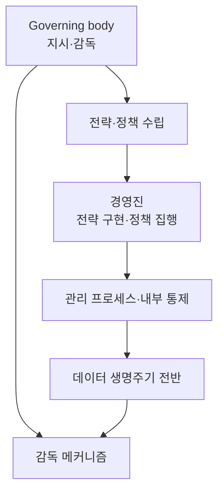
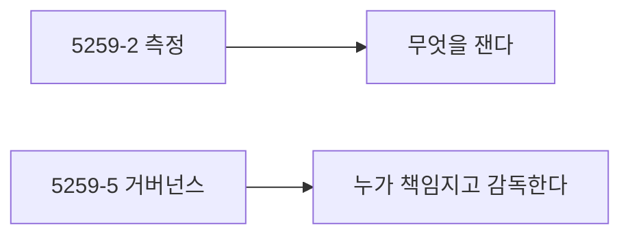

# 5259-5 데이터 품질 거버넌스

> ISO/IEC 5259-5:2025는 분석·ML용 데이터 품질을 **조직의 최고 의사결정 기구(governing body)와 경영진이 어떻게 지시·감독할지**를 정한 거버넌스 틀이다. 개별 측정이 아니라 "누가 책임지고 무엇을 감독하나"를 다룬다.

## 쉽게 말하면
회사 재무 보고에 이사회가 감독하고 경영진이 실행하는 구조가 있듯이, 데이터 품질도 이사회급이 방향을 정하고 경영진이 정책·절차·위험 통제를 집행하는 구조를 갖추라는 것이다. 현장 담당자 혼자 알아서 하게 두지 않는다.

## 자세히
(VDE가 공개한 **미리보기 PDF(표지·목차·서문·범위·3.1 용어 일부)를 직접 열어 확인**했다. 5절 이하 본문은 미리보기에 없어 읽지 못했으므로 항목의 세부 내용은 설명하지 않는다.)
- **서지 정보**: ISO/IEC 5259-5:2025(en), *Artificial intelligence — Data quality for analytics and machine learning (ML) — Part 5: Data quality governance framework*, 제1판 2025-02. JTC 1/SC 42 작성.
- **범위(1절)**: 조직의 **governing body가 데이터 품질 측정·관리·관련 프로세스의 구현과 운영을 지시·감독**할 수 있도록, 5259-1의 데이터 생명주기(DLC) 모델 전반에 걸쳐 적절한 통제를 갖춘 거버넌스 틀을 제공한다. 모든 분석·ML에 적용 가능하며, 5259-3(관리 요구사항)·5259-4(프로세스 요구사항)이 정하는 구체적 요구사항은 이 문서가 정의하지 않는다고 명시한다.
- **서문**: 자원을 낭비하지 않고 데이터 품질을 다루도록 governing body가 분석·ML 활용의 전략 방향을 정하고 필요한 데이터의 품질을 감독할 수 있다고 쓴다. 조직 규모·유형과 무관하며 5259 시리즈의 다른 부분과 함께 쓴다.
- **구조(목차에서 직접 확인)**
  - 5절: 분석·ML 맥락의 데이터 품질 거버넌스 — 기초(5.1), **책임이 모호한 데이터(5.2)**, 목적과 정당화(5.3).
  - 6절 프레임워크: DQ 지도 원칙, 전략과 정책, 사업 계획, **DQ 책임 체계(accountabilities)**, DQ 위험 관리, DQ 관리 프로세스.
  - 7절 **governing body의 책임**: 데이터 품질의 전략적 중요성 이해, 거버넌스 가능 환경 조성, 전략 수립, 사업 계획, 위험 관리 역량, 정책 수립, **감독 메커니즘** 수립.
  - 8절 **경영진의 책임**: 전략 구현, 포괄적 정책 수립·집행, 관리 프로세스 구현, 내부 위험 통제.
- **용어(3.1)**: 미리보기에 확인되는 첫 용어 "data creator"는 데이터 출처에서 데이터를 생성·수집·큐레이션하는 책임을 가진 조직 내 역할이다([데이터 오너와 스튜어드](#data-owner-steward) 참고).
- **한계**: 본문 세부(원칙의 구체 문구, 책임 매트릭스 예시)는 이번에 확인하지 못했다.

## 그림으로 보기

## 예시
- 전사 AI 도입 시 이사회 보고 항목에 "학습 데이터 품질 지표와 위험 요약"을 정례화하고, 데이터 책임 역할을 문서화.
- 교육 소재: 같은 데이터 사고 사례에 대해 현장·경영진·이사회가 각각 할 일을 나누는 역할극.

## 헷갈리는 것과 비교
| 개념 | 차이 |
|---|---|
| [5259-2 측정](#iso-5259-part2-measures) | 품질 모델과 측정 지표 |
| 5259-5 거버넌스 | 지시·감독 구조 |
| 5259-3·4 | 관리·프로세스 요구사항(본 문서가 정의하지 않음) |
| [데이터 오너와 스튜어드](#data-owner-steward) | 책임 역할 분담 |

## 더 읽을거리
- [ISO/IEC 5259-5 미리보기 (VDE)](https://assets.vde-verlag.de/iec-normen/preview-pdf/info_isoiec5259-5%7Bed1.0%7Den.pdf) — 목차·서문·범위(PDF 직접 확인).
