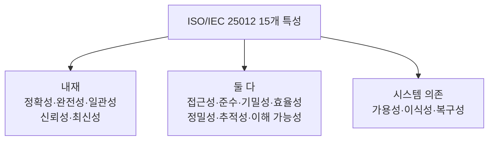

# ISO/IEC 25012

> 구조화된 데이터의 품질을 15가지 특성으로 나눠 정의한 국제 표준(2008년 초판)이다. 특성은 데이터 자체에서 보는 "내재(inherent)" 관점과 데이터가 저장·처리되는 시스템에 달린 "시스템 의존(system-dependent)" 관점으로 나뉜다.

## 쉽게 말하면
도서관 책을 평가한다고 해 보자. 책 내용이 맞는지·빠진 쪽이 없는지는 책 자체의 문제(내재)다. 책이 필요할 때 빌릴 수 있는지, 불이 나도 복구되는지는 도서관 시설의 문제(시스템 의존)다. 이 표준은 데이터에 대해 두 종류의 점검표를 한 장에 묶어 준다.

## 자세히
- 범위: 컴퓨터 시스템 안에 구조화된 형태로 저장된 데이터. 품질 요구사항 정의, 측정 지표 설계, 평가 계획에 쓴다(ISO 25000 시리즈 "SQuaRE" 중 데이터 품질 모델 편).
- **내재 관점**: 도메인 값과 제약, 값 사이 관계, 메타데이터 등 데이터 자체로 판단.
- **시스템 의존 관점**: 하드웨어·소프트웨어·도구가 좌우하는 품질(예: 백업은 복구성, 이전 도구는 이식성).
- **15개 특성**(분류는 표준 도표 기준, 상용·2차 요약으로 교차 확인):
  - 내재: 정확성(accuracy), 완전성(completeness), 일관성(consistency), 신뢰성(credibility), 최신성(currentness)
  - 둘 다: 접근성(accessibility), 준수(compliance), 기밀성(confidentiality), 효율성(efficiency), 정밀성(precision), 추적성(traceability), 이해 가능성(understandability)
  - 시스템 의존: 가용성(availability), 이식성(portability), 복구성(recoverability)
- 정확성은 "의도한 속성의 참값을 얼마나 맞게 나타내는가", 완전성은 "기대하는 속성·개체 값이 다 있는가", 일관성은 "모순이 없고 다른 데이터와 맞는가"로 정의한다.
- AI 데이터에 쓸 때: 학습 데이터는 내재 특성(정확성·완전성·일관성·최신성)을 주로 점검하고, 운영 파이프라인은 가용성·복구성·추적성(출처 기록)을 함께 본다. 분석·ML용 데이터 품질은 후속 시리즈 [ISO/IEC 5259](#iso-iec-5259)가 다룬다(제안: 25012를 바탕 어휘로 삼는다).
- 주의: 표준 원문은 유료이며, 위 도표 배치는 공개 요약본 기준이다.

## 그림으로 보기

## 예시
- 고객 문의 로그로 챗봇을 학습시킬 때: 정확성(오타·잘못된 라벨), 완전성(빈 답변), 최신성(옛 정책 문서)을 항목별로 점검표에 적고 통과 기준을 정한다.
- 사내 데이터 레이크: 가용성(점검 시간대), 복구성(백업 주기), 추적성(원천 시스템 기록)을 운영 요건으로 문서화.

## 헷갈리는 것과 비교
| 개념 | 차이 |
|---|---|
| ISO/IEC 25012 | 구조화 데이터 품질 특성 15개의 일반 모델 |
| [ISO/IEC 5259](#iso-iec-5259) | 분석·ML 데이터 품질 전용 시리즈 |
| [AI용 데이터 품질](#data-quality-for-ai) | 이 표준들을 AI 현장 점검에 적용하는 상위 개념 |

## 더 읽을거리
- [ISO 25000: ISO/IEC 25012](https://iso25000.com/index.php/en/iso-25000-standards/iso-25012) — 내재·시스템 의존 정의와 정확성·완전성·일관성 정의(열어 확인; 15개 목록은 이미지라 텍스트로 안 나옴).
- [arc42 Quality Model: ISO/IEC 25012](https://quality.arc42.org/standards/iso-iec-25012) — 두 관점 설명과 특성 요약(열어 확인).
- [Unfolding Data Quality Dimensions in Practice (arXiv 2507.17507)](https://arxiv.org/abs/2507.17507) — 25012의 내재/시스템 의존/둘 다 구조를 인용한 서베이(열어 확인).
