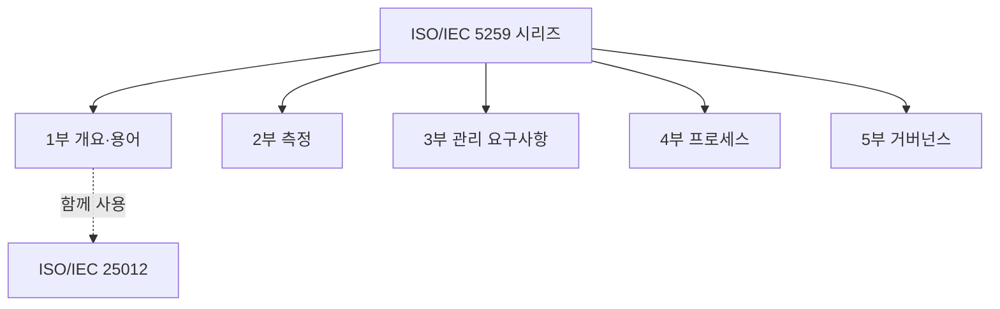

# ISO/IEC 5259

> 분석·머신러닝에 쓰는 데이터의 품질을 다루는 5부작 국제 표준 시리즈다. 1부(개요·용어·예시)가 2024년 7월 발행됐고, 나머지 부는 측정·관리·프로세스·거버넌스를 맡는다.

## 쉽게 말하면
식당 위생 인증에 비유하면, 25012가 "깨끗함의 기준표"라면 5259는 "식자재 검수부터 조리·점검 일지·책임자 지정까지의 운영 매뉴얼 묶음"이다. 데이터를 AI에 넣기 전에 무엇을 어떻게 재고 누가 책임지는지를 정한다.

## 자세히
- 시리즈 이름: Artificial intelligence — Data quality for analytics and machine learning (ML). ISO/IEC JTC 1/SC 42(AI 분과) 소관.
- **1부(Part 1)**: 개요·용어·예시. 2024년 7월 발행(ISO 카탈로그 검색 결과 기준). 다른 부와 [ISO/IEC 25012](#iso-iec-25012) 같은 관련 표준과 함께 쓰도록 설계됐다.
- 2~5부 설명은 **컨설팅사 요약 기준**이라 공식 제목·발행 상태는 ISO 카탈로그에서 재확인이 필요하다(ISO 페이지는 접근이 막혀 직접 못 열었다).
  - 2부 데이터 품질 측정: 정확성·완전성·일관성·적시성·대표성 등 측정 가능한 특성.
  - 3부 관리 요구사항과 지침: 품질 관리 프로세스를 도입·개선하는 요구사항.
  - 4부 프로세스 프레임워크: 데이터 수명주기(준비·평가·배포) 전반의 표준 프로세스.
  - 5부 거버넌스 프레임워크: 역할·책임·감독 구조.
- 25012와 차이: 25012는 일반 구조화 데이터의 특성 모델, 5259는 ML 특유의 요구(대표성, 라벨 품질 등)와 조직 운영까지 확장한다(요약본 기준).

## 그림으로 보기

## 예시
- 사내 AI 도입 TF가 "학습 데이터 인수 기준서"를 만들 때 2부 지표(완전성·대표성)를 합격선으로, 5부를 참고해 데이터 오너를 지정한다.
- 외부 데이터 구매 시 1부 용어로 계약서의 품질 조항을 통일한다.

## 헷갈리는 것과 비교
| 개념 | 차이 |
|---|---|
| ISO/IEC 5259 | ML·분석 데이터 품질 시리즈(5부) |
| [ISO/IEC 25012](#iso-iec-25012) | 구조화 데이터 품질 특성 15개 |
| [AI용 데이터 품질](#data-quality-for-ai) | 두 표준을 현장에 적용하는 상위 개념 |

## 더 읽을거리
- [Management Solutions: ISO/IEC 5259 해설](https://www.managementsolutions.com/en/node/4456) — 1~5부 요약(열어 확인, 2차 출처).
- [ISO 5259-1 표준 페이지](https://www.iso.org/standard/81088.html) — 검색 결과로 확인, 직접 열기는 403으로 실패.
