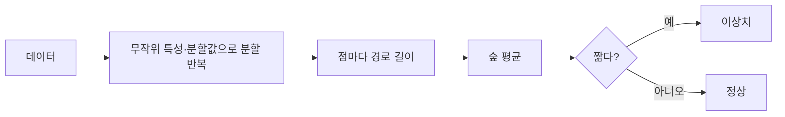

# Isolation Forest

> Isolation Forest는 무작위로 특성과 분할값을 골라 데이터를 쪼갤 때 금방 혼자 남는(고립되는) 점을 이상치로 보는 비지도 이상 탐지 알고리즘이다.

## 쉽게 말하면
스무고개로 사람을 지목하는 일이다. 흔한 사람은 질문을 많이 해야 특정되지만 괴짜는 몇 번만 물어도 가려진다. 질문 횟수(경로 길이)가 짧을수록 이상하다.

## 자세히
scikit-learn 문서(2026-11 확인):
- 각 트리는 무작위 특성과 그 최솟값~최댓값 사이 무작위 분할값으로 쪼갠다. 한 점이 고립되기까지의 분할 횟수 = 루트에서의 경로 길이. 숲 전체 평균에서 **경로가 짧으면 이상치**. "무작위 분할은 이상치에서 눈에 띄게 짧은 경로를 만든다".
- `ExtraTreeRegressor` 앙상블 기반, 최대 깊이 ⌈log₂(n)⌉, `warm_start=True`로 트리 추가 가능.
- 고차원에서 잘 작동하고 분포 가정이 적다. 범용 선택지로 소개된다.
- 출력: 정상 `1`, 이상 `-1`. `contamination`이 임계값을 정한다.
- 용어: **outlier detection**(학습 데이터에 이상치가 섞임) vs **novelty detection**(깨끗한 데이터로 학습, 새 관측이 이상인지 판단).

## 그림으로 보기


## 예시
```python
from sklearn.ensemble import IsolationForest
clf = IsolationForest(n_estimators=100, contamination=0.05, random_state=0)
labels = clf.fit_predict(X)   # 1 정상, -1 이상
```
서버 로그 지표, 카드 거래 이상 탐지 첫 베이스라인.

## 헷갈리는 것과 비교
| 개념 | 차이 |
|---|---|
| Isolation Forest | 전역적 고립 용이성, 고차원에 강점 |
| [LOF](#local-outlier-factor) | 이웃 대비 지역 밀도, 밀도가 다른 군집에 강점 |
| [이상치 처리](#outlier-handling) | 상위 주제 |
| 랜덤 포레스트 | 지도학습 분류·회귀 — 이름만 비슷 |

## 더 읽을거리
- [scikit-learn: Novelty and Outlier Detection](https://scikit-learn.org/stable/modules/outlier_detection.html) — 알고리즘 설명과 사용법.
