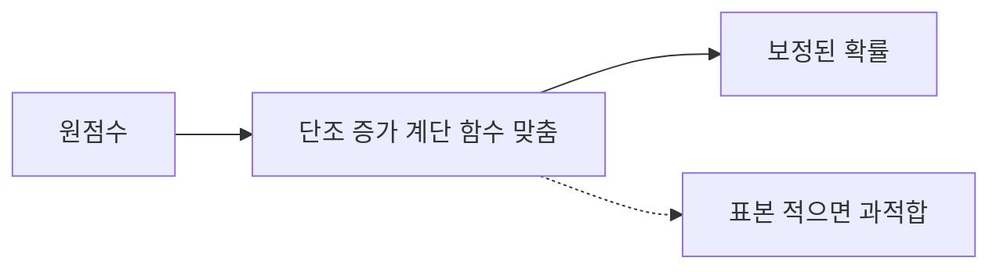

# 아이소토닉 보정

> 분류기의 점수를 확률로 바꾸는 **비모수 단조 증가 계단 함수**를 맞추는 보정 방식이다. 시그모이드(Platt)보다 유연하지만 데이터가 적으면 과적합한다.

## 쉽게 말하면
점수가 높을수록 실제 정답률도 높아야 한다는 규칙만 지키면서 점수-정답률 표를 계단처럼 자유롭게 그려 맞추는 것이다. 곡선 모양을 미리 정하지 않으니 유연하지만 표본이 적으면 우연에 휘둘린다.

## 자세히
(scikit-learn의 "Probability calibration" 문서를 직접 읽었다.)
- **정의(문서)**: `method="isotonic"`은 **단계적으로 비감소하는 함수**를 출력하는 비모수 isotonic 회귀를 맞춘다. 단조 제약 아래 제곱 오차를 최소화한다. 제약은 매핑이 단조 증가라는 것뿐이라 sigmoid보다 일반적이다.
- **sigmoid(Platt)와 비교(문서)**: sigmoid는 매개변수 2개(p = 1/(1+exp(Af+B))), 소표본·과소확신 모델에 효과적, 보정 오차가 대칭이어야 잘 작동(극단적 불균형에서 깨질 수 있음). isotonic은 모든 단조 왜곡을 교정하지만 **소표본에서 과적합 위험**.
- **표본 수 기준(문서)**: 데이터가 충분(**약 1,000개 초과**)하면 isotonic이 sigmoid만큼 또는 더 좋다. 문서가 말하는 *경험칙*이며 엄격한 경계는 아니다.
- **AUC 주의(문서)**: isotonic은 동점(tie)을 만들어 **AUC가 바뀔 수 있다**. 순위·AUC를 엄격히 유지하려면 strictly monotonic인 sigmoid를 쓴다.
- **사용(문서)**: `CalibratedClassifierCV(estimator, method="isotonic", cv=...)`. `ensemble=True`(기본)이면 CV 분할마다 복제 모델을 학습하고 그 분할의 예측으로 보정기를 맞춘 뒤 `predict_proba`는 평균. 모든 클래스가 각 분할의 학습·시험에 있어야 한다. 이미 학습된 모델은 `FrozenEstimator`로 감싸되 분류기 학습 데이터와 보정 데이터가 **서로소**여야 한다.
- **다중 클래스(문서)**: 클래스별 일대다 보정 후 정규화. 대안으로 `method="temperature"`.
- **검증(문서)**: `CalibrationDisplay`로 신뢰도 도표 확인. Brier·로그 손실은 보정과 변별력이 섞여 있다.

## 그림으로 보기


## 예시
```python
from sklearn.calibration import CalibratedClassifierCV
clf = CalibratedClassifierCV(base, method="isotonic", cv=5)
clf.fit(X, y)
proba = clf.predict_proba(X_new)
```
- 데이터가 수백 개뿐이면 sigmoid를 먼저 시험(문서 권고).

## 헷갈리는 것과 비교
| 방식 | 특징 |
|---|---|
| isotonic | 비모수, 유연, 1,000개+ 권장 |
| sigmoid(Platt) | 2 매개변수, 소표본, AUC 유지 |
| temperature | 다중 클래스용 대안 |
| [ECE](#ece-metric) | 보정 정도를 재는 지표 |

## 더 읽을거리
- [scikit-learn — Probability calibration](https://scikit-learn.org/stable/modules/calibration.html) — 직접 읽음.
