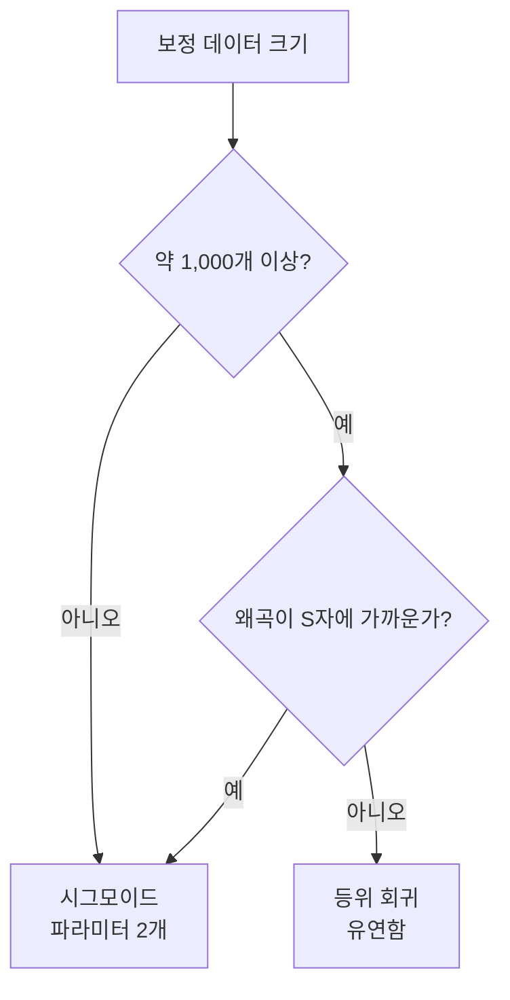

# isotonic vs sigmoid 보정

> 모델의 점수를 실제 정답 확률에 맞추는 대표적인 두 방법이다. 시그모이드(Platt) 보정은 S자 곡선 하나로 모양을 맞추는 모수적 방법이고, 등위(isotonic) 회귀는 단조 증가하기만 하면 어떤 모양이든 맞추는 비모수적 방법이다. 데이터가 적으면 시그모이드, 많으면 등위 회귀가 보통 유리하다.

## 쉽게 말하면
안경 도수를 맞출 때, 시그모이드는 "한 가지 렌즈 도수 곡선"만 조절하는 방식이고 등위 회귀는 구간마다 따로 렌즈를 깎는 방식이다. 후자는 더 정교하지만 측정할 데이터가 적으면 노이즈까지 따라 깎아 버린다.

## 자세히
scikit-learn 보정 문서(열람)의 내용이다.
- **목표**: 잘 보정된 분류기에서 0.8 근처로 예측된 표본의 약 80%가 양성이어야 한다. 진단은 보정 곡선(신뢰도 도표)으로 한다. 예측 확률을 구간별로 묶어 예측 평균 대 실제 양성 비율을 그린다. 브라이어 점수·로그 손실은 보정만이 아니라 변별력과 데이터의 무작위성이 섞여 있어 낮다고 보정이 좋은 것이 아닐 수 있다.
- **시그모이드(`method="sigmoid"`)**: p(y=1|f) = 1/(1+exp(Af+B))를 최대우도로 맞춘다. 왜곡이 시그모이드로 고쳐진다고 가정하며 Platt(1999)에서 SVM에 경험적으로 맞았지만 일반적으로 보장되지는 않는다. 양쪽 클래스의 보정 오차가 대칭이고 분산이 같다고 가정하므로 심한 불균형에서는 실패할 수 있다. 데이터가 적거나 상하단 오류가 비슷한 과소 확신 모델에 낫다. 단조 증가하므로 ROC-AUC를 보존한다.
- **등위 회귀(`method="isotonic"`)**: 제곱 오차를 최소화하는 비모수 비감소 계단 함수를 맞춘다. 어떤 단조 왜곡도 고칠 수 있지만 작은 데이터에서 과적합한다. 대략 1,000개 넘는 표본이 있으면 Niculescu-Mizil·Caruana에 따라 시그모이드와 같거나 더 낫다고 한다. 예측 확률에 동점이 생겨 AUC가 바뀔 수 있어 순위를 정확히 유지해야 하면 시그모이드를 쓴다.
- **`CalibratedClassifierCV`**: `cv` 분할의 모든 폴드에 모든 클래스가 있어야 한다. `ensemble=True`(기본)는 분할마다 모델을 학습하고 보정기를 맞춘 뒤 k개를 평균하고(학습 비용 k배), `False`는 교차 예측으로 보정기 하나를 맞추고 전체 데이터로 모델을 학습해 더 빠르고 작다. 이미 학습된 모델은 `FrozenEstimator`로 감싸며 보정 데이터는 학습 데이터와 겹치면 안 된다. 다중 클래스는 일대다로 각각 보정한 뒤 합이 1이 되게 정규화한다. `method="temperature"`는 로짓에 단일 온도 T를 맞추는 방식으로 argmax가 바뀌지 않아 정확도가 그대로다.
- **직접 해 본 시뮬레이션(순수 파이썬 구현, 시드 21)**: 참 확률이 sigmoid(x)인데 모델 점수가 sigmoid(2.5x)로 과신하는 데이터를 만들고, 보정 데이터 100·500·3,000개로 두 방법을 맞춘 뒤 2만 개 시험 데이터에서 평가했다. 보정 전 브라이어 0.2001, 참 확률과의 평균 절대 오차 0.130. 시그모이드는 오차 0.051(n=100)·0.017(n=500)·0.011(n=3,000), 등위는 0.095·0.042·0.024로 시그모이드가 모든 표본 크기에서 앞섰다. 이 실험은 왜곡이 정확히 시그모이드 모양이라 시그모이드에 유리하게 설계됐다. 시그모이드가 맞지 않는 왜곡에서는 등위가 유리해질 수 있으나 이번에는 확인하지 않았다.
- **선택 기준(문서와 실험을 합친 해석)**: 표본이 수백 개 이하이거나 왜곡이 S자 모양에 가까우면 시그모이드, 표본이 충분하고(약 1,000+) 왜곡이 비정형이면 등위 회귀. 어느 쪽이든 별도 보류 데이터로 보정 곡선과 브라이어 점수를 비교해 확인한다.

## 그림으로 보기

## 예시
- 라벨 오류 탐지 전: 모델 확률이 과신이라 80% 예측이 실제로 60%만 맞는다면, 보류 데이터 500개로 시그모이드 보정기를 먼저 맞춘 뒤 임계값을 정한다.
- 교육 활용: 같은 점수에 두 보정을 적용한 곡선을 그려 보고 표본이 적을 때 등위 곡선이 울퉁불퉁해지는 것을 관찰한다.

## 헷갈리는 것과 비교
| 개념 | 차이 |
| --- | --- |
| [예측 확률 보정](#pred-probs-calibration) | 상위 주제 |
| 시그모이드(Platt) | 모수 2개, 적은 데이터에 안정적, 순위 보존 |
| 등위 회귀 | 비모수, 유연, 많은 데이터 필요, 동점 발생 |
| 온도 조절 | 로짓에 T 하나, 다중 클래스에 간단, 정확도 불변 |

## 더 읽을거리
- [scikit-learn: Probability calibration](https://scikit-learn.org/stable/modules/calibration.html) — 두 방법의 가정·선택·`CalibratedClassifierCV`
