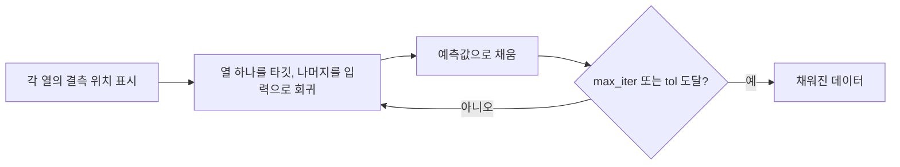
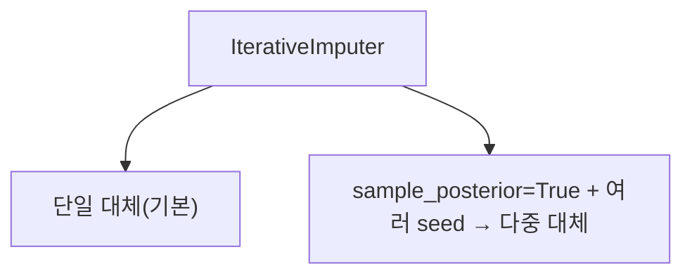

# IterativeImputer

> scikit-learn의 결측값 대체기. 결측이 있는 열을 다른 열들로 회귀 예측하는 과정을 열마다 반복(연쇄 방정식)해 채운다. R의 MICE에서 영감을 받았지만 기본은 단일 대체 한 벌만 반환한다.

## 쉽게 말하면
빈칸이 있는 표에서 "나이 칸이 비었으면 소득·직업으로 나이를 추정해 채우고, 다시 소득 칸이 비었으면 나이·직업으로 추정"하는 식으로 돌아가며 채운다.

## 자세히
(scikit-learn 1.9.1 문서를 하위 에이전트가 WebFetch로 읽은 노트 기준. 인용은 요약이라 원문 그대로가 아닐 수 있다.)
- **사용**: `from sklearn.experimental import enable_iterative_imputer` 후 `from sklearn.impute import IterativeImputer`. 아직 **실험적(experimental)** 기능.
- **기본값**: `estimator=None` → `BayesianRidge()`, `max_iter=10`, `tol=1e-3`, `imputation_order='ascending'`(결측이 적은 열부터), `sample_posterior=False`.
- **다중 대체와의 관계**: 문서는 "R의 MICE에서 영감"이라고 하며 기본은 **단일 대체**다. `sample_posterior=True`와 서로 다른 `random_state`로 여러 번 돌리면 다중 대체를 흉내 낼 수 있다([Rubin 규칙](#rubin-rules)로 합친다).
- **주의(제안)**: 결측 메커니즘이 MNAR이면 편향이 남는다. 예측 목적이면 교차검증 안에서(파이프라인) 학습 데이터에만 fit한다.

## 그림으로 보기



## 예시
```python
from sklearn.experimental import enable_iterative_imputer
from sklearn.impute import IterativeImputer
X_filled = IterativeImputer(random_state=0).fit_transform(X)
```
- 교육 활용: 평균 대체와 결과 비교로 변수 간 관계 보존 효과 체험.

## 헷갈리는 것과 비교
| 개념 | 차이 |
|---|---|
| IterativeImputer | 열마다 회귀로 반복 채움 |
| SimpleImputer | 평균·최빈값 등 단순 대체 |
| [다중 대체](#multiple-imputation) | 여러 완성본을 만들어 합침 |

## 더 읽을거리
- [IterativeImputer 문서](https://scikit-learn.org/stable/modules/generated/sklearn.impute.IterativeImputer.html) — 매개변수·기본값.
- [Imputation of missing values](https://scikit-learn.org/stable/modules/impute.html) — 개요.
