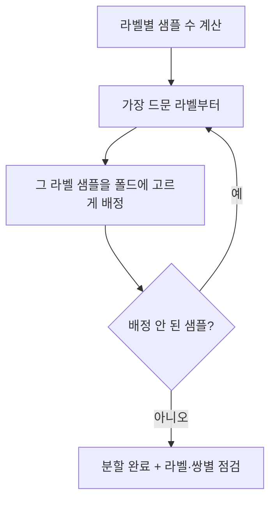

# Iterative stratification

> Iterative stratification은 한 샘플에 라벨이 여러 개 붙는 멀티라벨 데이터를 분할할 때, 각 라벨의 비율이 폴드·세트마다 비슷하도록 라벨을 하나씩(대개 가장 드문 라벨부터) 돌아가며 샘플을 배정하는 층화 알고리즘이다(Sechidis 외, ECML PKDD 2011).

## 쉽게 말하면
학생이 "축구부·합창부·코딩부"처럼 여러 동아리에 중복 소속일 때, 동아리별 인원 비율을 조별로 맞추려면 단순히 한 동아리 기준으로 나눌 수 없다. 가장 인원이 적은 동아리부터 조에 골고루 배정하고 나머지를 이어서 배정한다.

## 자세히
- **알고리즘의 아이디어(검색 결과 요약)**: 가장 샘플이 적은 라벨부터 시작해 그 라벨의 샘플들을 각 폴드에 고르게 분배하고, 그 과정을 모든 샘플이 배정될 때까지 라벨마다 반복하는 욕심(greedy) 절차라고 설명된다. 일반 `StratifiedKFold`는 단일 라벨(다중 클래스)만 지원한다. 일부 구현은 `iterative-stratification` 패키지(MultilabelStratifiedKFold 등 scikit-learn 호환 분할기)로 제공된다. 클래스 이름과 API는 사용 전에 문서를 확인해야 한다(이번에 직접 설치해 확인하지 않았다).
- **후속 연구(Szymański & Kajdanowicz, arXiv 1704.08756 초록, 직접 확인)**: 이 방식을 라벨 쌍 사이의 2차 관계로 확장해, 폴드에서 양성 증거가 전혀 없는 라벨 쌍의 비율 같은 새 척도를 제안하고 라벨 공간을 네트워크로 보아 커뮤니티 탐지로 라벨 집합을 나눈다. 표준 k-fold, 라벨 집합 기반, iterative stratification과 비교해 분류 품질의 분산이 줄고 라벨 쌍 척도가 개선됐다고 보고한다. 초록은 대부분의 멀티라벨 데이터셋이 라벨 간 고차 관계의 분포를 유지하지 않는 채 train/test로 나뉘어 제공된다고 지적한다.
- **필요한 이유(해석)**: 멀티라벨에서 "라벨 조합"을 키로 쓰면(조합 키, [조합 키 만들기](#combined-stratification-key)) 조합 종류가 폭발해 칸이 비어 층화가 불가능해진다. iterative stratification은 조합 대신 라벨별 비율을 근사해 맞춘다.
- **한계(해석)**: 라벨 쌍 이상의 관계는 근사로만 유지된다. 정확히 같은 분포를 보장하지 않으므로 분할 후 라벨별·라벨 쌍별 개수를 점검한다([클래스별 테스트 샘플 수 보고](#class-count-in-test-report)).

## 그림으로 보기

## 예시
- 뉴스 기사에 태그가 3~5개씩 붙은 데이터에서 드문 태그(전체의 0.5%)가 모든 폴드에 있도록 분할한 뒤, 태그별 폴드 개수 표를 확인한다.
- 교육 활용: 태그 5개짜리 가상 데이터로 일반 분할과 층화 분할의 태그별 개수 표를 비교한다.

## 헷갈리는 것과 비교
| 개념 | 차이 |
| --- | --- |
| iterative stratification | 멀티라벨 전용 근사 층화 |
| 조합 키 층화 | 라벨 조합을 키로(조합 폭발에 약함) |
| [조합 키 만들기](#combined-stratification-key) | 단일 라벨+속성 컬럼용 |
| [값이 많은 컬럼 묶기](#bin-high-cardinality-columns) | 칸 수 줄이기 |

## 더 읽을거리
- [A Network Perspective on Stratification of Multi-Label Data (arXiv 1704.08756)](https://arxiv.org/abs/1704.08756) — iterative stratification의 2차 확장과 라벨 쌍 척도
