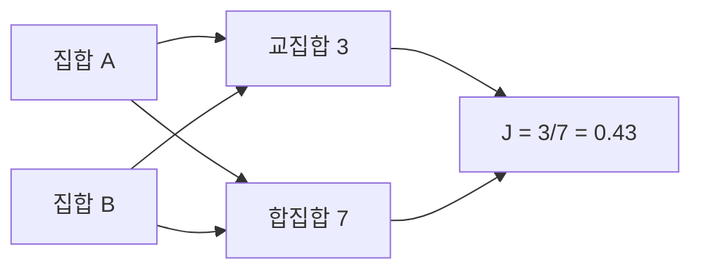
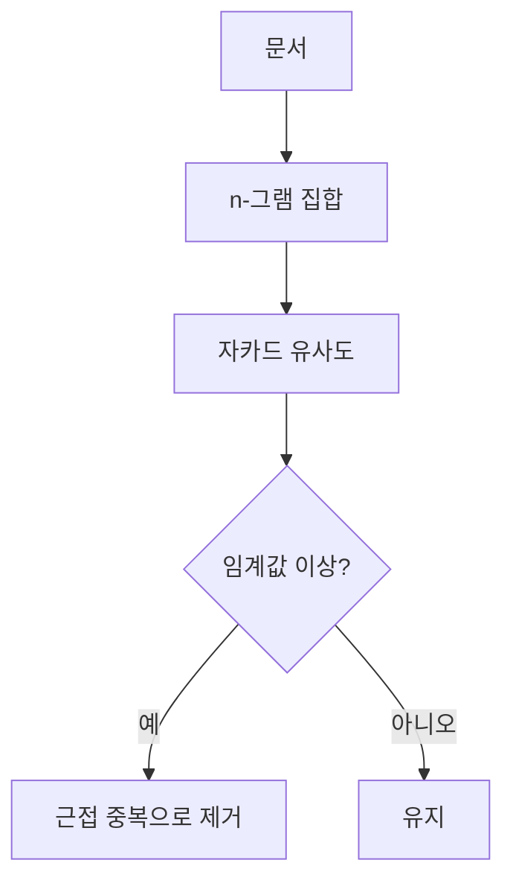

# 자카드 유사도

> 두 집합이 **얼마나 겹치는지**를 `교집합 크기 ÷ 합집합 크기`로 재는 0~1 사이 값이다. 문서를 n-그램 집합으로 바꿔 근접 중복을 찾는 MinHash·LSH가 근사하려는 바로 그 값이다.

## 쉽게 말하면
두 사람이 각자 좋아하는 음식 목록을 적었다. 둘 다 적은 음식이 3개, 둘 중 한 명이라도 적은 음식이 전부 7개면 취향 일치도는 3/7이다. 목록이 길어도 "겹친 비율"만 보므로 크기가 다른 목록끼리도 비교할 수 있다.

## 자세히
- 정의: J(A,B) = |A∩B| / |A∪B|. 같으면 1, 하나도 안 겹치면 0. 거리로 쓰려면 1−J.
- 순서·빈도를 보지 않고 **있다/없다**만 본다. 그래서 문서에는 단어 집합이나 [섀글링](#shingling-ngrams)으로 만든 n-그램 집합을 넣는다.
- scikit-learn `jaccard_score`(문서 확인)는 같은 식을 라벨 집합에 적용한다. 다중 라벨은 `average='micro|macro|weighted|samples'`로 합치고, 양쪽이 모두 비면 0과 경고를 낸다.
- 직접 계산(파이썬): "the cat sat on the mat" vs "the cat lay on the rug" → 교집합 {the,cat,on}=3, 합집합 7, J=0.43. 문자 3-그램으로 "data science" vs "data sciences"는 0.91.
- 한계: 길이 차이가 매우 크면(짧은 글이 긴 글에 포함) J가 작아진다. 의미 유사도는 못 잡는다(어휘가 다르면 0) → 의미는 [임베딩](#text-embedding)이 담당.
- 큰 데이터에서는 모든 쌍의 J를 직접 구하기 어려워 [MinHash·LSH](#minhash-lsh)로 근사한다.

## 그림으로 보기

## 예시
- 학습 데이터 정제: 문서 쌍의 3-그램 J ≥ 0.8이면 중복으로 보고 하나만 남긴다(임계값은 데이터로 조정).
- 다중 라벨 분류 평가: 정답 {고양이, 실내}와 예측 {고양이, 야외}는 J=1/3.
- 교육: "겹치는 부분 ÷ 전체"라는 한 줄로 설명하면 비전공자도 바로 이해한다.

## 헷갈리는 것과 비교
| 개념 | 차이 |
|---|---|
| 자카드 | 집합의 겹침 비율, 빈도 무시 |
| 코사인 유사도 | 벡터 방향 비교, 빈도·가중치 반영 |
| [MinHash·LSH](#minhash-lsh) | 자카드를 빠르게 근사·후보 추리기 |
| 편집 거리 | 문자열을 고치는 횟수, 순서 반영 |

## 더 읽을거리
- [scikit-learn jaccard_score](https://scikit-learn.org/stable/modules/generated/sklearn.metrics.jaccard_score.html) — 정의, 다중 라벨 평균 방식, 0 처리.
