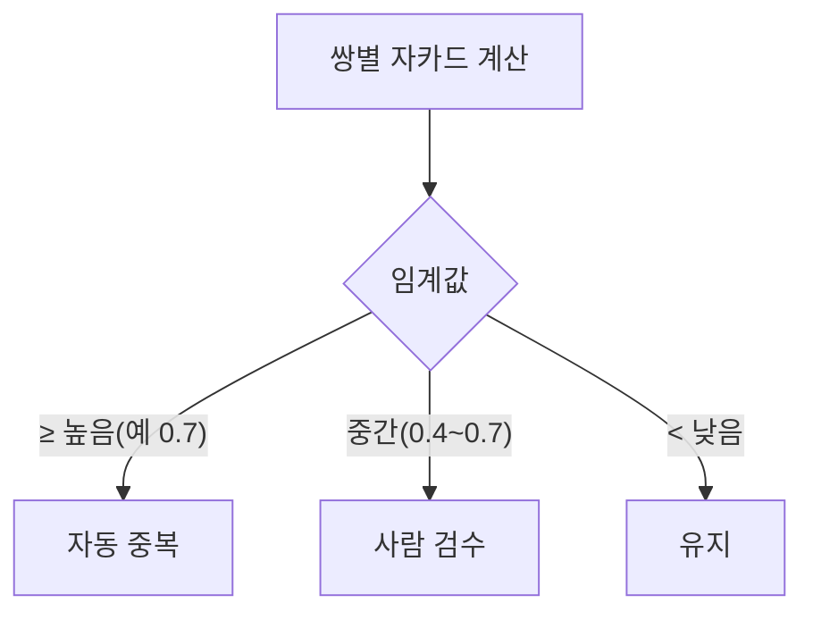
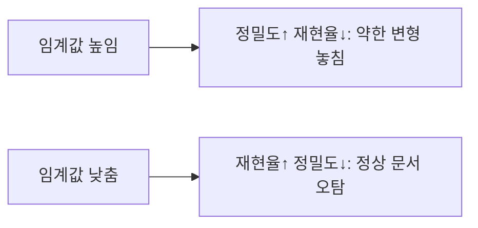

# 자카드 임계값 정하기

> 두 문서가 "중복"인지 판정하는 **자카드 유사도의 기준선**은 정답이 하나가 아니다. 어느 정도 수정까지 중복으로 볼지(요구 재현율)와 무관한 문서를 잘못 묶지 않을지(정밀도)를 **데이터로 조정**한다.

## 쉽게 말하면
시험지 표절 검사에서 "문장 몇 %가 겹치면 표절?"의 기준을 너무 높이면 약간 바꿔 베낀 것을 놓치고, 너무 낮추면 같은 교재에서 인용한 정상 답안까지 잡는다. 기준은 실제 사례로 정한다.

## 자세히
- **직접 시뮬레이션(순수 파이썬)**: 어휘 3,000개에서 무작위로 200단어 문서를 만들고, 원본에서 단어의 p%를 다른 단어로 바꾼 "근사 중복"을 만든 뒤 **단어 3-섀글** 집합의 자카드를 쟀다(문서 200쌍 평균).
  | 바꾼 비율 p | 평균 자카드 | 하위 5%(10번째) | 상위 5% |
  |---|---|---|---|
  | 2% | 0.897 | 0.808 | 0.970 |
  | 5% | 0.754 | 0.650 | 0.859 |
  | 10% | 0.580 | 0.483 | 0.685 |
  | 20% | 0.344 | 0.265 | 0.451 |
  | 30% | 0.208 | 0.148 | 0.286 |
  | 50% | 0.069 | 0.039 | 0.103 |
  **무관한 문서 쌍 500개의 자카드는 모두 0**(최대 0). 단어 한 개를 바꾸면 그 단어를 포함하는 3-섀글 3개가 바뀌므로 p%의 바꿈이 자카드를 훨씬 크게 떨어뜨린다(p=10%에서 0.58).
- **임계값별 탐지율(각 p에서 근사 중복이 임계값 이상인 비율)**
  | 임계값 | p=2% | 5% | 10% | 20% | 30% |
  |---|---|---|---|---|---|
  | 0.3 | 1.00 | 1.00 | 1.00 | 0.81 | 0.01 |
  | 0.5 | 1.00 | 1.00 | 0.91 | 0.01 | 0.00 |
  | 0.7 | 1.00 | 0.80 | 0.04 | 0.00 | 0.00 |
  | 0.8 | 0.94 | 0.26 | 0.00 | 0.00 | 0.00 |
  | 0.9 | 0.47 | 0.01 | 0.00 | 0.00 | 0.00 |
  임계값을 0.8~0.9로 높게 잡으면 **단어 5%만 바뀐 문서도 놓친다**(0.8에서 26%만 탐지). 0.5는 10% 변형까지 91%를 잡으면서 이 합성 데이터의 무관 쌍(0)은 안 잡는다.
- **합성 데이터의 한계**: 실제 문서는 템플릿·상용구·같은 주제 어휘로 **무관한 문서도 자카드가 높다**(위 무관 쌍 0은 무작위 어휘 가정). 실제 임계값은 실제 문서 쌍 표본으로 정해야 한다.
- **조정 절차(권장)**
  1. 사람이 판정한 **중복/비중복 쌍 라벨 표본**(양쪽 각 100~300쌍, 경계 사례 포함)을 만든다.
  2. 임계값을 0.3~0.9로 바꿔 가며 **정밀도·재현율**을 구해 목적에 맞게 고른다(삭제용이면 정밀도 우선, 검수 후보용이면 재현율 우선).
  3. 섀글 크기·전처리(소문자, 공백 정리)에 따라 값이 달라지므로 **고정한 설정으로** 임계값을 정한다([섀글 크기](#shingle-size-choice)).
  4. 경계 구간(예: 0.4~0.7)은 사람 검수로 넘기는 3구간 설계.
  5. 기준을 문서화하고 새 데이터에서 주기적으로 재검증.
- **활용**: 학습 데이터 중복 제거는 모델 평가 누수를 막는다(학습·시험 분리 시 근사 중복 점검).

## 그림으로 보기



## 예시
```python
def shingles(words, k=3): return {tuple(words[i:i+k]) for i in range(len(words)-k+1)}
J = lambda a, b: len(a & b) / len(a | b)
for th in (0.5, 0.7, 0.8):
    pred = [J(shingles(a), shingles(b)) >= th for a, b in pairs]
    print(th, precision(labels, pred), recall(labels, pred))
```
- 사내 FAQ 12만 건에서 사람이 판정한 300쌍으로 임계값 0.6을 고르고 0.45~0.6은 검수 큐로.

## 헷갈리는 것과 비교
| 설정 | 영향 |
|---|---|
| 임계값 | 정밀도·재현율 균형 |
| 섀글 크기 k | 값의 스케일(변형에 민감도) |
| 전처리 | 같은 문서도 값 변화 |
| [자카드 vs 코사인](#jaccard-vs-cosine) | 유사도 선택 |

## 더 읽을거리
- [Wikipedia: Jaccard index](https://en.wikipedia.org/wiki/Jaccard_index) — 자카드 정의(본문 열어 확인). 변형 비율별 표는 이 글의 직접 시뮬레이션(합성 데이터).
