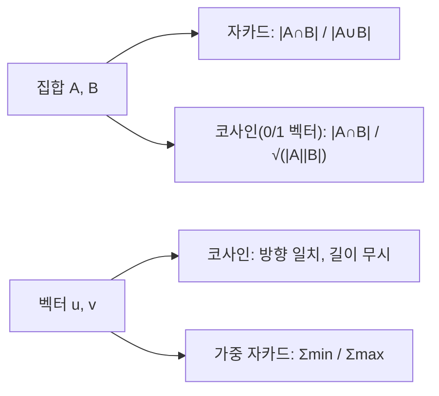
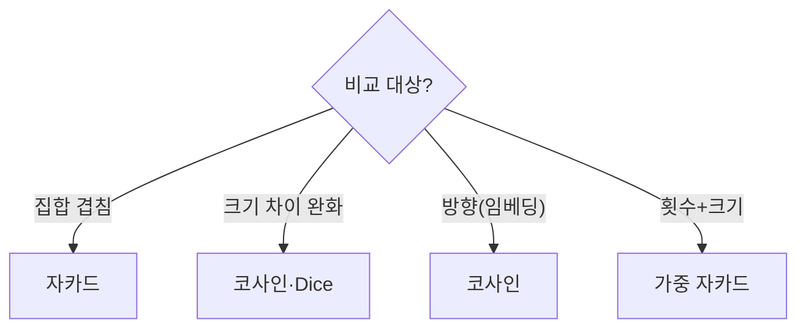

# 자카드 vs 코사인 유사도

> **자카드(Jaccard)** 는 두 **집합의 겹침 비율**(교집합/합집합)이고, **코사인(cosine)** 은 두 **벡터가 가리키는 방향의 일치도**다. 집합이 크기가 다를 때, 반복 횟수가 중요할 때, 정규화가 필요할 때 값이 크게 달라진다.

## 쉽게 말하면
두 사람이 본 영화 목록이 얼마나 겹치는지는 자카드로 본다. 영화를 몇 번씩 봤는지 같은 "횟수 패턴"이 비슷한지는 코사인으로 본다. 한 사람이 영화를 1,000편 봤고 다른 사람이 10편 봤는데 그 10편이 전부 겹치면, 자카드는 낮고 코사인은 중간쯤이다.

## 자세히
(Wikipedia "Jaccard index" 본문 확인)
- **자카드**: J(A,B) = |A∩B| / |A∪B|, 범위 0~1(공통 원소 없음 0, 같으면 1). 자카드 거리 1−J는 모든 유한 집합 위의 **거리(metric)** 다. 예: A={1,2,3}, B={2,3,4,5} → 교집합 2, 합집합 5 → J=0.4, 거리 0.6.
- **가중 자카드(Ruzicka)**: 음이 아닌 벡터에서 원소별 **최솟값의 합 ÷ 최댓값의 합**. 0/1이면 일반 자카드. x=(2,0,1), y=(1,3,1) → 2/6≈0.333.
- **Tanimoto**: 여러 분야에서 자카드와 동의어(비트맵 형태). 벡터식 A·B/(‖A‖²+‖B‖²−A·B)는 비트 벡터에서만 자카드와 같고 일반 벡터에서는 1−식이 삼각 부등식을 깰 수 있다.
- **Dice와의 관계**: J = S/(2−S), S = 2J/(1+J). 위 예에서 Dice 0.571.
- **코사인**: cos(u, v) = u·v / (‖u‖·‖v‖), **방향의 일치**만 보고 벡터의 **길이는 무시**한다. 집합을 0/1 벡터로 보면 cos = |A∩B| / √(|A|·|B|).
- **직접 계산한 비교**
  | 상황 | 자카드 | 코사인 | Dice |
  |---|---|---|---|
  | A={a,b,c,d}, B={c,d,e} | 0.400 | 0.577 | 0.571 |
  | A=10개, B=1,000개(A⊂B) | **0.010** | 0.100 | 0.020 |
  | 횟수 벡터 u=(3,0,1,0), v=(6,0,2,0) | 가중 Ruzicka = 0.500 | **1.000** | - |
  (마지막 행의 Ruzicka: 최솟값 합 4, 최댓값 합 8 → 0.5; 벡터식 Tanimoto는 0.667.) 크기가 매우 다른 집합이 포함 관계일 때 자카드는 0.01로 크게 낮다. 코사인은 0.10, Dice는 0.02다. 횟수 벡터가 **비례**하면 코사인은 1(방향 동일)인데 가중 자카드는 0.5(양이 다름).
- **선택 가이드(권장)**
  | 데이터·목적 | 권장 |
  |---|---|
  | 집합 겹침(태그, 이웃 집합, 중복 문서 shingle) | 자카드 |
  | 크기 차이를 덜 벌주고 싶음 | 코사인·Dice |
  | 빈도·임베딩 방향 비교(텍스트 임베딩) | 코사인 |
  | 반복 횟수 중요, 크기도 중요 | 가중 자카드 |
  | 거리 공리(metric)가 필요 | 자카드 거리 |
- **데이터 품질에서의 용도**: 중복·근사 중복 탐지(MinHash는 자카드 근사), 두 실행의 하위 k% 집합 겹침([가치 순위 안정성](#valuation-ranking-stability))에는 자카드, 문서·이미지 임베딩 유사도에는 코사인([임베딩 가치 평가](#embedding-space-valuation)).

## 그림으로 보기



## 예시
```python
import math
def jaccard(A, B): return len(A & B) / len(A | B)
def cosine_set(A, B): return len(A & B) / math.sqrt(len(A) * len(B))
A, B = set(range(10)), set(range(1000))
print(jaccard(A, B), cosine_set(A, B))      # 0.01, 0.1
```
- 두 문서의 단어 집합이 얼마나 겹치는지는 자카드, 두 문서 임베딩의 의미 유사도는 코사인.

## 헷갈리는 것과 비교
| 지표 | 입력 | 크기 차이 민감도 |
|---|---|---|
| 자카드 | 집합 | 큼 |
| Dice | 집합 | 중간 |
| 코사인(집합) | 0/1 벡터 | 중간 |
| 코사인(벡터) | 실수 벡터 | 길이 무시 |

## 더 읽을거리
- [Wikipedia: Jaccard index](https://en.wikipedia.org/wiki/Jaccard_index) — 정의·가중 자카드·Dice 관계·Tanimoto 주의(본문 열어 확인). 비교표 수치는 이 글의 직접 계산.
