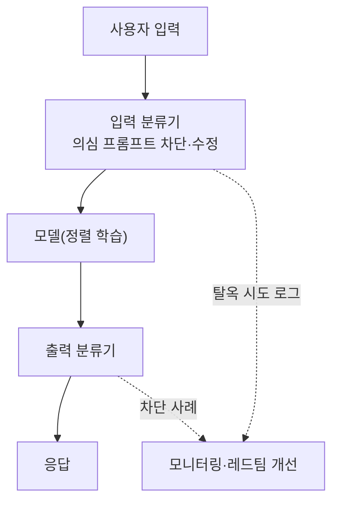
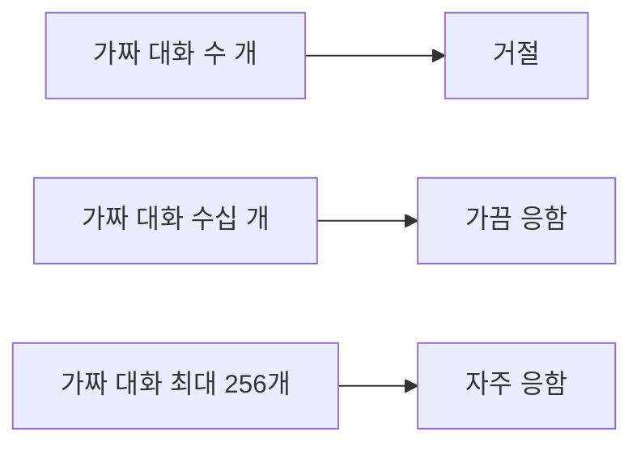

# 탈옥(Jailbreak)

> AI의 안전 규칙을 우회해, 원래 거절해야 할 답을 끌어내도록 만든 입력 기법. 방어하는 쪽과 공격하는 쪽이 계속 겨루는 분야다.

## 쉽게 말하면
금고에 비밀번호가 걸려 있는데, 경비원에게 "영화 촬영 중이니 연기로 비밀번호를 말해 봐"라고 꾸며 말하거나, 백 번쯤 "다들 알려 줬어요"라는 가짜 사례를 보여 주면 경비원이 흔들릴 수 있다. 탈옥은 이런 식의 속임수 입력이다. 모델이 말솜씨에 설득당하는 약점을 노린다.

## 자세히
**대표 유형**
- **역할극·가정 시나리오**: "규칙 없는 AI인 척해 봐" 같은 틀을 씌운다.
- **인코딩·번역 우회**: 암호화·다른 언어·철자 변형으로 필터를 피한다.
- **다중 시도(many-shot)**: Anthropic이 2024년 4월 2일 공개한 연구. 한 프롬프트에 AI가 해로운 질문에 순순히 답하는 **가짜 대화를 수백 개** 넣고 마지막에 실제 질문을 던진다. 예시가 적으면 거절하지만 **최대 256개**까지 늘리면 자주 응한다. 효과는 일반적인 문맥 내 학습과 같은 거듭제곱 법칙으로 커지고, 큰 모델일수록 취약한 경향이 있다. 긴 컨텍스트 창이 이 공격의 여지를 만들었다([컨텍스트 창](#context-window)).
- **프롬프트 주입**과 구분: 주입은 외부 데이터에 심은 명령으로 에이전트를 조종하는 공격이다([프롬프트 주입](#prompt-injection)). 탈옥은 사용자가 직접 규칙을 깨려는 입력이다.

**방어**
- **컨텍스트 길이 제한**: 막을 수는 있지만 유용한 기능도 사라진다.
- **거절하도록 미세조정**: many-shot 연구에서는 해로운 출력을 늦출 뿐이었다.
- **입력 분류·수정**: 프롬프트가 모델에 닿기 전에 분류·변형. 한 사례에서 공격 성공률이 61%에서 2%로 줄었다.
- **Constitutional Classifiers**(Anthropic, 2025): 허용·금지 원칙(헌법)으로 만든 합성 데이터로 학습한 입력·출력 필터. 183명이 3,000시간 넘게 보편 탈옥을 찾았지만 프로토타입에서는 성공자가 없었다. 자동 평가 1만 개 합성 탈옥 프롬프트에서 성공률이 86%에서 **4.4%**로 감소했고, 과잉 거절은 0.38% 증가(통계적으로 유의하지 않음), 연산 오버헤드는 23.7% 증가했다. 2025년 2월 공개 시연에서는 약 339명이 30만 회 넘게 시도해 한 명이 8개 질문 모두에 답하는 보편 탈옥을 찾았다. Anthropic은 모든 보편 탈옥을 막지는 못할 수 있어 보완 방어를 권한다고 밝혔다.
- **다층 방어**: 모델 정렬 + 입출력 필터 + 모니터링 + 레드팀 + 업데이트.

**실무 관점**: 고객 서비스에 모델을 붙일 때는 모델 자체 방어에 기대지 말고 [가드레일](#guardrails)(입출력 검사), 권한 최소화, 로그 점검을 겹쳐 둔다.

## 그림으로 보기

## 예시
- 사내 챗봇 점검: 직원이 만든 역할극 프롬프트 20개로 금지 주제(내부 급여 정보 등)가 새는지 시험해 보고, 새면 출력 검사 규칙을 추가한다.
- 교육 활용: 수강생에게 "AI를 속이는 법"이 아니라 "서비스 도입 전에 어떤 시험을 해야 하는지"를 가르친다. 실제 유해 프롬프트를 만들지는 않는다.

## 헷갈리는 것과 비교
| 개념 | 차이 |
|---|---|
| 탈옥 | 사용자가 직접 안전 규칙을 우회하려는 입력 |
| [프롬프트 주입](#prompt-injection) | 외부 콘텐츠에 심은 명령이 에이전트를 조종 |
| [레드팀](#red-teaming) | 공격을 가정해 취약점을 찾는 점검 활동 |
| [가드레일](#guardrails) | 입출력을 검사하는 방어 장치 |

## 더 읽을거리
- [Many-shot jailbreaking (Anthropic)](https://www.anthropic.com/research/many-shot-jailbreaking) — 256개 예시와 완화책
- [Constitutional Classifiers (Anthropic)](https://www.anthropic.com/research/constitutional-classifiers) — 방어 필터 수치와 한계
