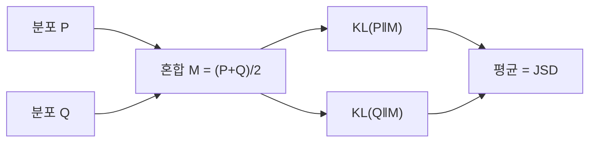
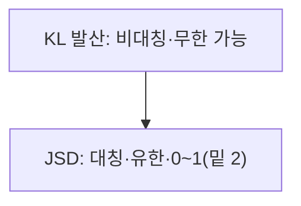

# 젠슨-섀넌 발산

> 두 확률분포가 **얼마나 다른지** 재는 대칭적이고 값이 유한한 지표다. KL 발산을 평균 분포와의 비교로 매끄럽게 만든 것으로, 로그 밑이 2이면 값이 0~1 사이다. 숫자형·범주형 특징의 분포 변화 감지에 쓰인다.

## 쉽게 말하면
두 사람의 입맛(분포)이 얼마나 다른지 비교하려고 둘의 "중간 입맛"을 만든 다음, 각자가 중간에서 얼마나 떨어져 있는지 평균 낸다. 어느 쪽을 기준으로 삼든 값이 같고, 한쪽이 한 번도 안 먹은 음식이 있어도 계산이 무너지지 않는다.

## 자세히
(Wikipedia의 Jensen–Shannon divergence 문서와 BigQuery `ML.TFDV_VALIDATE`, TFDV 문서를 직접 읽었다. 숫자 예는 이 지도의 가상 분포에 대해 정의대로 직접 계산하고 파이썬으로 검증했다.)
- **정의(Wikipedia)**: 분포 P, Q와 혼합 분포 M = ½(P + Q)에 대해 **JSD(P‖Q) = ½·D(P‖M) + ½·D(Q‖M)**. D는 KL 발산이며, JSD는 KL의 대칭화·평활화 버전이다.
- **성질(Wikipedia)**: ① **대칭** — P와 Q를 바꿔도 같다 ② **유계** — 밑 2 로그면 0~1, 자연로그면 상한이 ln 2 ③ **항상 유한** — KL 발산과 달리 ④ 제곱근(Jensen–Shannon distance)은 **거리 함수(metric)**. 0에 가까울수록 비슷하다.
- **직접 계산(가상 분포 P=[0.6, 0.3, 0.0, 0.1], Q=[0.5, 0.3436, 0.0064, 0.15])**
  - JSD(밑 2) ≈ **0.01118**, 순서를 바꿔도 같다(대칭). 자연로그로는 약 0.00775. 제곱근은 약 0.1057.
  - **KL 발산과의 차이**: KL(P‖Q)는 약 0.0406이지만 KL(Q‖P)는 P가 0인 칸(세 번째)에서 Q가 0이 아니라 **0으로 나누게 되어 정의되지 않는다**(구현에서 오류). JSD는 혼합 분포 M을 거치므로 이런 문제가 없다.
  - 서로 겹치지 않는 분포 A=[1,0], B=[0,1]는 JSD(밑 2)=**1.0**, 자연로그면 0.693(=ln 2). 같은 분포는 0.
- **TFDV·BigQuery에서의 사용(문서)**: TFDV는 `skew_comparator`·`drift_comparator`에 `jensen_shannon_divergence` 임계값을 지정하면 **숫자형·범주형 모두** 감지한다(L-infinity는 범주형만). BigQuery `ML.TFDV_VALIDATE`는 범주형에 L-infinity(기본) 또는 JS, **숫자형은 JS만** 쓰고 기본 임계값은 0.3(범위 [0,1)), 열별로 덮어쓸 수 있다. 어떤 로그 밑을 쓰는지는 읽은 문서에 적혀 있지 않았다. 밑에 따라 스케일이 달라지므로 임계값을 옮길 때 주의한다.
- **숫자형에는 구간화가 필요(일반 원칙, 문서 설명 아님)**: 연속값 분포를 비교하려면 구간(bin)으로 나눠 확률 벡터를 만든다. 구간 수와 경계가 결과에 영향을 준다.
- **한계(해석)**: 분포 전체의 차이를 하나의 숫자로 압축하므로 "어느 범주가 변했는지"는 알려 주지 않는다. 그런 정보는 [L∞ 거리](#l-infinity-norm-categorical) 같은 지표가 준다.

## 그림으로 보기



## 예시
```python
import math
def kl(p, q): return sum(a*math.log2(a/b) for a, b in zip(p, q) if a > 0)
def js(p, q):
    m = [(a+b)/2 for a, b in zip(p, q)]
    return 0.5*kl(p, m) + 0.5*kl(q, m)
js([0.6,0.3,0.0,0.1],[0.5,0.3436,0.0064,0.15])   # 약 0.01118
```
- 교육 소재: "거리 하나로 두 분포의 닮은 정도를 말하기".

## 헷갈리는 것과 비교
| 지표 | 대칭 | 유계 | 비고 |
|---|---|---|---|
| Jensen–Shannon | 예 | 예(밑 2: 0~1) | 숫자·범주형에 적용 |
| KL 발산 | 아니오 | 아니오 | 0 확률 칸에서 무한·미정의 가능 |
| [L∞ 거리](#l-infinity-norm-categorical) | 예 | 예(0~1) | 가장 큰 범주 차이 |
| [skew vs drift](#skew-vs-drift) | — | — | 비교 대상의 구분 |

## 더 읽을거리
- [Jensen–Shannon divergence (Wikipedia)](https://en.wikipedia.org/wiki/Jensen%E2%80%93Shannon_divergence) — 정의·성질(직접 읽음).
- [ML.TFDV_VALIDATE (BigQuery)](https://docs.cloud.google.com/bigquery/docs/reference/standard-sql/bigqueryml-syntax-tfdv-validate) — 숫자형은 JS만, 기본 임계값 0.3(직접 읽음).
