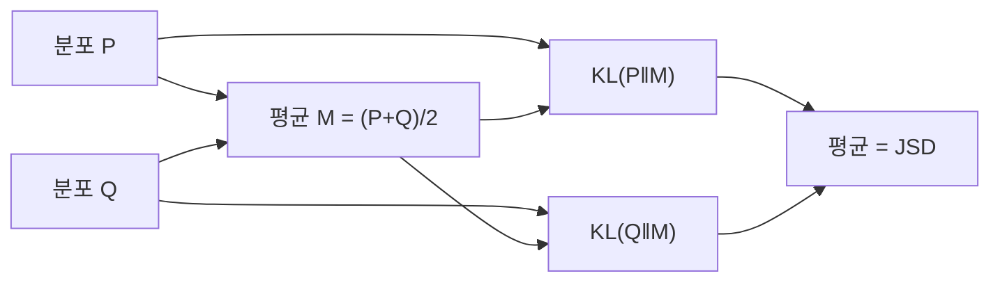

# JS 발산

> Jensen–Shannon 발산(JSD)은 두 분포를 각각 평균 분포와 비교해 KL을 대칭·유한하게 만든 값이다. 0에서 시작하며 base 2 로그에서는 최대 1이다.

## 쉽게 말하면
KL은 "A의 눈으로 B를 보면 얼마나 놀라나"라서 A→B와 B→A가 다르다. JS는 두 사람 사이의 중간 지점을 정하고, 각자 그 중간 지점이 얼마나 낯선지 평균 낸다. 순서를 바꿔도 같은 값이다.

## 자세히
- 정의(Wikipedia): JSD(P‖Q) = ½·KL(P‖M) + ½·KL(Q‖M), M = ½(P+Q). 일반형은 H(M) − Σπᵢ·H(Pᵢ).
- 성질: 대칭, 항상 유한(KL은 무한대 가능), 범위 0 ≤ JSD ≤ 1(base 2; base e면 ln 2). 제곱근은 거리(metric)가 되어 JS distance라 부른다.
- 한쪽 분포가 0인 곳에서 KL은 폭발하지만 JSD는 안정적이다.
- 원조 GAN 논문(Goodfellow 외, 2014)은 최적 판별기에서 생성기 손실이 JSD와 관련된다고 보인다(이 글의 출처는 인용만 확인, 세부 유도는 논문 참고).

## 그림으로 보기

## 예시
- 두 문서의 단어 분포를 비교해 유사도로 쓴다.
- 모델 출력이 바뀌었는지 모니터링할 때, 0 확률이 섞여도 값이 터지지 않는다.

## 헷갈리는 것과 비교
| 개념 | 차이 |
| --- | --- |
| [KL 발산](#kl-divergence) | 비대칭, 무한대 가능 |
| JS 발산 | 대칭, 유한, 범위 있음 |
| JS 거리 | JSD의 제곱근, 진짜 거리 |

## 더 읽을거리
- [Jensen–Shannon divergence (Wikipedia)](https://en.wikipedia.org/wiki/Jensen%E2%80%93Shannon_divergence) — 정의와 성질
