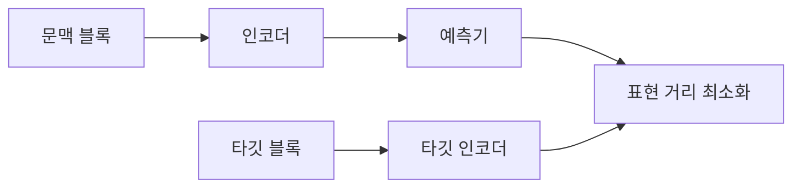
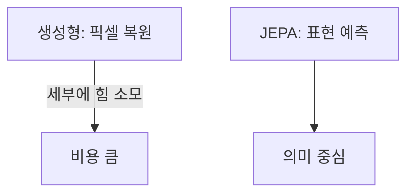

# JEPA

> **JEPA(Joint-Embedding Predictive Architecture)** 는 픽셀 자체를 복원하지 않고, **표현(잠재) 공간에서 가려진 부분을 예측**하는 자기지도 학습 구조다. 얀 르쿤이 제안한 월드 모델 방향의 핵심 부품이다.

## 쉽게 말하면
그림 한 귀퉁이를 가리고 "거기 뭐가 있을지"를 맞히되, 붓질 하나하나가 아니라 "나무가 있다"처럼 **의미**를 맞히게 하는 방식이다. 세부 픽셀에 힘을 빼지 않으니 효율적이고 본질을 배운다는 생각이다.

## 자세히
(I-JEPA, Assran 외, arXiv 2301.08243 초록 확인)
- **비생성형** 자기지도 학습: 한 장의 이미지에서 **문맥 블록 하나**를 보고 같은 이미지의 여러 **타깃 블록의 표현**을 예측한다.
- 핵심은 마스킹: 타깃 블록은 의미를 담을 만큼 커야 하고, 문맥 블록은 공간적으로 넓게 퍼져야 한다.
- **수작업 데이터 증강 없이** 의미 있는 특징을 배운다.
- ViT와 결합해 잘 확장된다: ViT-Huge/14를 ImageNet에서 A100 16장으로 72시간 미만에 학습, 선형 분류·객체 세기·깊이 예측에서 강한 성능을 보고했다.
- 영상·월드 모델로의 확장(V-JEPA 등)은 이 글에서 확인하지 않았다.

## 그림으로 보기

## 예시
- 사진 데이터에서 라벨 없이 특징을 학습한 뒤 적은 라벨로 분류기를 얹는 사전학습 용도.

## 헷갈리는 것과 비교
| 개념 | 차이 |
|---|---|
| JEPA | 잠재 공간 예측, 비생성형 |
| MAE | 가려진 픽셀 복원(일반 지식) |
| 확산 모델 | 픽셀 생성 |
| [플로 매칭](#flow-matching) | 생성 모델 학습법 |

## 더 읽을거리
- [I-JEPA](https://arxiv.org/abs/2301.08243) — 논문 초록.
