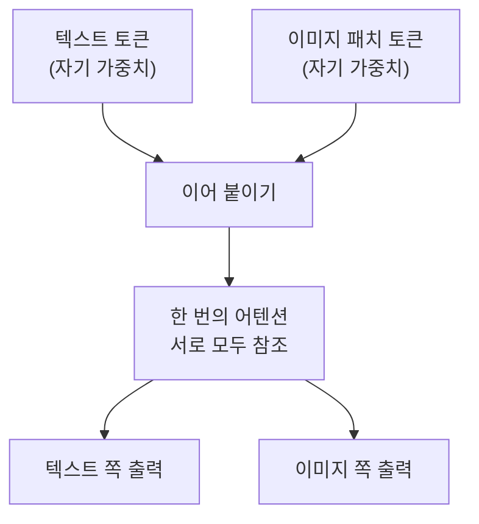
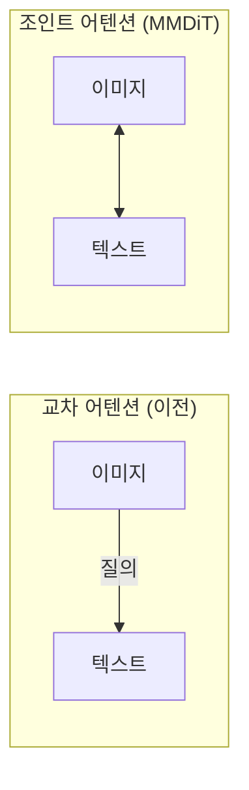

# 조인트 어텐션(Joint Attention)

> 글 토큰과 이미지 토큰을 한 줄로 이어 붙인 뒤, 한 번의 어텐션에서 서로를 모두 바라보게 하는 방식. Stable Diffusion 3의 MMDiT가 쓰며, 글 이해와 글자 그리기 품질을 높였다고 보고됐다.

## 쉽게 말하면
이전 방식(교차 어텐션)은 화가가 주문서를 가끔 슬쩍 들여다보는 구조였다. 조인트 어텐션은 주문서 내용과 캔버스 조각을 한 테이블에 함께 펼쳐 놓고, 서로 필요할 때마다 양방향으로 참고하는 구조다. 그림이 글을 참고하는 것은 물론 글도 그림의 진행 상황에 맞춰 조정된다.

## 자세히
- **출처**: "Scaling Rectified Flow Transformers for High-Resolution Image Synthesis"(Esser 외, arXiv 2403.03206, 2024년 3월, Stable Diffusion 3 논문). 텍스트-이미지 트랜스포머가 **두 모달리티에 별도의 가중치**를 쓰면서 이미지와 텍스트 토큰 사이에 **양방향 정보 흐름**을 허용해 텍스트 이해·글자(타이포그래피)·사람 선호 평가를 개선했다고 저자들은 보고한다. 이 구조를 MMDiT라 부른다.
- **작동**: 이미지 조각(패치) 토큰과 텍스트 토큰을 각각 자기 가중치로 쿼리·키·값으로 만든 뒤, 두 시퀀스를 이어 붙여 하나의 어텐션을 계산하고 결과를 다시 각 모달리티로 나눠 자기 가중치로 처리한다. 모달리티마다 다른 가중치를 쓰는 이유는 글과 이미지 특징의 통계가 다르기 때문이다(개념 설명).
- **교차 어텐션과 차이**: 기존 잠재 확산 모델(UNet)은 이미지가 글에 질의하는 단방향 교차 어텐션이었다. 조인트 어텐션은 글 토큰도 이미지 토큰에서 정보를 받는다.
- **정류 흐름(rectified flow)**: 같은 논문은 데이터와 노이즈를 직선으로 잇는 방식의 학습에서 노이즈 샘플링을 지각적으로 중요한 규모 쪽으로 치우치게 해 기존 확산 공식보다 낫다고 보였다. 검증 손실이 낮을수록 이미지 품질 지표와 인간 평가가 좋아지고 규모 확장 경향이 예측 가능하다고 한다.
- **SD3 구성(Hugging Face diffusers 문서)**: 텍스트 인코더 3개(CLIP ViT-L, OpenCLIP bigG, T5-XXL), MMDiT 트랜스포머, 흐름 매칭 스케줄러, VAE. T5-XXL은 4.7B 매개변수라 24GB 미만 GPU에서는 무겁고, 추론 시 T5를 빼면 메모리를 크게 줄이는 대신 성능이 약간 떨어진다. 문장 전체 요약 벡터(pooled 임베딩)는 CLIP 쪽에서 나오며 [풀링 텍스트 임베딩](#pooled-text-embedding)으로 조건을 준다. T5의 기본 최대 길이는 256토큰이며 CLIP은 77토큰 제한이 있다.
- **계보**: SD3 계열 외에도 FLUX 등 최신 이미지 모델이 변형된 형태를 쓴다([FLUX 구조](#flux-architecture)).

## 그림으로 보기




## 예시
- 프롬프트 "a photo of a cat holding a sign that says hello world"(diffusers 문서 예시)에서 간판의 글자를 정확히 쓰는 능력이 조인트 어텐션 구조의 강점으로 설명된다.
- 간단한 사용:
```python
from diffusers import StableDiffusion3Pipeline
pipe = StableDiffusion3Pipeline.from_pretrained(
    "stabilityai/stable-diffusion-3-medium-diffusers", dtype=torch.float16)
image = pipe("a cat holding a sign that says hello world",
             num_inference_steps=28, guidance_scale=7.0).images[0]
```
(모델은 접근 승인이 필요한 게이트 모델)

## 헷갈리는 것과 비교
| 개념 | 차이 |
|---|---|
| 교차 어텐션 | 이미지가 글을 참조하는 단방향 |
| 조인트 어텐션 | 글·이미지 토큰을 합쳐 양방향 참조 |
| [MMDiT](#mmdit) | 조인트 어텐션을 쓰는 확산 트랜스포머 구조 |
| [CLIP 텍스트 인코더](#clip-text-encoder) | 글을 벡터로 바꾸는 부품. SD3는 CLIP 둘과 T5를 함께 씀 |

## 더 읽을거리
- [Scaling Rectified Flow Transformers (arXiv 2403.03206)](https://arxiv.org/abs/2403.03206) — SD3와 MMDiT 원 논문
- [Stable Diffusion 3 (Hugging Face diffusers)](https://huggingface.co/docs/diffusers/api/pipelines/stable_diffusion/stable_diffusion_3) — 구성·메모리 최적화·코드
