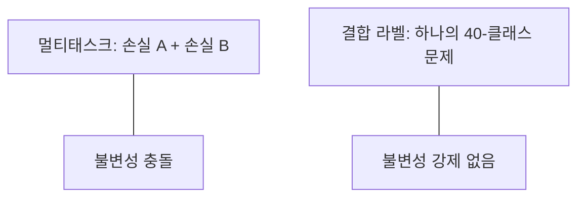

# 결합 라벨 분포

> 자기지도 라벨 증강(SLA)에서 **원래 클래스 라벨과 변환 라벨의 모든 조합을 하나의 라벨 공간으로 만들어 한 번에 맞히게 하는** 방식이다. 예를 들어 CIFAR-10(10개)에 회전(4개)을 더하면 10×4 = 40개 클래스가 된다.

## 쉽게 말하면
"이 사진은 고양이"만 묻는 대신 "이 사진은 **90도 돌린 고양이**"까지 하나의 정답으로 묻는다. 정답 칸이 40개로 늘어나지만, 모델은 "회전해도 같은 고양이"라고 억지로 배우지 않아도 된다.

## 자세히
- 출처: Lee, Hwang, Shin, *Self-supervised Label Augmentation via Input Transformations*(ICML 2020, arXiv 1910.05872v2)을 PDF로 읽었다.
- 아이디어: 기존에는 원래 과제와 자기지도 과제(회전 예측)의 **손실을 두 개로 더하는(멀티태스크)** 방식이었다. 논문은 이를 두 과제가 아니라 "결합 분포에 대한 단일 과제"로 바꾼다. 결합 라벨 y = (i, j) ∈ [N]×[M]을 한 정수 `y = M×i + j`로 쓰고, N은 원래 클래스 수, M은 변환 종류 수다.
- 장점(논문 주장): 변환에 대한 불변성을 강제하지 않아 원래 과제의 학습이 쉬워진다. 멀티태스크는 "회전과 상관없이 같은 클래스"라는 제약과 "회전을 구분하라"는 목표가 부딪친다.
- 구현(논문 부록 E의 Listing 1 요약): 배치의 각 이미지를 `torch.rot90(inputs, k, (2,3))`로 k=0..3 회전해 4배로 늘리고, 타깃은 `targets*4 + k`로 바꿔 일반 교차엔트로피로 학습한다. 코드가 몇 줄 안 된다.
- 결과(논문 Table 1, 분류 정확도 %, 단일 추론 SLA+SI): 기준선 vs 회전을 일반 증강으로 쓴 경우(DA) vs 멀티태스크(MT) vs SLA — CIFAR-10 92.39 / 90.44 / 90.79 / **92.50**, CIFAR-100 68.27 / 65.73 / 66.10 / **68.68**, tiny-ImageNet 63.11 / 60.21 / 58.04 / **63.99**. 즉 **회전을 그냥 증강으로 쓰거나 멀티태스크로 쓰면 오히려 정확도가 떨어졌고**, 결합 라벨로 쓰면 소폭 올랐다(작은 모델·표 기준).
- 한계: 회전처럼 이미지의 의미를 바꾸는 변환은 객체 정렬이 중요한 데이터(문자·위성 등)에서 영향이 다를 수 있다(추정). 출력 클래스가 M배라 헤드가 커진다. 추론 시 집계 방식은 [집계 추론](#aggregated-inference)에서 다룬다.

## 그림으로 보기



## 예시
```python
inputs = torch.stack([torch.rot90(x, k, (2, 3)) for k in range(4)], 1).view(-1, 3, 32, 32)
targets = torch.stack([t * 4 + k for k in range(4)], 1).view(-1)
```
- 교육: "라벨을 늘려서 데이터를 늘린다"는 발상 소개.

## 헷갈리는 것과 비교
| 개념 | 차이 |
|---|---|
| 결합 라벨(SLA) | 원래×변환 조합을 하나의 라벨로 |
| 멀티태스크 | 두 과제의 손실을 합산 |
| 일반 증강 | 변환 후에도 원래 라벨 유지 |
| [집계 추론](#aggregated-inference) | 변환별 예측을 합쳐 추론 |

## 더 읽을거리
- [Self-supervised Label Augmentation via Input Transformations (arXiv 1910.05872)](https://arxiv.org/abs/1910.05872) — 초록·1~3장·부록 E(읽음).
