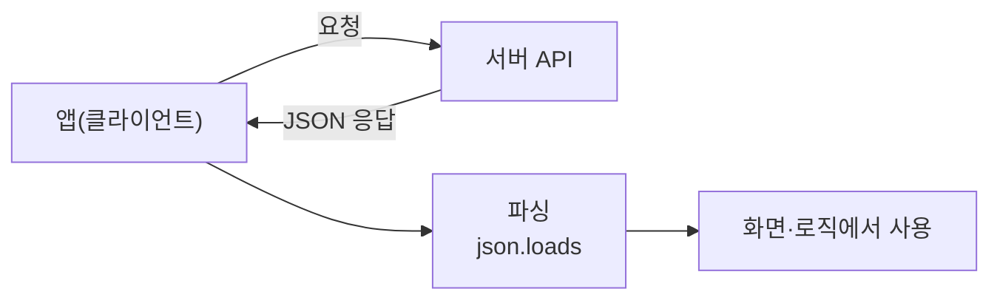
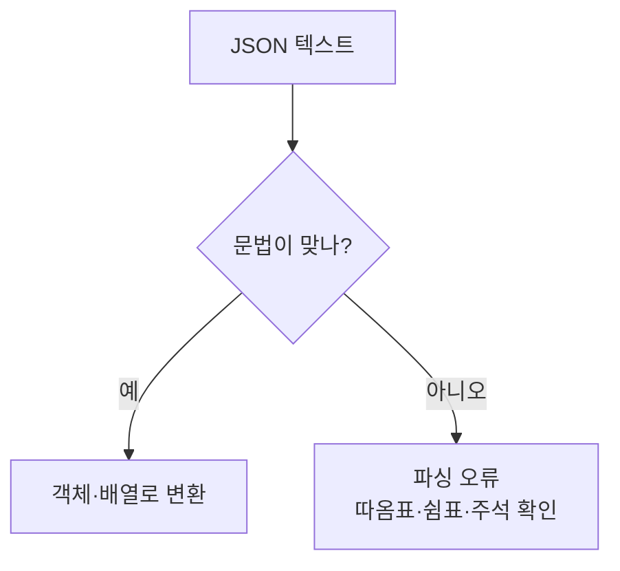

# JSON

> **키-값 쌍과 목록으로 데이터를 적는 텍스트 형식.** API가 데이터를 주고받는 가장 흔한 방식이고, AI에게 "JSON으로 답해 줘"라고 시켜 프로그램이 바로 읽게 만드는 데도 쓴다. 문법이 엄격해서 **따옴표·쉼표 하나만 틀려도 통째로 읽히지 않는다.**

## 쉽게 말하면
회사 서식 문서처럼 "이름: 책, 가격: 12000" 같은 항목을 정해진 모양의 표로 적는 것이다. 사람이 읽기도 쉽고, 프로그램도 같은 모양이면 바로 읽는다. 대신 서식 규칙(큰따옴표 등)을 어기면 접수 거부된다.

## 자세히
- **구성 요소**: 객체 `{ "키": 값 }`, 배열 `[ 값, 값 ]`, 문자열 `"…"`(큰따옴표만), 숫자, `true`/`false`, `null`.
- **직접 실행**(Python 3 `json` 모듈): 아래 입력의 결과.

| 입력 | 결과 |
|---|---|
| `{"name":"책","price":12000,"tags":["ai","공부"],"stock":null,"ok":true}` | 정상(객체로 읽힘) |
| `{'name':'책'}` (작은따옴표) | 오류: 속성 이름은 큰따옴표여야 함 |
| `{"a":1,}` (마지막 쉼표) | 오류: 객체 끝의 쉼표 불가 |
| `{name:"책"}` (키에 따옴표 없음) | 오류 |
| `{"a":1 // x }` (주석) | 오류: JSON에는 주석이 없다 |
| `{"a":None}` (파이썬 None) | 오류: JSON은 `null` |

- **자주 하는 실수**: 작은따옴표, 마지막 쉼표, 주석, `None`/`True`(파이썬 표기)를 그대로 씀. AI가 만든 JSON 응답이 앞뒤에 설명 문장이나 코드 펜스(```)를 붙여 파싱 실패하는 경우도 흔하다.
- **한글 처리**: `json.dumps`는 기본적으로 한글을 `\uXXXX`로 바꾼다(위 실행 결과 `"책"`). 사람이 읽을 형태로 저장하려면 `ensure_ascii=False`를 쓴다.
- **AI와 쓰기**: ① "JSON만 출력, 설명 금지", ② 필드 이름·형식 예시 제공, ③ 받은 뒤 **반드시 파싱·검증**(스키마 검사), ④ 실패 시 재시도. 일부 API는 구조화 출력(스키마 강제) 기능을 제공한다(제공사 문서 확인).
- 한계: JSON은 날짜 형식, 큰 정수 정밀도, 순서 보장 등을 직접 정해 주지 않는다. 설정 파일에는 주석이 되는 다른 형식(YAML·TOML)도 쓰인다.

## 그림으로 보기



## 예시
```json
{
  "name": "책",
  "price": 12000,
  "tags": ["ai", "공부"],
  "stock": null,
  "ok": true
}
```
```python
import json
data = json.loads(text)                       # 문자열 → 파이썬 객체
print(json.dumps(data, ensure_ascii=False, indent=2))   # 사람이 읽기 좋게
```
- 프롬프트: "다음 회의록에서 {담당자, 마감일, 할 일} 배열을 JSON으로만 출력해. 설명 문장은 쓰지 마."

## 헷갈리는 것과 비교
| 개념 | 차이 |
|---|---|
| JSON | 엄격한 데이터 교환 형식, 주석 없음 |
| 파이썬 딕셔너리 | 파이썬 코드 안의 자료 구조(작은따옴표·None 가능) |
| YAML·TOML | 설정 파일용, 주석 가능 |
| [HTTP 요청과 상태 코드](#http-basics) | JSON이 실려 오가는 통로 |

## 더 읽을거리
- [json.org: Introducing JSON](https://www.json.org/json-en.html) — 문법 정의.
- [MDN: Working with JSON](https://developer.mozilla.org/en-US/docs/Learn_web_development/Core/Scripting/JSON) — 입문 설명.
