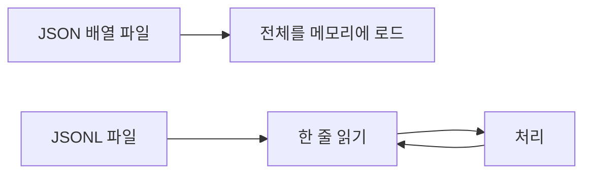

# JSON Lines

> 한 줄에 JSON 값 하나씩 적는 텍스트 형식(.jsonl). 파일을 통째로 읽지 않고 한 줄씩 처리할 수 있어 로그·학습 데이터에 널리 쓰인다.

## 쉽게 말하면
JSON 배열이 "한 권짜리 책"이라면 JSON Lines는 "카드 상자"다. 카드를 한 장씩 꺼내 읽고, 새 카드는 맨 뒤에 꽂기만 하면 된다.

## 자세히
jsonlines.org 사양 기준:
- 인코딩은 UTF-8, **BOM(U+FEFF) 금지**.
- 각 줄은 유효한 JSON 값 하나(보통 객체). 빈 줄은 유효하지 않다.
- 줄 끝은 `\n`(`\r\n`도 가능). 마지막 줄 종결자는 권장이지만 선택.
- 확장자 `.jsonl`, 압축은 `.jsonl.gz`·`.jsonl.bz2`. MIME `application/jsonl`은 아직 표준화되지 않았다.
- 용도: 로그, 스트리밍 처리, Unix 도구·파이프, 프로세스 간 메시지 전달.
- 장점: 추가(append)가 쉽고, 한 줄이 깨져도 나머지를 읽을 수 있으며, 메모리를 적게 쓴다. 단점: 전체가 하나의 JSON이 아니므로 일반 JSON 파서로는 못 읽는다.
- AI 쪽: 파인튜닝·배치 추론 데이터, 평가 결과, 에이전트 실행 로그가 `.jsonl`로 흔히 저장된다.

## 그림으로 보기


## 예시
```
{"role":"user","text":"안녕"}
{"role":"assistant","text":"반가워요"}
```
```python
import json
for line in open("log.jsonl", encoding="utf-8"):
    rec = json.loads(line)
```

## 헷갈리는 것과 비교
| 개념 | 차이 |
| --- | --- |
| JSON | 파일 전체가 값 하나 |
| JSON Lines | 줄마다 값 하나, 스트리밍·append 쉬움 |
| [msgpack](#msgpack-vs-json) | 이진 형식, 사람이 못 읽음 |

## 더 읽을거리
- [JSON Lines](https://jsonlines.org/) — 공식 사양과 용도
