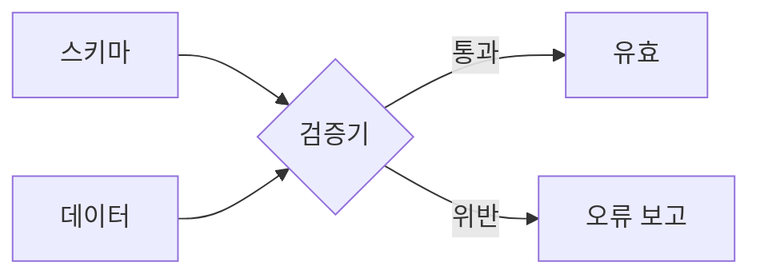
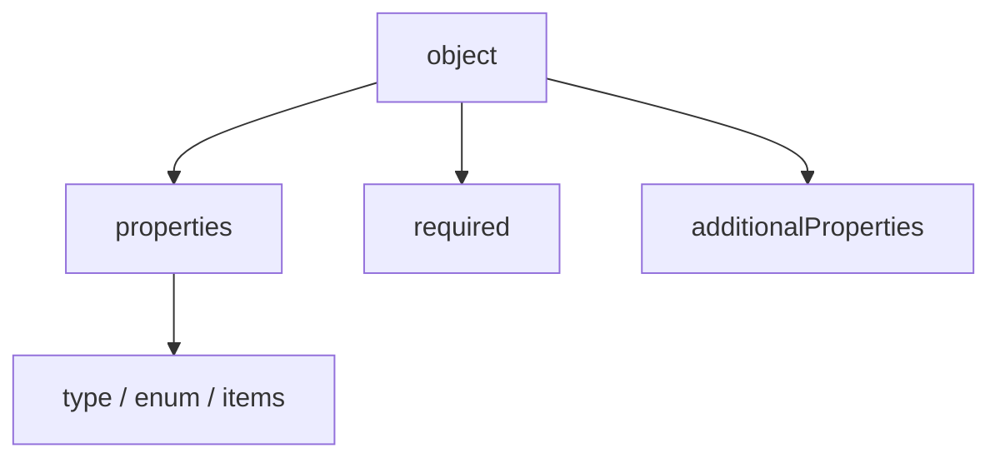

# JSON Schema 기초

> JSON 데이터가 "어떤 모양이어야 하는지"를 JSON으로 선언하는 표준 언어. MCP의 `inputSchema`·`outputSchema`와 LLM 도구 호출의 인자 정의가 모두 이것이다.

## 쉽게 말하면
입력 양식의 칸 설명서다. "이름은 글자, 나이는 숫자, 이름은 필수, 정해 둔 칸 외에는 쓰지 마세요." 사람이 아니라 프로그램(과 모델)이 이 설명서로 양식이 맞는지 검사한다.

## 자세히
- **type**: `string`, `number`, `integer`, `boolean`, `object`, `array`, `null`. 배열로 여러 타입 허용도 가능(하나라도 맞으면 유효, json-schema.org 설명).
- **객체 키워드**: `properties`(각 속성 스키마), `required`(필수 속성), `additionalProperties`(정해지지 않은 속성 허용 여부).
- **배열 키워드**: `items`(각 항목 스키마). **enum**: 허용 값 목록(표준 키워드, 위 페이지에서 직접 확인하진 않음).
- `description`을 속성마다 적으면 모델이 인자의 뜻을 이해하는 데 도움이 된다.
- MCP 도구는 `inputSchema`로 인자를 정의하고, 선택적 `outputSchema`가 있으면 서버는 그에 맞는 `structuredContent`를 줘야 한다(MUST).

## 그림으로 보기



## 예시
```json
{
  "type": "object",
  "properties": {
    "name": {"type": "string"},
    "tags": {"type": "array", "items": {"type": "string"}},
    "status": {"enum": ["active", "inactive"]}
  },
  "required": ["name"],
  "additionalProperties": false
}
```
유효: `{"name":"Ada","tags":["admin"],"status":"active"}` / 무효: `{"tags":[1],"extra":true}`(name 없음, tags 항목이 숫자, extra 불허).

## 헷갈리는 것과 비교
| 개념 | 차이 |
| --- | --- |
| JSON Schema | 데이터 모양 선언·검증 |
| [구조화 출력(MCP)](#mcp-structured-output) | 스키마로 도구 결과 형태를 약속 |
| LLM Structured Outputs | 모델 생성 자체를 스키마에 맞게 제한(다른 기능) |
| TypeScript 타입 | 컴파일 시점 검사, 런타임 검증 아님 |

## 더 읽을거리
- [JSON Schema: type 레퍼런스](https://json-schema.org/understanding-json-schema/reference/type) — 타입 키워드 정의
- [MCP 사양: Tools](https://modelcontextprotocol.io/specification/2025-06-18/server/tools) — inputSchema·outputSchema 사용
