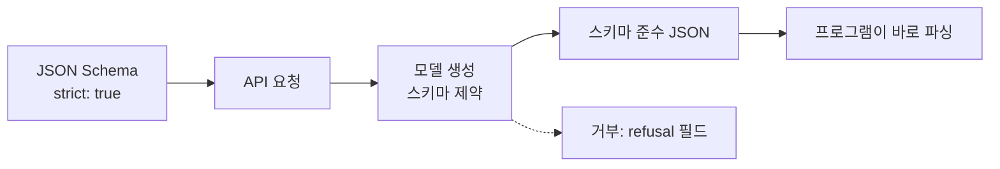

# JSON 스키마 출력 (Structured Outputs)

> 응답이 내가 준 JSON Schema를 반드시 따르도록 API가 보장하는 기능으로, 필수 키 누락이나 잘못된 enum 값을 막아 준다.

## 쉽게 말하면
자유 서술형 답안지 대신 "빈칸 채우기 양식"을 주는 것이다. 칸 이름과 허용 값이 정해져 있어 프로그램이 바로 읽을 수 있다.

## 자세히
OpenAI Structured Outputs 문서(2026-11 확인):
- Responses API에서 `text.format`에 `{"type":"json_schema","name":...,"schema":...,"strict":true}`를 지정한다.
- **함수 호출 vs text.format**: 모델이 도구·함수·데이터를 부를 때는 function calling, 사용자에게 주는 최종 응답의 구조를 정할 때는 `text.format`.
- **JSON mode와 차이**: `json_object`는 유효한 JSON만 보장, Structured Outputs는 스키마 준수까지 보장 → 가능하면 후자를 쓰라고 권장.
- **거부(refusal)**: 거부 응답은 스키마를 따르지 않을 수 있어 `refusal` 필드를 확인해야 한다.
- 일부 JSON Schema 기능은 성능·기술상 지원하지 않는다(세부 제한은 문서의 supported schemas 절 — 이번에 전부 읽지 못함).
- 모델: `gpt-4o-mini`, `gpt-4o-2024-08-06` 이후. 구형(gpt-4-turbo 이하)은 JSON mode.
- 원리는 [구조화 출력 디코딩](#structured-output-decoding)(문법에 맞지 않는 토큰을 생성 중에 배제)과 연결된다(일반 설명). 다른 제공사도 비슷한 기능을 제공하며 이름·제약은 다르다.

## 그림으로 보기

## 예시
고객 문의 분류: `{category: enum["결제","배송","기타"], urgency: 1~5 정수, summary: 문자열}` 스키마를 주면 항상 이 형태로 받아 DB에 저장.

## 헷갈리는 것과 비교
| 개념 | 차이 |
|---|---|
| Structured Outputs | 스키마 준수 보장 |
| JSON mode | 유효 JSON만 보장 |
| function calling | 모델이 도구를 호출할 인자 구조 |
| [MCP 구조화 출력](#mcp-structured-output) | 도구 결과의 스키마를 선언하는 MCP 기능 |

## 더 읽을거리
- [Structured Outputs (OpenAI)](https://developers.openai.com/api/docs/guides/structured-outputs) — 사용법·JSON mode와 차이·거부 처리.
