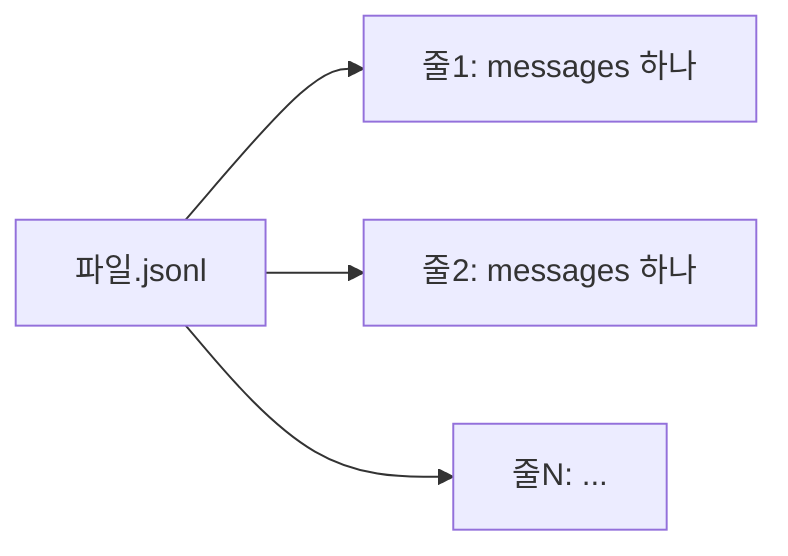

# JSONL 학습 형식

> 미세조정 데이터를 **한 줄에 JSON 객체 하나씩** 담은 파일 형식이다. 각 줄이 완결된 학습 예시(질문과 모범 답)다.

## 쉽게 말하면
엑셀의 한 행처럼, 줄 하나가 문제 하나와 정답 하나다. 줄 단위로 끊어 읽을 수 있어 큰 파일도 다루기 쉽다.

## 자세히
(OpenAI의 supervised fine-tuning 가이드를 직접 읽었다. 필드 이름과 최소 개수는 시점·모델에 따라 바뀔 수 있다.)
- **형식(문서)**: 각 줄은 **chat completions의 `messages` 형식**의 JSON 객체 하나. `messages` 배열에 사용자 프롬프트와 assistant 응답. 함수 호출이면 `tools`, `parallel_tool_calls`도 포함 가능.
- **최소 개수(문서)**: 최소 **10줄**. 50~100개에서 향상이 보인다고 하며 **잘 만든 시연 50개로 시작**하길 권한다.
- **검증 세트(문서)**: 문서는 검증 파일 설명이 거의 없고(`"validation_file": null`만 보임), 평가용으로 학습 세트에서 **입력·응답의 다양성이 비슷한 보류 세트**를 떼어 두라고 한다.
- **주의**: 한 줄 안의 줄바꿈은 \\n으로 이스케이프한다(JSON 규칙, 일반 상식).

## 그림으로 보기


## 예시
```jsonl
{"messages":[{"role":"user","content":"환불 규정 알려줘"},{"role":"assistant","content":"구매 후 7일 이내 미사용 시 환불됩니다."}]}
{"messages":[{"role":"user","content":"배송 기간은?"},{"role":"assistant","content":"영업일 기준 2~3일입니다."}]}
```
- 줄 수를 세고 각 줄이 유효한 JSON인지 스크립트로 검사한 뒤 업로드(제안).

## 헷갈리는 것과 비교
| 형식 | 특징 |
|---|---|
| JSONL | 줄마다 JSON |
| JSON 배열 | 파일 전체가 하나의 배열 |
| CSV | 표 형식, 다중 줄 텍스트에 불편 |

## 더 읽을거리
- [OpenAI — Supervised fine-tuning](https://developers.openai.com/api/docs/guides/supervised-fine-tuning) — 직접 읽음.
