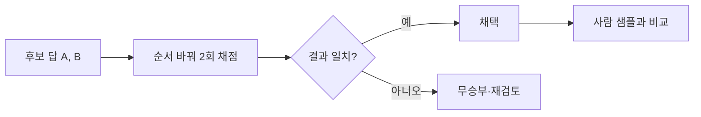

# 심사위원 편향

> LLM이 다른 모델의 답을 채점할 때 내용과 무관하게 점수를 기우는 체계적 버릇(위치·장황함·자기 선호 등).

## 쉽게 말하면
AI 조교가 답안을 볼 때, 먼저 읽은 답안에 후하거나 길고 화려한 글에 끌리거나 자기가 쓴 글 스타일을 편애하는 것과 같다. 실력과 상관없는 요인이라 평가가 왜곡된다.

## 자세히
Zheng 외 논문(arXiv 2306.05685, 2023)이 꼽은 한계:
- **위치 편향**: 두 답을 나란히 줄 때 특정 위치(주로 앞)를 선호.
- **장황함 편향**: 길이가 긴 답을 높이 평가.
- **자기 선호 편향**: 자기 모델이 만든 답에 후함.
- **제한된 추론력**: 수학·추론 문제는 심사위원도 틀릴 수 있음.
- 완화책(논문 본문·2차 해설 기준): 순서를 바꿔 두 번 채점, 길이를 보상하지 말라는 지시, 참조 답 제공, 다른 계열 모델을 심사위원으로 쓰기, 여러 심사위원 합의, 사람 샘플로 교정.

## 그림으로 보기

## 예시
챗봇 A/B 비교에서 A가 항상 이긴다면 위치 편향을 의심하고 순서를 뒤집어 다시 돌려 본다. 답 길이와 점수의 상관도 계산해 본다.

## 헷갈리는 것과 비교
| 개념 | 차이 |
| --- | --- |
| 심사위원 편향 | 채점자의 체계적 쏠림 |
| 환각 | 모델이 사실이 아닌 것을 지어냄 |
| 데이터 편향 | 학습 데이터에서 온 사회적 쏠림 |
관련: [LLM 심사위원](#llm-as-judge), [루브릭 설계](#rubric-design)

## 더 읽을거리
- [Judging LLM-as-a-Judge (arXiv 2306.05685)](https://arxiv.org/abs/2306.05685) — 편향 명명 논문
- [Demystifying evals for AI agents](https://www.anthropic.com/engineering/demystifying-evals-for-ai-agents) — 채점기 함정과 교정
