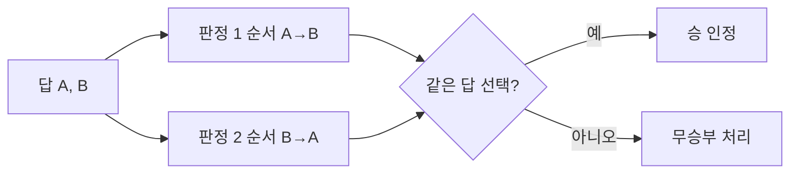
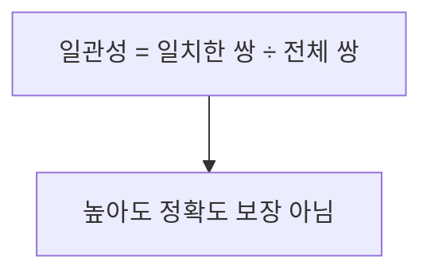

# 판정 일관성 측정

> 두 답의 순서를 맞바꿔 두 번 판정했을 때 같은 결과가 나오는 비율. LLM 심판의 위치 편향을 수치로 보는 가장 간단한 방법이다.

## 쉽게 말하면
같은 두 후보를 왼쪽·오른쪽 자리만 바꿔 다시 보여 줬는데 심사위원이 다른 후보를 고른다면, 후보의 질이 아니라 "자리"가 판단을 흔든 것이다. 일관성은 그런 흔들림이 얼마나 적은지를 재는 값이다.

## 자세히
출처는 Zheng 외(arXiv 2306.05685, PDF 본문 직접 열람).
- **정의**: 일관성(consistency)은 두 어시스턴트의 순서를 바꿨을 때 심판이 일관된 결과를 주는 경우의 비율. 함께 "첫 번째로 편향된 비율", "두 번째로 편향된 비율", 잘못된 출력 형식 오류 비율을 본다.
- **논문의 측정(표 2)**: MT-bench 첫 턴 질문마다 GPT-3.5를 온도 0.7로 두 번 불러 비슷한 두 답을 만들고 세 심판으로 시험했다. 기본 프롬프트에서 일관성은 Claude-v1 23.8%(첫째 쪽 편향 75.0%), GPT-3.5 46.2%(첫째 편향 50.0%), GPT-4 65.0%(첫째 편향 30.0%). 어시스턴트 이름을 바꾼 "rename" 프롬프트에서는 Claude-v1 56.2%, GPT-3.5 51.2%, GPT-4 66.2%. 대부분 심판이 첫 위치를 선호했고 Claude-v1은 이름 편향("Assistant A")도 보였다. 두 답이 거의 비슷한 어려운 시험이라 사람도 구별이 어려울 수 있고, 다른 경우에는 위치 편향이 덜하다고 부록에서 언급한다.
- **완화(3.4절)**: 보수적 방법은 두 순서로 두 번 판정해 두 순서에서 모두 선호된 답에만 승을 주고 불일치하면 무승부로 처리. 공격적 방법은 위치를 무작위 배정(대규모에서 유효). 퓨샷 심판은 GPT-4 일관성을 65.0%에서 77.5%로 올렸지만, 높은 일관성이 높은 정확도를 뜻하지는 않고 새 편향 가능성이 있으며 프롬프트가 길어 API 호출이 4배 비싸다고 한다.
- **이 글의 계산 예(가상)**: 100쌍을 순서 바꿔 판정해 A가 두 번 이기면 40쌍, B가 두 번 이기면 30쌍, 순서에 따라 뒤집히면 30쌍이라면 일관성 = (40+30)/100 = 70%. 보수적 방식에서는 뒤집힌 30쌍이 무승부가 된다.
- **한계**: 논문은 위치 편향의 원인을 학습 데이터 또는 인과 트랜스포머의 구조일 수 있다고 추정만 한다. 수치는 2023년 모델·프롬프트 조건이다.

## 그림으로 보기

## 예시
- 위의 가상 100쌍: 일관성 70%, 보수적 방식에서 승부 확정은 70쌍.
- 교육 실습: 같은 두 답으로 심판 프롬프트의 순서를 바꿔 두 번 돌리고 결과가 일치하는 비율을 직접 센다.

## 헷갈리는 것과 비교
| 개념 | 차이 |
|---|---|
| 일관성 | 순서를 바꿔도 같은 결론인지 |
| 정확도 | 사람 선호와 일치하는지 |
| [자기 선호 편향](#self-enhancement-bias) | 자기 모델을 선호하는 다른 편향 |
| 무작위 위치 배정 | 대규모에서 편향을 상쇄 |

## 더 읽을거리
- [Judging LLM-as-a-Judge (arXiv 2306.05685)](https://arxiv.org/abs/2306.05685) — 표 2, 3.4절(본문 열람)
