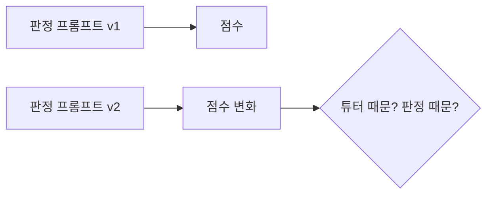

# 판정 프롬프트 버전 관리

> LLM 판정자(채점 모델)의 **모델·프롬프트·루브릭이 곧 측정 도구**이므로 고정하고 검증해서, 점수 변화가 튜터의 변화인지 판정자의 변화인지 구분한다.

## 쉽게 말하면
저울 눈금이 매번 바뀌면 몸무게 변화를 알 수 없다. 채점 모델이나 채점 기준 문장이 바뀌면 같은 답도 다른 점수를 받으므로, 채점 도구도 판본을 관리한다.

## 자세히
(Langfuse 가이드와 Stack Overflow Blog 글을 직접 읽었다. **두 글 모두 "판정 프롬프트가 바뀐 뒤 재검증 절차"는 다루지 않는다.** 아래 마지막 항목은 제안이다.)
- **모델 고정(Langfuse)**: 판정 모델 버전을 고정하라고 권하나, 예제 코드는 버전이 고정되지 않은 이름(gpt-4.1-mini)을 쓴다.
- **판정 설계(Langfuse)**: 1~10점 척도 대신 **명시적 루브릭의 이진 pass/fail**, 구조화 JSON 출력, 데이터셋 전체 평균으로 개별 잡음 완화. 판정자를 믿기 전에 **사람 라벨과의 일치도**를 검증.
- **게이트 vs 경고(Langfuse)**: 판정자 지표가 안정적임이 입증되기 전에는 경고로만 쓰고, **결정적 코드 평가자**를 차단 게이트로 쓴다.
- **SO**: 판정 기반 채점과 `judge_disagreement_ratio` 지표가 언급되나 프롬프트 관리 지침은 없다.
- **제안(문서 밖)**: 판정 프롬프트를 저장소에 버전으로 두고, 바꿀 때마다 같은 사람 라벨 표본으로 일치도를 다시 측정하며, 판정 변경과 튜터 변경을 같은 PR에 섞지 않는다.

## 그림으로 보기

## 예시
- 판정 프롬프트 문장을 고친 날 누출률이 갑자기 4%에서 9%로 올랐다면 먼저 사람 표본으로 새 판정자의 일치도를 확인한다.

## 헷갈리는 것과 비교
| 개념 | 차이 |
|---|---|
| 판정 프롬프트 버전 | 채점 도구의 판본 |
| [누출 LLM 판정자](#llm-judge-leakage) | 누출을 판정하는 도구 자체 |
| [골든 데이터셋 버전](#golden-dataset-versioning) | 시험 문항의 판본 |

## 더 읽을거리
- [Langfuse — LLM regression testing](https://langfuse.com/resources/engineering/llm-regression-testing.md) — 판정자 고정·이진 판정(직접 읽음).
- [Stack Overflow Blog](https://stackoverflow.blog/2026/10/07/evals-as-a-deployment-gate-and-how-to-know-when-they-drift/) — judge 기반 채점 언급(직접 읽음).
