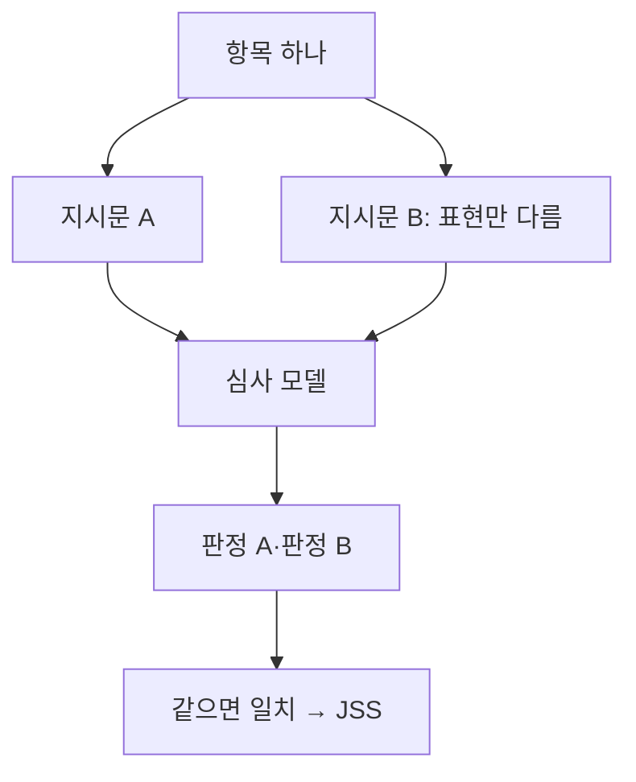
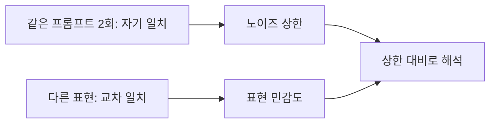

# Judge Sensitivity Score

> **Judge Sensitivity Score(JSS)**는 LLM 심사위원(LLM-as-a-Judge)이 **같은 뜻의 요청을 다르게 말했을 때 같은 판정을 내는 비율**이다. 심사위원이 맞는지가 아니라 **말투에 흔들리지 않는지**를 잰다.

## 쉽게 말하면
같은 답안을 "채점해 주세요"와 "점수를 매겨 보세요"로 요청했는데 채점자가 다른 점수를 준다면, 그 채점 결과는 믿기 어렵다. JSS는 채점자가 지시문 표현에 얼마나 휘둘리는지 재는 지표다.

## 자세히
(JudgeSense 논문, arXiv 2604.23478(Bellibatlu·Raff·Zhang)의 초록을 WebFetch로 직접 확인. 버전 v1 2026-04-26, v2 2026-05-07, v3 2026-09-18. 정의식·세부 수치는 초록에 없어 확인하지 못했고, 아래 일부 숫자는 기존 [예측 일관성 지표](#prediction-consistency-metric) 노드가 본문에서 확인한 것을 따랐다.)
- **무엇을 하나(논문 초록)**: 880개 항목(사람이 라벨링한 코퍼스에서 추출)을 **표현만 다르고 요구는 같은 두 지시문**으로 각각 평가하게 한다. 4개 과제, 6개 제공사의 25개 심사 모델. 전체 판정 로그를 공개했다.
- **노이즈 분리(초록)**: 각 점수는 **같은 프롬프트를 두 번 보냈을 때 그 심사위원의 자기 일치도**와 비교해서 잰다. 그래서 디코딩 무작위성이 "표현 민감도"로 잘못 계산되지 않는다. → [반복 상한](#repeat-ceiling)
- **결과(초록)**: 표현을 바꾸면 **4개 과제 모두에서 일치도가 낮아졌다**. 그중 2개 과제는 저자가 정한 "실질적 유의" 기준을 넘었다. **서수(ordinal) 과제**가 가장 불안정하고 정확한 심사위원도 가장 적었다. **같은 모델 계열 안에서는 파라미터 수가 안정성을 예측하지 못했다**.
- **측정 환경 효과(초록)**: 에이전트 하네스 안에서 돌린 심사위원은 직접 API로 부른 것보다 추정치가 작았다. 자기 일치도가 교차 표현 일치도보다 더 빨리 떨어지기 때문이라고 설명한다.
- **실무 시사점(초록에서 도출, 해석)**: ① 심사 점수와 함께 자기 일치도(반복 상한)를 보고한다. ② 서수 척도 판정은 특히 말바꿈 시험을 한다. ③ 큰 모델이 더 안정적이라고 가정하지 않는다. ④ 같은 평가라도 API냐 하네스냐에 따라 값이 달라진다.

## 그림으로 보기

## 예시
- 챗봇 답변을 LLM 심사위원으로 1~5점 채점할 때, 지시문 두 가지로 같은 답을 채점시켜 일치 비율을 본다. 70%라면 점수 비교에 쓰기 위험하다.
- 교육 활동: 같은 답안에 "엄격히", "공정하게" 두 지시를 주고 점수가 얼마나 달라지는지 비교한다.

## 헷갈리는 것과 비교
| 개념 | 차이 |
|---|---|
| JSS | 표현 변화에 대한 판정 일치도 |
| 심사위원 정확도 | 사람 라벨과 맞는지. JSS와 별개 |
| [반복 상한](#repeat-ceiling) | 같은 프롬프트 반복 일치도(노이즈 천장) |
| [최악 프롬프트 성능](#worst-prompt-performance) | 말바꿈 중 최저 점수 |
| [예측 일관성 지표](#prediction-consistency-metric) | 상위 개념 |

## 더 읽을거리
- [JudgeSense (arXiv 2604.23478)](https://arxiv.org/abs/2604.23478) — 심사위원의 표현 민감도 벤치마크, 880개 항목·25개 심사 모델(초록 확인).
