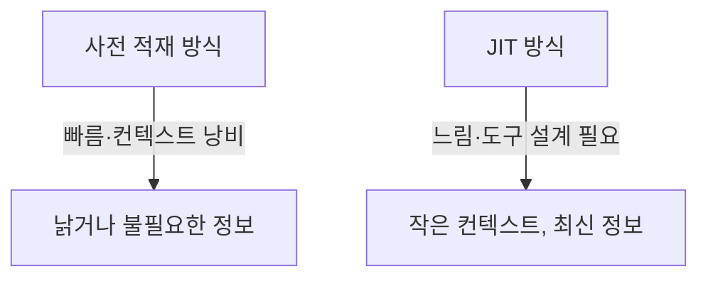

# JIT 검색

> **JIT(Just-in-time) 검색**은 자료를 미리 컨텍스트에 다 넣지 않고, 파일 경로·저장된 질의·링크 같은 **가벼운 참조만 들고 있다가 필요할 때 도구로 불러오는** 전략이다.

## 쉽게 말하면
도서관 사서가 책 전체를 외우는 대신 색인 카드를 들고 다니다가 질문이 오면 해당 서가에서 꺼내 오는 방식이다. 머릿속(컨텍스트)이 가득 차지 않고, 꺼낸 내용이 다음 탐색의 단서가 된다.

## 자세히
(Anthropic 엔지니어링 블로그 "Effective context engineering for AI agents" 확인)
- **가벼운 식별자**: 파일 경로, 저장된 쿼리, 링크를 유지하고 필요할 때 로드. Claude Code는 `head`·`tail` 같은 명령으로 큰 데이터를 통째로 올리지 않고 분석한다.
- **메타데이터가 신호**: 폴더 경로·이름 규칙·타임스탬프로 파일의 용도와 관련성을 추론.
- **점진적 공개**: 각 단계의 결과가 다음 결정을 이끈다.
- **하이브리드**: 일부는 미리 넣고(Claude Code는 `CLAUDE.md`), 나머지는 glob·grep으로 탐색. 법률·재무처럼 변화가 적은 분야에 어울린다고 제안.
- **트레이드오프**: 런타임 탐색은 미리 계산한 검색보다 느리고, 도구·지침이 부실하면 잘못 쓰거나 막다른 길을 헤맨다.
- 같은 글의 관련 기법: **압축(compaction)** 은 한도에 가까운 대화를 요약해 새 창에서 이어 가기, **구조화된 메모**는 NOTES.md 같은 외부 기억, **하위 에이전트**는 깨끗한 컨텍스트에서 일하고 1,000~2,000토큰 요약만 반환. 압축은 대화가 긴 작업, 메모는 이정표가 있는 반복 개발, 멀티에이전트는 병렬 탐색이 이득인 연구에 맞다고 정리한다.

## 그림으로 보기

## 예시
- 코드베이스 질문: 전체 파일을 붙이지 않고 `grep`으로 관련 함수를 찾아 해당 부분만 읽기.
- 사내 문서 에이전트: 문서 목록(제목·경로)만 두고 질문에 맞는 문서를 열어 읽기.

## 헷갈리는 것과 비교
| 개념 | 차이 |
|---|---|
| JIT 검색 | 에이전트가 실행 중 탐색해 불러옴 |
| 전통 RAG | 미리 색인·임베딩해 검색 결과를 주입 |
| [도구 노출 최소화](#tool-selection) | JIT를 가능하게 하는 도구 설계 |
| [압축](#compaction) | 이미 쌓인 컨텍스트를 요약 |

## 더 읽을거리
- [Effective context engineering for AI agents](https://www.anthropic.com/engineering/effective-context-engineering-for-ai-agents) — JIT·압축·메모·서브에이전트.
