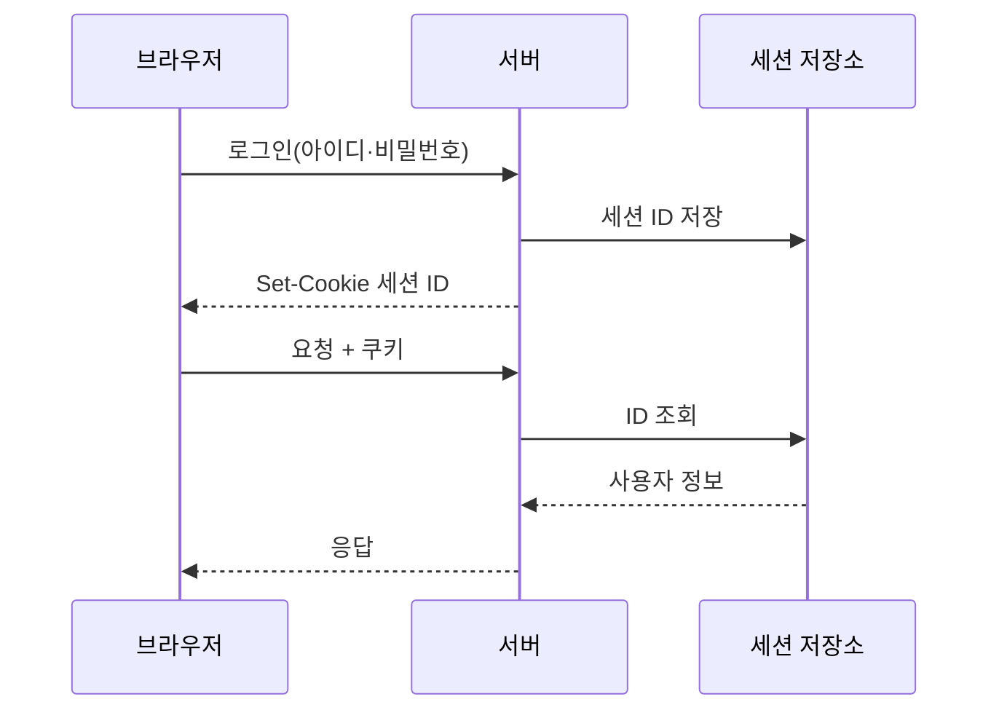
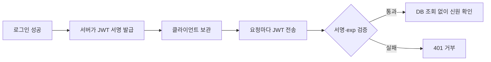

# 세션과 JWT

> 로그인한 사용자를 요청마다 알아보는 두 방식. **세션**은 서버가 상태를 기억하고 쿠키에는 번호표만 주며, **JWT**는 서명된 신분증을 클라이언트가 들고 다닌다.

## 쉽게 말하면
세션은 놀이공원 **물품보관함 번호표**다. 번호표(세션 ID)만 들고 있고, 짐(사용자 정보)은 서버 보관함에 있다. 번호표를 무효로 하면 즉시 출입이 막힌다. JWT는 **서명이 찍힌 입장권**이다. 입구에서 도장만 확인하면 되니 서버가 기억할 필요가 없지만, 한 번 발급하면 만료 전까지 회수하기 어렵다.

## 자세히
- **세션 방식**: 로그인 성공 → 서버가 무작위 세션 ID 생성·저장소(메모리, DB, Redis)에 저장 → `Set-Cookie`로 전달 → 이후 요청마다 브라우저가 쿠키를 자동 전송. 로그아웃·강제 만료·기기별 차단이 쉽다. 대신 서버가 저장소를 가져야 해서 서버를 여러 대로 늘릴 때 저장소 공유가 필요하다.
- **JWT**(RFC 7519): `header.payload.signature` 세 부분을 base64url로 인코딩해 점으로 잇는다. 클레임은 `sub`(누구), `iat`(발급 시각), `exp`(만료 시각) 등이며 모두 선택 사항이다. 서버는 서명만 검증하면 DB 조회 없이 신원을 안다.
- **JWT의 핵심 오해**: 서명(JWS)은 위조를 막을 뿐 **내용을 숨기지 않는다**. payload는 누구나 디코딩해 읽을 수 있으니 비밀번호·주민번호를 넣지 않는다. 기밀성이 필요하면 JWE로 암호화한다.
- **JWT의 약점**: 만료 전 회수가 어렵다(그래서 access token은 5~15분으로 짧게 하고 refresh token을 따로 둔다). `alg: none`이나 허용 목록 밖 알고리즘을 받아들이면 위조가 가능하므로, 서버가 허용 알고리즘을 직접 고정해야 한다.
- **쿠키 속성**(MDN): 인증용 쿠키는 `Secure; HttpOnly; SameSite=Lax` 이상을 기본으로 한다. HttpOnly는 JS가 쿠키를 읽지 못하게 해 XSS 피해를 줄이고, SameSite는 CSRF를 줄인다. 로그인 직후 세션 ID를 **새로 발급**해야 세션 고정 공격을 막는다.
- JWT를 localStorage에 두면 XSS 한 번에 탈취되므로, 브라우저 앱이라면 JWT도 HttpOnly 쿠키에 담는 편이 안전하다는 것이 일반적 권고다.

## 그림으로 보기

## 예시
- 사내 관리자 페이지 1대 서버: **세션 + HttpOnly 쿠키**가 가장 단순하고 안전하다. 바이브코딩으로 만든 앱이면 Supabase·Auth.js 같은 라이브러리가 이 방식을 기본으로 처리한다.
- 모바일 앱과 여러 마이크로서비스가 같은 신원을 공유: **짧은 JWT + refresh token**. 프롬프트 예: "access token 10분, refresh token 30일 회전(rotation), 로그아웃 시 refresh 폐기 목록을 두는 구조로 짜 줘."

## 헷갈리는 것과 비교
| 개념 | 차이 |
|---|---|
| 세션 | 상태는 서버, 즉시 폐기 쉬움, 저장소 필요 |
| JWT | 상태는 토큰 안, 서버 무상태, 회수 어려움 |
| 쿠키 | 값을 **담는 그릇**. 세션 ID도 JWT도 담을 수 있음 |
| [인증과 인가](#access-control) | 로그인 확인과 권한 검사. 세션·JWT는 "누구인가"를 전달하는 수단 |
| [OAuth와 소셜 로그인](#oauth-sso) | 외부에 로그인을 맡기는 표준. 결과로 JWT(ID token)를 쓰기도 함 |

## 더 읽을거리
- [RFC 7519 JSON Web Token](https://datatracker.ietf.org/doc/html/rfc7519) — JWT 구조·클레임·alg none 주의의 원문.
- [MDN HTTP Cookies](https://developer.mozilla.org/en/docs/Web/HTTP/Guides/Cookies) — 세션 쿠키와 Secure·HttpOnly·SameSite.
