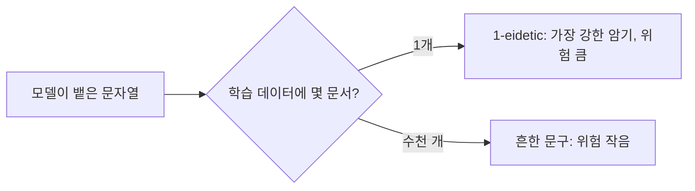
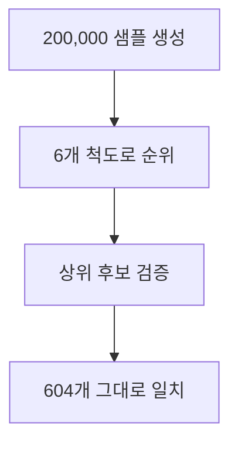

# k-eidetic 암기

> 모델이 어떤 문자열을 그대로 뱉어 낼 수 있고(추출 가능), 그 문자열이 **학습 데이터의 문서 k개 이하에만** 나온다면 "k-eidetic 암기"라고 부른다. k가 작을수록 더 강한 암기다. 한 문서에만 나온 문자열을 외웠다면 1-eidetic이다.

## 쉽게 말하면
노래 후렴은 수천 번 들어서 외우는 게 당연하다. 하지만 딱 한 번 본 전화번호를 줄줄 말하면 정말 외운 것이다. k-eidetic은 "몇 번 본 것을 외웠는가"를 따지는 기준이다. 적게 본 것을 외울수록 놀랍고 위험하다.

## 자세히
- **정의**(Carlini 외 2021, arXiv 2012.07805 본문 확인): 문자열이 ① 모델에서 추출 가능하고 ② 학습 예제 **k개 이하**(웹페이지 하나를 예제 하나로 셈)에 나타나면 k-eidetic 암기. 임의의 UUID가 한 문서에만 있었다면 1-eidetic.
- **왜 필요한가**: 학습 데이터에 수천 번 나오는 라이선스·이용약관 문구는 외워 뱉어도 큰 문제가 아니다(흔한 문구). 문제는 **적게 나온 개인정보·고유 문자열**을 외우는 경우여서, 개수 k로 위험도를 구분한다.
- **공격에서의 쓰임**: GPT-2 XL에서 256토큰 샘플 약 20만 개를 생성하고 여섯 가지 척도(퍼플렉서티, GPT-2 Small·Medium 대비 비율, zlib 압축 대비 비율, 소문자 변환 대비 비율, 50토큰 창 최소 퍼플렉서티)로 순위를 매겨 후보를 골랐다. 구성별 상위 100개씩 18구성 1,800개를 웹 검색과 GPT-2 저자 확인으로 검증해 **604개가 학습 데이터 그대로**(참양성 33.5%)였다. 가장 좋은 구성(인터넷 조건 샘플의 zlib 순위)은 67%. 범주로는 유효 URL 50, 실명 46, 연락처 32, UUID·base-64 같은 고엔트로피 문자열 35 등. 큰 모델일수록 더 외웠다(1.5B가 124M 대비 한 설정에서 18배 이상).
- **직접 계산(장난감)**: 문서 4개에서 `uuid 3f2a-9c1b`(1개 문서), `a@x.com`(1개), `license MIT permission is hereby granted`(3개)의 등장 문서 수를 세면 k=1, 1, 3. 앞의 둘이 추출된다면 1-eidetic, 라이선스 문구는 3-eidetic이다. 실제로는 말뭉치 전체를 색인([접미사 배열](#suffix-array))해 문서 빈도를 센다.
- **한계(해석)**: "문서 수" 기준이라 같은 내용을 복사한 여러 페이지가 있으면 k가 커져 위험이 낮아 보인다. 그래서 [중복 제거](#training-data-deduplication) 전후로 k가 달라진다.

## 그림으로 보기

## 예시
- 사내 모델 점검: 추출된 후보 문자열을 학습 말뭉치에서 검색해 문서 수 k를 세고, k가 작은 개인정보부터 우선 조치.
- 교육: "한 번 본 것을 외운 모델 vs 수천 번 본 것을 외운 모델"을 비교하는 토론.

## 헷갈리는 것과 비교
| 개념 | 차이 |
|---|---|
| 추출 가능(extractable) | 모델이 뱉을 수 있는가 |
| k-eidetic | 추출 가능하면서 학습에 k개 이하 문서에만 있음 |
| [암기 측정(50토큰)](#memorization-measurement-50token) | 생성물의 정확 일치 비율 |
| [학습 데이터 추출 공격](#training-data-extraction-attack) | 이 개념이 정의된 공격 연구 |

## 더 읽을거리
- [Extracting Training Data from Large Language Models — ar5iv](https://ar5iv.labs.arxiv.org/html/2012.07805) — k-eidetic 정의와 공격 단계·수치(열어 확인).
