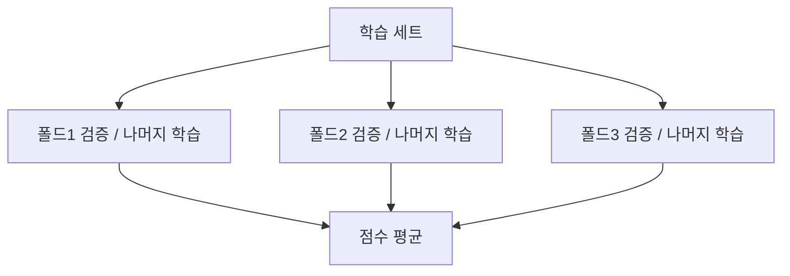
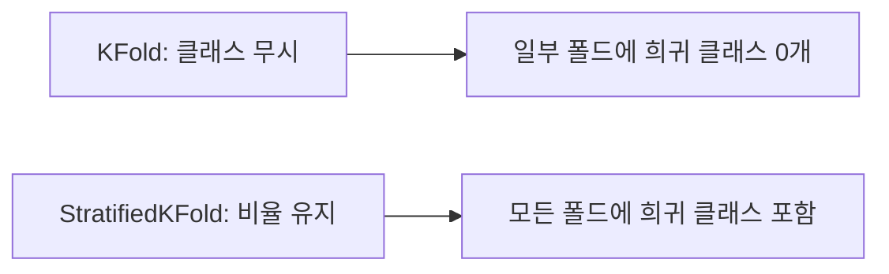

# k-겹 교차 검증

> 학습 데이터를 k조각으로 나눠, 한 조각씩 돌아가며 검증용으로 쓰고 나머지로 학습해 성능을 k번 재고 평균을 내는 방법이다. 데이터가 적어도 우연한 분할 하나에 결과가 휘둘리지 않게 한다.

## 쉽게 말하면
시험 범위를 5부분으로 나눠, 매번 한 부분만 모의고사로 빼고 나머지로 공부하는 것을 5번 돌리는 것이다. 한 번의 모의고사 운에 의존하지 않고, 5번의 평균 점수로 실력을 본다.

## 자세히
(scikit-learn 문서 직접 확인. 코드 이름은 `sklearn.model_selection`.)
- **기본 방식**: 시험 세트는 최종 평가용으로 따로 떼어 두고, 나머지 학습 세트를 k조각으로 나눈다. 각 조각을 검증용으로 한 번씩 쓰고 보고하는 지표는 k번 값의 **평균**이다. 별도의 고정 검증 세트가 필요 없다.
- **KFold(n_splits=5, shuffle=False)**: 연속된 k개 조각으로 나눈다. 문서는 `KFold`가 "클래스나 그룹의 영향을 받지 않는다"고 적는다.
- **StratifiedKFold**: 각 조각이 전체와 비슷한 클래스 비율을 유지한다. 문서 예(50개 중 클래스 0이 45개, 1이 5개)에서 StratifiedKFold는 모든 시험 조각에 클래스 1이 2개씩 들어가지만, 일반 KFold는 클래스 1이 하나도 없는 시험 조각이 생긴다. 불균형 분류에 적합.
- **k 선택**: 5나 10이 흔한 관행이지만 규칙이 아니다(일반적 관행). k가 클수록 학습 데이터는 많아지고 계산은 늘어난다.
- **주의**: ① 전처리(표준화 등)는 각 학습 조각 안에서만 배우도록 `Pipeline`으로 묶는다([데이터 누수](#data-leakage)). ② 시간순 데이터를 섞으면 점수가 부풀 수 있어 `TimeSeriesSplit`이 낫다. ③ 같은 사용자·환자의 샘플이 여러 개면 [그룹 단위 분할](#group-wise-split)이 필요하다. ④ `cross_val_predict`는 일반화 오차의 적절한 측정이 아니다(문서).
- **LLM 시대**: 대형 모델 학습에는 거의 쓰지 않고(비용), 작은 모델·전통 ML·프롬프트 평가의 소표본 검증에서 주로 쓴다(제안).

## 그림으로 보기



## 예시
```python
from sklearn.model_selection import StratifiedKFold, cross_val_score
cv = StratifiedKFold(n_splits=5, shuffle=True, random_state=0)
scores = cross_val_score(clf, X_train, y_train, cv=cv)   # 학습 세트에서만
print(scores.mean(), scores.std())
```
불량 비율이 10%인 데이터에는 StratifiedKFold를 쓴다.

## 헷갈리는 것과 비교
| 개념 | 차이 |
|---|---|
| 교차 검증 | 검증을 k번 돌려 평균 |
| 홀드아웃 | 한 번 나눠 한 번 검증 |
| [학습·검증·시험 분할](#train-validation-test-split) | 기본 틀, 교차 검증은 검증 세트의 대체 |
| [그룹 단위 분할](#group-wise-split) | 같은 그룹이 양쪽에 걸치지 않게 하는 변형 |

## 더 읽을거리
- [scikit-learn: Cross-validation](https://scikit-learn.org/stable/modules/cross_validation.html) — KFold·StratifiedKFold 예제와 주의점(직접 열어 확인).
