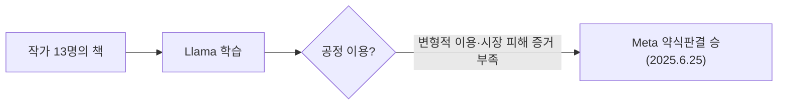
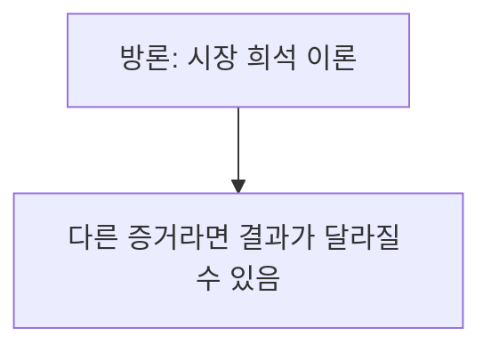

# Kadrey v. Meta

> 작가 13명이 Meta의 Llama 학습에 자기 책이 쓰인 것을 문제 삼은 미국 소송이다. 2025년 6월 연방지방법원은 이 사안에서 Meta의 공정 이용을 인정했지만, 일반적 합법 판결은 아니라고 선을 그었다. (교육용 요약, 법률 자문 아님.)

## 쉽게 말하면
책을 읽고 배운 AI가 책을 베낀 것인지를 다툰 재판에서, 이번 재판부는 "이 증거로는 시장 피해가 입증되지 않았다"며 Meta의 손을 들었다. 다른 증거가 나오면 결과가 달라질 수 있다는 단서가 붙었다.

## 자세히
(하위 에이전트가 검색 결과와 요약으로 확인한 노트 기준. 판결문 원문과 남은 청구 상태는 미확인.)
- **선고**: 2025-06-25, N.D. Cal. Chhabria 판사, Meta에 대한 약식판결(공정 이용). 대상은 원고 작가 13명의 책으로 Llama를 학습한 행위.
- **판단**: 이용은 "매우 변형적(highly transformative)"이며 원고 측에 **시장 피해 증거가 없었다**. DMCA 청구도 Meta 승소.
- **방론(dicta)**: 시장 희석(market dilution) 이론이 공정 이용 4요소 중 시장 영향 요소에서 종종 이길 수 있다는 취지의 언급.
- **한계**: 사건 한정 판단이며 모든 AI 학습이 합법이라는 판결이 아니다. 판결 인용 쪽수(1026 vs 1028)가 출처마다 달라 정확한 인용은 확인이 필요하다. 남은 배포(distribution) 청구 상태는 미확인.
- **교육 관점(제안)**: 학습 데이터 출처와 시장 영향 기록, 라이선스 확보 여부가 분쟁 결과를 좌우할 수 있다.

## 그림으로 보기

## 예시
- 사내 AI 학습 데이터 정책에 출처·라이선스·시장 영향 검토 항목 포함.
- 교육 활용: 공정 이용 4요소를 이 판결 사실관계에 대입해 토론.

## 헷갈리는 것과 비교
| 개념 | 차이 |
|---|---|
| Kadrey v. Meta | 미국, 학습 행위의 공정 이용 |
| [Getty v. Stability](#getty-v-stability) | 영국·미국, 모델 가중치와 상표 |
| [TDM 예외](#text-data-mining-exception) | EU 법정 예외 |

## 더 읽을거리
- [Kadrey v. Meta (CourtListener)](https://www.courtlistener.com/docket/67569326/kadrey-v-meta-platforms-inc/) — 사건 기록(이번에 열람하지 못함, 주소는 제안).
