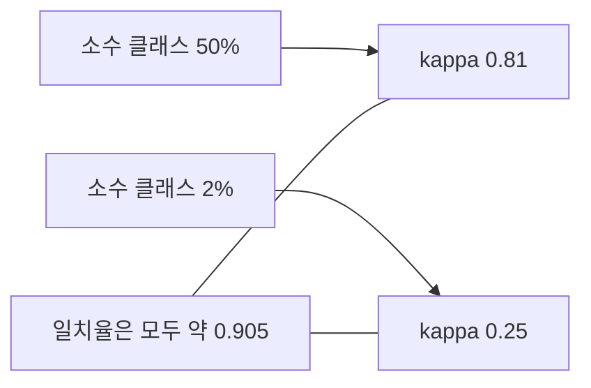
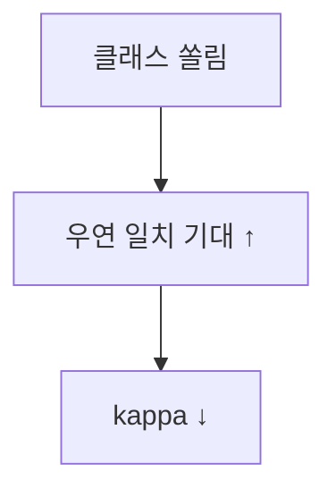

# kappa와 클래스 불균형

> 두 평가자의 정확도와 일치율이 같아도, 한 클래스가 압도적으로 많은 데이터(클래스 불균형)에서는 kappa가 훨씬 낮게 나온다. 우연히 일치할 확률이 높아지기 때문이다.

## 쉽게 말하면
"비가 안 오는 날"이 98%인 지역에서 두 사람이 모두 "안 온다"고만 답해도 거의 항상 일치한다. 이 일치는 실력이 아니라 상황이 만든 것이라서, kappa는 그 몫을 크게 빼 버린다.

## 자세히
- **원리(McHugh 2012)**: kappa는 주변 비율에서 우연 일치를 계산하고, 우연 일치가 클수록 kappa가 낮아진다고 설명한다([kappa 해석표 비교](#kappa-interpretation-scales)).
- **직접 시뮬레이션(평가자 2명이 각각 참 라벨을 95% 정확도로 독립 판정, 각 10만 개)**:

| 소수 클래스 비율 | 일치율 | kappa |
| --- | --- | --- |
| 50% | 0.906 | 0.812 |
| 20% | 0.905 | 0.731 |
| 10% | 0.905 | 0.603 |
| 2% | 0.905 | 0.251 |

  일치율은 약 0.905로 같은데 kappa는 0.812에서 0.251까지 떨어진다. 두 평가자의 실력은 같고 데이터 분포만 달라졌다. (가정: 두 평가자 독립·같은 오류율. 실제 평가자는 독립이 아닐 수 있다.)
- **해석**: 희귀 사건(사기·결함·악성 댓글) 라벨링에서 kappa가 낮다고 평가자가 부실하다고 단정하지 말고, 클래스 분포를 함께 본다.
- **대안(해석)**: ① 클래스별 일치율(양성 일치·음성 일치) ② 소수 클래스에서 두 평가자가 모두 "있다"고 한 비율 ③ 소수 클래스를 일부러 더 뽑은 평가 표본에서 kappa 측정(층화 표본, 표본 비율을 보고서에 명시).

## 그림으로 보기

## 예시
- 결함 제품 검사 라벨: 불량 2%일 때 kappa 0.25가 나왔다면, 불량 표본을 따로 모아 50:50으로 만든 평가 표본에서 일치도를 다시 잰다.
- 교육 활용: 위 표를 보고 "일치율 90%인데 kappa가 낮다"는 상황을 설명하게 한다.

## 헷갈리는 것과 비교
| 개념 | 차이 |
| --- | --- |
| 일치율 | 우연 일치 포함, 쏠림에 안 흔들림 |
| kappa | 우연 보정, 쏠림에 민감 |
| [평가자 간 일치도](#inter-annotator-agreement) | 지표 소개 |
| [카파와 유병률 쏠림](#kappa-prevalence-paradox) | 같은 현상의 원리 설명 |

## 더 읽을거리
- [Interrater reliability: the kappa statistic (McHugh, 2012)](https://pmc.ncbi.nlm.nih.gov/articles/PMC3900052/) — 우연 일치 계산과 한계
- [Inter-rater reliability (Wikipedia)](https://en.wikipedia.org/wiki/Inter-rater_reliability) — base rate와 kappa
