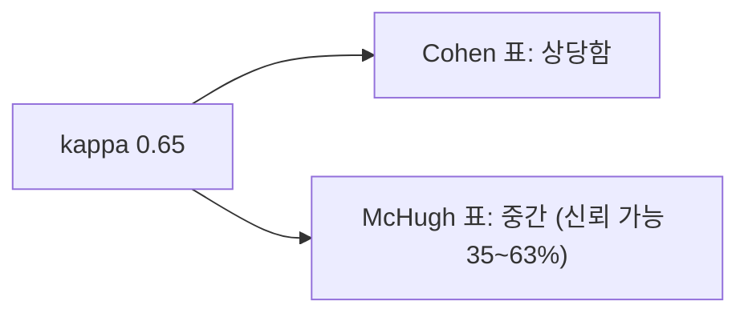
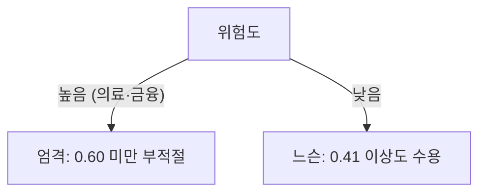

# kappa 해석표 비교

> kappa 값이 "어느 정도면 좋은가"를 말해 주는 해석표는 여러 가지다. Cohen의 표는 0.61~0.80을 "상당한(substantial)" 일치로 보지만, McHugh(2012)는 건강·의료 연구에는 너무 느슨하다며 더 엄격한 표를 제안했다.

## 쉽게 말하면
같은 점수라도 학교 시험과 의사 국가시험의 합격선은 다르다. 라벨링 일치도의 "합격선"도 용도의 위험 정도에 따라 달라져야 한다.

## 자세히
- **Cohen의 해석(McHugh 2012 논문 인용)**: ≤0 일치 없음 / 0.01~0.20 거의 없음 / 0.21~0.40 보통 이하(fair) / 0.41~0.60 중간(moderate) / 0.61~0.80 상당함(substantial) / 0.81~1.00 거의 완벽.
- **McHugh의 제안표(논문 Table 3)**:

| kappa | 일치 수준 | 신뢰할 수 있는 데이터 비율 |
| --- | --- | --- |
| 0~0.20 | 없음 | 0~4% |
| 0.21~0.39 | 최소 | 4~15% |
| 0.40~0.59 | 약함 | 15~35% |
| 0.60~0.79 | 중간 | 35~63% |
| 0.80~0.90 | 강함 | 64~81% |
| 0.90 초과 | 거의 완벽 | 82~100% |

  논문은 표 구간 사이에 빈틈(예: 0.39와 0.40 사이)이 있는 채로 인쇄했다고 한다. 결론에서 "0.60 미만의 kappa는 평가자 간 일치가 부적절하다"고 하고, Cohen 표는 0.41도 받아들일 만하다고 하므로 의료 연구에는 너무 관대하다고 주장한다. 일치율의 경우 많은 교재가 최소 80%를 권한다고도 적었다.
- **해석(내 정리)**: 같은 kappa 0.65라도 Cohen 표로는 "상당함", McHugh 표로는 "중간(신뢰 가능 데이터 35~63%)"이다. 라벨이 사람의 안전·돈에 영향이 크면 엄격한 표를, 가벼운 분류(감성·주제)는 느슨한 표를 쓰되 **프로젝트 시작 전에** 기준을 적어 둔다([목표 일치도 정하기](#target-agreement-setting)).
- **주의**: 어떤 표든 경험칙이다. 클래스가 한쪽에 쏠리면 kappa 자체가 낮게 나오므로 표와 함께 분포를 본다([kappa와 클래스 불균형](#kappa-class-imbalance)).

## 그림으로 보기

## 예시
- 의료 영상 판독 라벨은 kappa 0.80 이상을 목표로 하고, 상품 리뷰 감성 라벨은 0.60 이상으로 시작한다(정책 예시).
- 교육 활용: 같은 kappa 값을 두 표에 대 보고 팀이 합의할 기준을 토론한다.

## 헷갈리는 것과 비교
| 개념 | 차이 |
| --- | --- |
| Cohen 표 | 상대적으로 느슨 |
| McHugh 표 | 의료 등 엄격 |
| [평가자 간 일치도](#inter-annotator-agreement) | kappa 자체의 의미 |
| [kappa와 클래스 불균형](#kappa-class-imbalance) | 값이 낮아지는 구조적 이유 |

## 더 읽을거리
- [Interrater reliability: the kappa statistic (McHugh, 2012)](https://pmc.ncbi.nlm.nih.gov/articles/PMC3900052/) — 두 해석표와 0.60 기준
